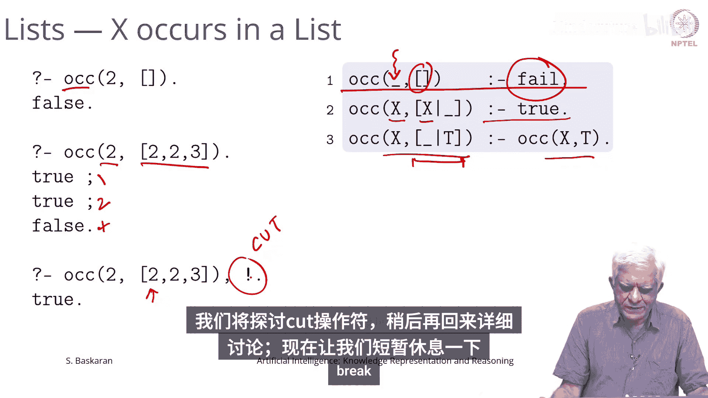

**知识表示与推理：P51：Prolog项合一** 🔍


在本节课中，我们将学习Prolog语言中一个核心的操作：**合一**。我们将了解合一如何工作，它在Prolog查询求解中的关键作用，以及一些需要注意的特殊情况。

---

### **概述**

Prolog通过将用户查询与知识库中的事实和规则进行匹配来回答问题。这个匹配过程的核心就是**合一**。合一的目标是找到一组变量替换，使得两个项的结构变得相同。

---

### **合一的基本概念**

上一节我们介绍了Prolog如何基于知识库进行推理。本节中，我们来看看驱动这一过程的**合一**机制。

简单来说，合一是判断两个项 `T1` 和 `T2` 能否通过变量替换变得相同的过程。在Prolog中，查询 `T1 = T2` 会尝试对这两个项进行合一。

*   如果合一成功，查询返回 `true`，并给出使两项相等的变量替换。
*   如果合一失败，查询返回 `false`。

Prolog出于效率考虑，使用了一种简化的合一算法，它**不进行出现检查**。

> **出现检查**：防止将变量 `X` 替换为包含 `X` 本身的项（例如 `f(X)`）。这可能导致逻辑上的无限结构。如果需要严格的逻辑合一，必须使用专门的 `unify_with_occurs_check` 谓词。

---

### **合一的规则与示例**

以下是合一操作在不同情况下的具体表现：

1.  **常量与常量**：如果两个常量相同，则合一成功。
    *   `sun = sun` 返回 `true`。
    *   `sun = moon` 返回 `false`。

2.  **函数项**：如果两个函数项的函数符相同，且它们的参数能依次合一，则合一成功。
    *   `f(X) = f(g(Y))` 成功，并给出替换 `X = g(Y)`。
    *   `f(X) = g(Y)` 失败，因为函数符 `f` 与 `g` 不同。

3.  **变量**：变量可以与任何项合一。
    *   `X = sun` 成功，绑定 `X` 为 `sun`。
    *   `X = f(X)` **在标准Prolog中成功**（因为缺少出现检查），绑定 `X` 为 `f(X)`，这可能造成逻辑问题。使用 `unify_with_occurs_check(X, f(X))` 会失败。

4.  **复合项与计算**：Prolog的合一是结构性的，不进行算术计算。
    *   `6 = 1+2+3` 返回 `false`，因为项 `6` 与项 `+(1, +(2, 3))` 结构不同。
    *   `X+Y = 1+2+3` 成功，绑定 `X=1`, `Y=2+3`（即 `+(2,3)`）。这展示了项可以嵌套匹配。

5.  **列表**：列表是特殊的项，其合一遵循相同规则。
    *   `[3,2,1] = [3 | [2,1]]` 成功，因为这是列表的两种等价表示。
    *   `[X | Y] = [3,2,1]` 成功，绑定 `X=3`, `Y=[2,1]`。
    *   `[X, Y | Z] = [3,2,1]` 成功，绑定 `X=3`, `Y=2`, `Z=[1]`。

---

### **实践应用：编写`occurs`谓词**

了解了合一机制后，我们可以利用它来编写实用的程序。让我们编写一个名为 `occurs` 的谓词，用于判断一个元素是否出现在列表中。

其逻辑是：
1.  一个元素不可能出现在空列表中。
2.  如果一个元素是列表的第一个元素（头），则它出现在列表中。
3.  否则，检查该元素是否出现在列表的剩余部分（尾）中。

以下是该谓词的Prolog代码实现：

```prolog
occurs(_, []) :- fail.        % 规则1：元素不在空列表中
occurs(X, [X | _]).           % 规则2：元素是列表的头
occurs(X, [_ | Tail]) :-      % 规则3：在尾部查找
    occurs(X, Tail).
```

**代码说明**：
*   第一条规则实际上冗余，因为Prolog的**否定即失败**机制会自动处理空列表情况。这里显式写出以明确逻辑。
*   第二条规则利用合一：如果查询 `occurs(X, [Head | Tail])` 中的 `X` 能与 `Head` 合一，则规则成功。
*   第三条规则递归地在列表尾部进行查找。

**查询示例**：
*   `occurs(2, [])` 返回 `false`。
*   `occurs(2, [2,2,3])` 会依次成功两次，找到两个 `2`。
*   如果只想确认元素是否存在，而不想知道所有出现位置，可以使用 **`cut`操作符(`!`)**。`cut` 具有过程性语义，能阻止Prolog在找到第一个解后继续回溯搜索。我们将在后续课程中详细讨论它。

---

### **总结**



本节课我们一起学习了Prolog中的**合一**操作。我们了解到合一是通过变量替换使两个项结构相同的匹配过程，它是Prolog推理的基础。我们探讨了合一的规则、Prolog简化算法带来的影响（缺少出现检查），并通过编写 `occurs` 谓词实践了合一在列表操作中的应用。理解合一对于掌握Prolog编程至关重要。