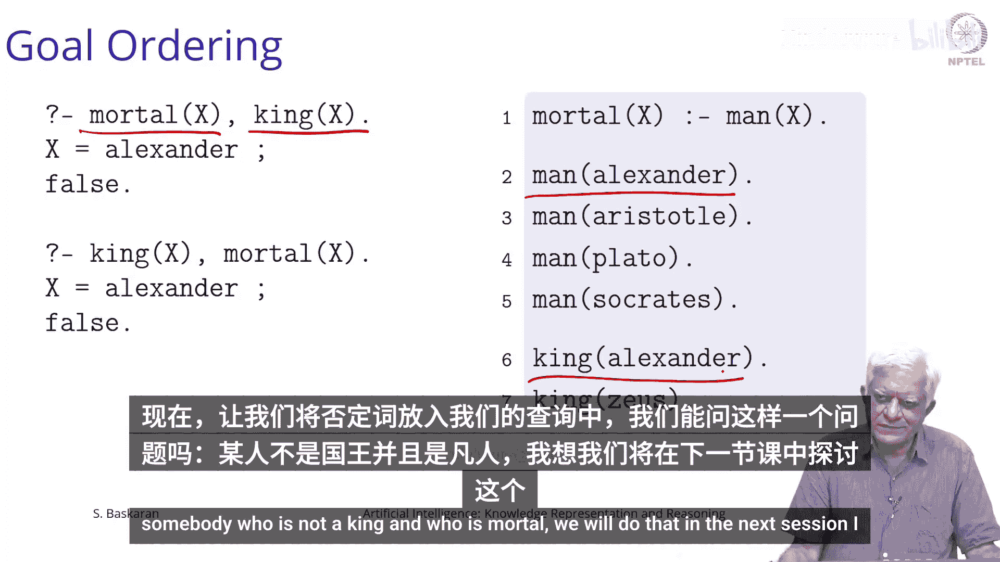

# 053：Prolog表格与否定


在本节课中，我们将学习Prolog编程中的两个重要概念：如何通过“表格”技术避免无限递归，以及如何使用“否定”进行查询。我们将通过具体的例子来理解这些概念，并了解它们在实际编程中的应用。

## 无限递归问题

上一节我们介绍了Prolog中递归定义可能带来的问题。本节中我们来看看一个具体的例子。

当程序涉及递归，尤其是左递归时，可能会陷入无限循环。我们以 `above` 谓词的三种定义为例。

第一种定义是：
```prolog
above(X, Z) :- on(X, Y), above(Y, Z).
```
这个定义会从顶部开始，递归地寻找位于 `X` 之下的对象。它可能导致第二个查询 `X above Y, Y above Y1, Y1 above Z`，从而逐渐向下扩展。

第二种定义则试图寻找所有在 `X` 之下的对象。如果我们的知识库很简单：
```prolog
on(a, b).
on(b, c).
```
查询 `above(a, b)` 在第一种和第二种定义下都会返回 `true`。然而，当尝试寻找其他答案时，由于左递归，第二种定义会陷入无限循环。第三种定义也存在同样的问题，其第一个子句是左递归的，最终会导致栈溢出错误。

理想情况下，对于一个包含变量的一般性查询，它应该生成所有三个答案：`a above b`, `b above c`, `a above c`。但我们已经看到，这可能导致栈溢出。

## 表格技术

为了解决这个问题，现代Prolog允许切换到数据驱动模式。这个过程称为“表格化”。

表格化的核心思想是创建一个已知事实的表格，然后基于这个表格进行推理。通过启用表格功能，可以防止左递归规则导致的无限递归。

以下是启用表格后发生的情况：
*   所有三个版本的 `above` 定义都会给出相同的三组答案。
*   它们在结束时略有不同。第一个版本在给出答案后会说没有更多答案，而另外两个版本在给出表格中存在的所有答案后会正常终止。

这只是一个简单的说明，让你知道有一种方法可以在必须使用递归的情况下避免无限循环。

## 表格化示例：兄弟谓词

让我们通过另一个例子来巩固对表格化的理解。这里我们为 `sibling` 谓词创建表格。

知识库中给出了两个事实：
```prolog
sister(ada, eva).
brother(dan, frieda).
```
我们定义的兄弟规则如下：
```prolog
sibling(X, Y) :- sister(X, Y).
sibling(X, Y) :- brother(X, Y).
sibling(X, Y) :- sibling(Y, X). % 对称规则
sibling(X, Z) :- sibling(X, Y), sibling(Y, Z), X \= Z. % 传递规则
```
我们提出的查询是：数据库中是否存在两个兄弟？

理想情况下，我们期望的答案是：
*   `ada` 是 `eva` 的兄弟（由数据库直接给出）。
*   `ada` 是 `dan` 的兄弟。
*   由于对称规则，`eva` 是 `ada` 的兄弟，`dan` 是 `ada` 的兄弟。
*   由于传递规则，可能还会推导出其他关系。

但是，因为使用了表格功能，我们只得到了最初的两个答案，而没有陷入 `X是Y的兄弟 => Y是X的兄弟 => X是Y的兄弟...` 这样的无限循环中。

这种技术被称为 **SLG归结表格化执行**。它通过“记忆化”来工作，即记住迄今为止找到的所有答案。这是一种数据驱动的计算形式。

记忆化的好处包括：
*   **避免谓词重复求值**：如果某个谓词已经求值过一次，就不会再次求值，从而提升性能。
*   **避免左递归规则导致的无限递归**。
*   **避免数据中的循环导致的无限递归**。
*   **移除重复的答案**。

关于此功能的更多信息，可以参考SWI-Prolog网站上的文档。

## 目标顺序与否定

我们之前讨论过目标顺序的重要性。现在结合否定来看一个经典例子。

我们从课程开始就使用的例子是：
```prolog
mortal(X) :- man(X).
man(alexander).
man(aristotle).
man(plato).
man(socrates).
king(alexander).
king(zeus).
```
以下是不同查询的结果：
*   查询 `mortal(X)` 会返回所有四个人的答案。
*   查询 `king(X)` 会返回两个答案。
*   查询 `mortal(X), king(X)`（即“既是凡人又是国王”），无论两个目标的顺序如何，Prolog都会正确地告诉你：`alexander` 是这个人，并且没有其他人。

到目前为止，我们还没有讨论 **否定**。

如果你想问：“是否存在一个人，他是凡人，并且 **不是** 国王？” 从例子中可以看到，有三个人符合条件：Aristotle, Plato, Socrates。

我们如何在Prolog中做到这一点？关键部分是“谁不是国王”。更困难的是，如果我们颠倒目标的顺序，询问“是否存在一个人，他不是国王，但却是凡人？”，我们可能会遇到问题。

这个问题源于Prolog处理否定的方式。Prolog使用 **失败即否定**：如果它无法证明某事为真，就会说它是假的。

现在，让我们在查询中加入否定。我们可以问“某人不是国王且是凡人”这个问题吗？我们将在下一节中具体操作。

## 总结



本节课中我们一起学习了Prolog中的两个高级主题。首先，我们了解了递归定义，特别是左递归，如何导致程序陷入无限循环。接着，我们介绍了“表格化”技术，它通过记忆化已知答案来避免无限递归和提升效率。最后，我们引入了“否定”的概念，并初步探讨了Prolog通过“失败即否定”来实现它，同时指出了查询中目标顺序对否定查询结果可能产生的影响。在下一节，我们将深入实践否定查询。