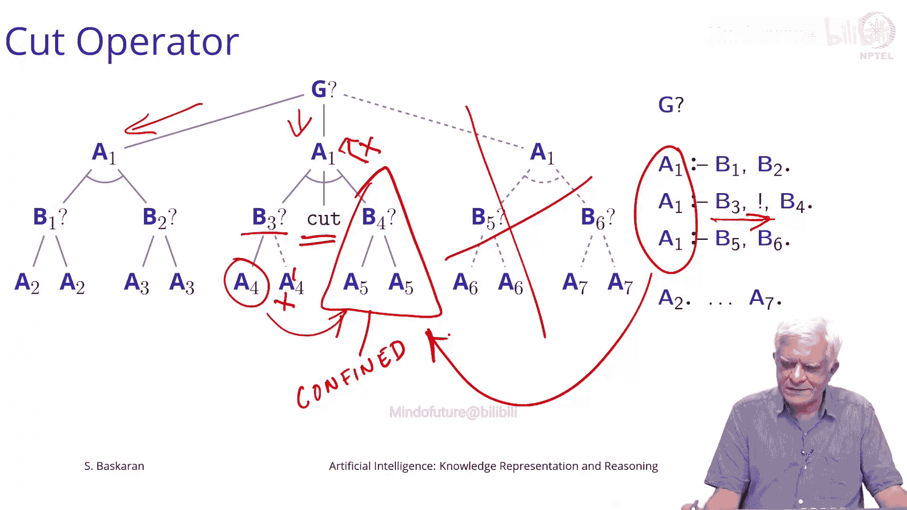

# 054：Prolog的“失败即否定”与“截断”操作符


在本节课中，我们将学习Prolog编程语言中的两个重要概念：“失败即否定”和“截断”操作符。我们将探讨它们如何影响程序的逻辑推理和搜索效率，并理解它们与纯逻辑推理的区别。

## 回顾与问题引入

上一节我们讨论了关于模型、国王和凡人的知识库。现在，我们来看一个具体的查询问题。

我们的知识库包含四个人：Alexander, Aristotle, Plato, Socrates。其中，Alexander 和 Socrates 是国王。当我们查询“是否存在一个人，他既是凡人又是国王？”时，程序会正确返回 Alexander。

然而，当我们改变查询顺序，询问“是否存在一个人，他既是国王又是凡人？”时，结果依然相同。

现在，让我们提出一个新问题：“是否存在一个人，他不是国王，但他是凡人？”

根据知识库，Aristotle, Plato 和 Socrates 是凡人但不是国王，因此应该有三个答案。但是，Prolog 的查询结果取决于查询目标的顺序。

## “失败即否定”的概念

在Prolog中，我们使用反斜杠加号 `\+` 来表示否定。它并非逻辑上的“非”，而是一种“失败即否定”的机制。

**核心概念**：`\+ Goal` 表示“无法证明 Goal 为真”。

这意味着，当Prolog尝试证明某个目标 `Goal` 失败时，它就认为 `\+ Goal` 为真。这是一种“封闭世界假设”，即“所有未被明确声明为真的事实都是假的”。

### 否定与变量处理

“失败即否定”在处理常量时工作正常。例如，查询 `\+ king(aristotle).` 会返回 `true`。

但当否定目标中包含自由变量时，就会出现问题。例如，在查询 `mortal(X), \+ king(X).` 中，程序会为 `X` 绑定一个值（如 Aristotle），然后检查 `\+ king(aristotle)`，这会成功。然而，如果查询顺序是 `\+ king(X), mortal(X).`，程序会先尝试证明 `\+ king(X)`。由于 `X` 是未绑定的变量，程序无法证明“某人是国王”为假（因为它可以尝试将 `X` 绑定为 Alexander 来证明其为真），因此整个查询会直接失败，即使逻辑上存在答案。

**关键点**：`\+` 不能正确处理包含自由变量的否定目标。它要求其参数在求值时是**实例化**的（即已绑定具体值）。

## “截断”操作符

为了理解如何实现“失败即否定”，我们需要先了解“截断”操作符 `!`。

`!` 是一个系统谓词，是一个**过程性构造**，它在一定程度上打破了逻辑与控制的分离。它的主要作用是**修剪搜索树**以提高效率。

### 截断操作符的作用

想象一个搜索树，程序通过深度优先搜索尝试证明一个目标。当执行到 `!` 时，它会产生以下效果：
1.  **承诺当前选择**：它“冻结”了到该点为止所做的所有变量绑定和子句选择。
2.  **消除后续选择**：它阻止了回溯到 `!` 之前，去尝试证明当前目标的其它可能子句（规则）。
3.  **限制未来搜索**：在 `!` 之后，你只能在其所在的当前子句内继续搜索，无法回溯到 `!` 之前去尝试别的路径。

**简单来说**：一旦程序执行通过了 `!`，它就承诺了当前这条证明路径，并放弃了所有其他可能的替代路径。

## 用“截断”实现“失败即否定”

现在，我们来看如何利用 `!` 来定义我们自己的“非”谓词（通常称为 `not/1`）。

以下是实现代码：
```prolog
not(P) :- call(P), !, fail.
not(P).
```

让我们分析这段代码的工作流程：

1.  **第一条规则** `not(P) :- call(P), !, fail.`
    *   尝试证明目标 `P`（通过 `call(P)`）。
    *   如果 `P` **成功**（即可被证明为真）：
        *   执行 `!`，承诺此路径。
        *   执行 `fail`，强制使整个 `not(P)` 目标失败。
        *   由于 `!` 阻止了回溯，程序不会去尝试第二条规则。因此 `not(P)` 返回 `false`。
    *   这对应逻辑情况：`P` 为真，则 `not(P)` 为假。

2.  **第二条规则** `not(P).`
    *   这是一个无条件成功的事实。
    *   它只有在第一条规则失败时才会被尝试。
    *   如果 `call(P)` **失败**（即无法证明 `P` 为真），程序会从第一条规则回溯。
    *   由于 `call(P)` 失败发生在遇到 `!` 之前，因此回溯是允许的。
    *   程序接着尝试第二条规则，并立即成功。因此 `not(P)` 返回 `true`。
    *   这对应逻辑情况：无法证明 `P` 为真，则 `not(P)` 为真。

通过这种方式，我们使用 `!` 和 `fail` 精确地模拟了“失败即否定”的语义。

## 总结

本节课中我们一起学习了Prolog中两个关键的操作符：
1.  **“失败即否定” (`\+`)**：一种非逻辑的否定，意为“无法证明”。它基于封闭世界假设，但在处理包含自由变量的目标时需格外小心。
2.  **“截断”操作符 (`!`)**：一个用于控制搜索过程的过程性工具。它通过修剪搜索树来提高效率，并可用于实现像“失败即否定”这样的高级控制结构。



理解这两个概念对于编写高效且行为符合预期的Prolog程序至关重要。它们展示了Prolog如何将逻辑声明与过程控制相结合，以解决实际问题。