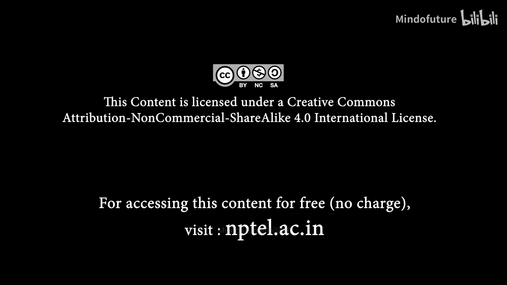
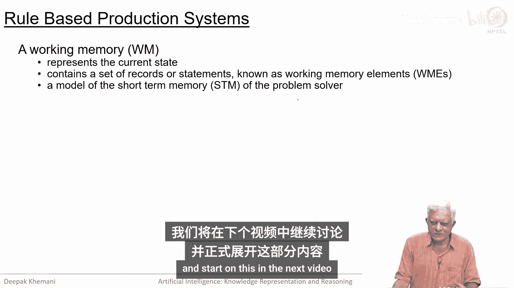

# 056：基于规则的专家系统 🧠

在本节课中，我们将学习基于规则的专家系统。这是一种利用前向链推理，通过匹配领域中的模式来做出决策或触发行动的系统。我们将探讨其核心概念、工作原理、应用场景，并了解它与我们之前学习的逻辑编程（如Prolog）的区别。

---

## 从逻辑到专家系统 🔄

上一节我们介绍了逻辑及其在编程中的应用。本节中，我们来看看基于规则的专家系统。

我们最初学习了逻辑。然后我们看到，逻辑可以用于计算，可以进行逻辑编程。我们探讨了Prolog，它使用**后向链**进行推理。许多人认为，后向链也是人类的推理方式，即人们设定一个目标，然后思考如何实现它，本质上是从目标开始向后推理。

然而，也存在许多需要进行**前向推理**的情况，即你观察到某些事实，然后做出一些推断，并继续前进。

现在，我们将关注**基于规则的专家系统**这一领域，它本质上源于前向推理。你可以观察领域中的模式，并据此做出决策。它在许多企业环境中非常流行，因为企业需要将业务逻辑输入到程序中，由程序来做出决策。他们也喜欢这种声明式编程的理念。

我们今天要看的基于规则的系统，也提倡声明式编程的理念。Prolog在这方面并不纯粹，因为用户必须仔细地对子句进行排序。而基于规则的系统理念更为通用：你只需提供规则，我们将编写一个推理引擎来运行这些规则。当然，我们会提供一些元级别的控制（如搜索策略），一旦你选择了策略，剩下的工作就由系统完成。规则不需要以特定的顺序或特定的方式编写。

---

## 前向链与后向链 ⚖️

我们已经了解了后向链和前向链，也了解了作为完备方法的归结法。但就我们当前的目标而言，前向链和后向链是重点。

*   **规则**：规则将**前件**与**后件**连接起来。其核心思想是：如果左侧（前件）为真，那么右侧（后件）也为真。我们设想世界由某种语言（在我们的案例中是**一阶逻辑**）的语句描述。然后，我们编写规则，这些规则将查看知识库的子集，或寻找知识库中的模式。规则的前件捕获了领域中的一个模式。如果模式被匹配，那么后件就成立。如果你在进行逻辑推理，你就会断言后件为真。

*   **后向链**：后向链关注**目标**。它将目标转化为子目标，并重复这个过程，直到子目标与知识库中的某些事实匹配。它检查规则捕获的模式是否存在于领域中，以及我们提出的问题（目标）是否被满足。这是一个**自上而下**、**目标导向**的过程，从目标出发，走向子目标，最终到达具体事实。它的分支因子较低，因为只有那些后件与目标匹配的规则才会被应用。它也是**惰性处理**，仅在查询时（当有人问某个特定目标是否为真时）才进行推理，这意味着它可能需要时间。

*   **前向链**：前向链关注**数据中的模式**，并考虑该模式的后果。本质上，它是**自下而上**、**数据驱动**的。它查看数据并说：“哦，我看到了这个模式，我可以采取这个行动或得出这个推断。”根据定义，它是**积极处理**，与惰性处理相反：如果你能做出推断，你就去做，而不考虑你是否想做出这个推断，或者它是否引向你心中的目标。因此，这类方法需要一些额外的指导，来决定在众多可能的推断中，究竟应该进行哪一个。显然，它的分支因子较高，因为可能有许多推断，但并非所有推断都与你感兴趣的目标相关。

这个基于前向推理、数据驱动的处理领域，也被称为**模式导向推理系统**：你查看模式，并基于此进行推断，然后以这种方式继续前进。

我们今天要提出并解决的问题是：**如何使前向推理高效工作？**

---

## 规则与模式匹配 🧩

规则与模式匹配的核心思想是：如果我们有一个给定的状态（也可以称为知识库），那么一条规则会查看知识库的一个小子集，并执行某些操作。最简单的操作是进行推断，但你也可以做其他事情，例如触发某些行动（比如控制机器人）。

我们的规则形式如下：它查看状态中匹配某个模式的部分，并执行规则中描述的适当操作。

以下是触发基于规则的专家系统想法的关键点：当你构建系统时，规则从何而来？显然，每次开发软件时，你都必须以某种方式将领域知识注入其中。这些知识要么像在过程式语言中那样嵌入到系统中，要么像在Prolog和我们今天要看的语言OPS5这样的声明式语言中那样，以某种形式表达。

但关键是，这些规则必须来自某个地方。谁了解我们试图解决问题的领域？我们称之为**领域专家**。基于规则的系统背后的理念，就是从领域专家那里提取知识，并将其放入系统中。

---

## 专家系统的兴起与应用 🚀

基于规则的专家系统这一想法由此产生，并在20世纪80年代前后非常流行，开发了许多系统。

*   **石油勘探**：例如，有一款名为 **Prospector** 的系统用于石油勘探。对于石油公司来说，钻井成本极高。人们认为，如果基于规则的系统能提供一个好的钻井地点建议，那么它节省的资金就足以支付其开发成本。
*   **诊断**：另一个应用广泛的领域是**诊断**，包括人类疾病诊断和机器故障诊断。因为诊断本质上是模式驱动的：你看到某种模式，就做出某种推断。诊断的复杂性在于它并非纯粹的演绎，而是我们之前讨论过的**溯因推理**。尽管如此，它非常有用。最早的诊断系统之一是名为 **MYCIN** 的程序。由于它进行溯因推理，它引入了**置信度度量**或**确定性因子**，以数字形式表示结论的确定性程度。
*   **配置**：我们之前提到过，这类系统也用于**配置系统**。

---

## 知识获取瓶颈与后续发展 🧱

在基于规则的专家系统理念提出后，人们发现，从概念上讲这是一个伟大的想法：去找人类专家，提取他们的知识，放入系统，你就有了一个专家系统。

但事实证明，专家要么不愿意，要么无法以规则的形式清晰地表达知识。当时，社区开发了许多协议来指导如何提取知识，**知识获取**成为一个大问题，人们投入了大量努力。然而这并不容易，它成为了一个瓶颈，即所谓的**知识获取瓶颈**。

到了80年代中期，人们提出：与其从专家那里抽象出规则，不如直接存储他们的全部经验。这催生了一个全新的领域——**基于案例的推理**。在CBR中，每个问题解决的实例都被存储为一个**案例**，案例包含问题描述部分和解决方案部分。当遇到新问题时，你将新问题与案例库中的问题描述进行匹配，检索出最匹配的案例，取其解决方案，并可能根据当前问题进行一些调整。这种方法也很成功，开发了许多基于CBR的工业系统。

当然，在80年代中期，Rumelhart等人再次提出了神经网络的**反向传播算法**，神经网络的研究兴趣回归。自那以后，我们便一路向前。大约在本世纪初，我们获得了深度学习算法，此后神经网络一直是AI许多工作的焦点。

---

## 商业应用与声明式编程 💼

但商业领域发现了一个机会，并坚持了基于规则系统的理念，尽管它们不再被称为“专家系统”。这绝对是实现软件的一种有用方式，特别是在拥有**业务逻辑**的企业中。

管理者能够清晰表达业务逻辑，并将其输入系统，由某个系统来执行，这个想法对他们非常有吸引力。因为他们不必每次调整逻辑时都去找软件公司。如果你使用过程式语言编程，那么你输入的很多知识都嵌入在代码中。**声明式编程**的理念在于：**控制与逻辑是分离的**。如果你能单独表达逻辑，而将控制权交给机器，那么我们就有了不同的编程范式。这对商业人士来说非常适合，因为他们可以自然地表达逻辑本身，并在实验系统时进行调整。

---

## 规则的局部性与前向链的优势 🎯

关于逻辑的一点是：你可能有一个庞大的知识库，但进行推断是一个**局部行为**。你不需要查看整个知识库来得出结论，你只需要查看一小部分。结论仅取决于前件是否被匹配。从这个意义上说，它是局部的：你查看局部模式，做出局部推断。从复杂性角度来看，这使事情变得更好。

例如，在基于状态的搜索算法中，它们将整个知识库读取为一个状态，然后说“从这个状态我可以到达那个状态”。或者，在**默认推理**中（例如，“如果X是教授，那么X拥有博士学位，除非……”），要做出默认推断，你必须查看整个知识库，复杂性就上升了。类似地，**概率推理**也依赖于整个知识库，因为概率来自数据和知识库。

因此，基于规则的系统利用了**行动的局部性**，这通常是逻辑的特性。

前向链主动考虑领域中的模式，并说：“如果我看到这个模式，我可以执行这个操作。”操作可以是像逻辑中那样进行断言（“如果这个模式为真，那么这个后件为真”），但也可以做其他事情。从这个意义上说，它包含了进行推断。

---

## 规则、生产式与搜索策略 ⚙️

如果你处于一个给定状态，你可能在该状态中发现许多不同的模式，因此许多规则都适用。你可能需要选择其中之一。

*   **状态**：是某种语言中的一组语句（在我们的案例中，语言是一阶逻辑）。
*   **模式**：是该知识库中那些语句的一个子集。
*   **移动/推断**：表示如果你看到一个模式，你就执行某个操作。

例如，在一个状态下，你可能看到四种不同的模式，因此可以执行四种不同的操作。关键点当然在于：你将选择这四种选择中的哪一个？这正是系统效率所在。

我们已经讨论了声明式编程，让我们快速回顾一下：
*   一条规则将**一个操作**与**状态中的一个模式**关联起来。在我们所看的语言中，一条规则也被称为一个**生产式**。
*   一个生产式或规则将不同种类的知识统一为一种形式。它可以是启发式知识（“如果这是模式A，那么这是正确的行动B”），可以是业务规则（“如果这是贷款申请人的描述，那么此人有贷款资格”），甚至可以是编程语言中的操作。事实证明，这些规则足以定义一个**图灵完备**的完整编程语言（就像Prolog是图灵完备的一样）。
*   声明式编程的理念是：用户或程序员只**陈述规则**。他们只指定**模式-操作关联**，而不指定**何时**应该执行该操作（这是命令式或过程式语言编程的关键部分）。

然而，我们仍然必须讨论**搜索策略**。因为正如上一张幻灯片所示，如果有四条可能的规则可以应用，你应该选择哪一条？基于规则系统的开发者所做的是，为你提供一系列可以使用的策略选择，然后你可以说“我将使用这个策略”。我们将看一些这方面的例子。

---

## 总结 📝

本节课中，我们一起学习了基于规则的专家系统。我们了解了它如何利用前向链推理，通过匹配局部模式来做出决策或触发行动。我们探讨了其与后向链推理（如Prolog）的区别，回顾了它在诊断、配置等领域的应用历史，并认识了其发展过程中遇到的知识获取瓶颈以及催生的新领域（如基于案例的推理）。最后，我们强调了声明式编程的核心——逻辑与控制分离，以及在实际应用中需要通过搜索策略来解决规则冲突的问题。基于规则的系统因其清晰表达业务逻辑的能力，在企业环境中依然保持着生命力。