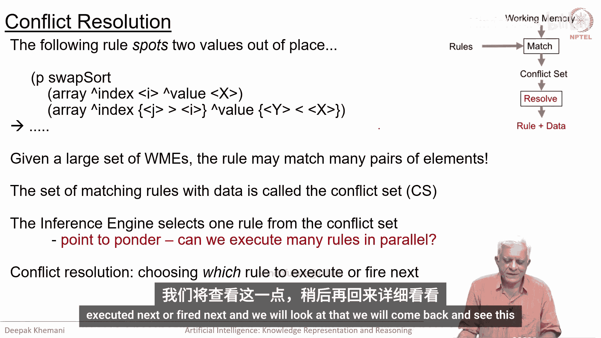

知识表示与推理：P58：匹配、解析与执行 🧠


在本节课中，我们将学习基于规则的生产系统语言 OPS5。我们将详细探讨其规则结构、匹配机制以及如何通过规则执行来实现推理和状态改变。

上一节我们介绍了 OPS5 的基本概念，本节中我们来看看其规则的具体构成和执行过程。

---

### 规则的结构

OPS5 中的规则由名称、左侧（LHS）和右侧（RHS）组成。
*   **工作内存**：知识库，包含一组工作内存元素。
*   **工作内存元素**：本质上是带有属性-值对的类名。
*   **规则左侧**：由应与工作内存元素匹配的模式组成。
*   **规则右侧**：是一组要执行的动作。

### 左侧模式的匹配

规则左侧的模式用于匹配工作内存元素。匹配意味着类名相同，属性名相同。但规则中的值字段可以包含变量或布尔测试。

以下是模式中可进行的布尔测试类型：
*   **相等性测试**：可以测试两个值是否相等或类型相同，也可以测试它们是否不相等或类型不同。
*   **比较测试**（仅限整数或浮点数）：由于它们是有序集合，可以进行大于、小于等比较。
*   **逻辑组合**：
    *   **合取（AND）**：使用花括号 `{ }` 表示，例如 `{> 3.0 < 3.5}` 表示值必须同时大于3.0且小于3.5。
    *   **析取（OR）**：使用方括号 `[ ]` 表示，例如 `[Monday Wednesday Friday]` 表示值可以是周一、周三或周五中的任意一个。

### 右侧的动作

在 OPS5 中，我们不称右侧为“后件”，而称之为“动作”。这体现了其过程性的一面：如果左侧匹配，则执行右侧描述的动作。

以下是主要的动作类型：
*   **添加新元素**：创建一个新的工作内存元素。这类似于逻辑推理中添加结论，例如，如果知识库中有“所有人都是会死的”和“苏格拉底是人”，则添加“苏格拉底是会死的”。
*   **移除现有元素**：从工作内存中删除一个元素。这与经典（单调）逻辑不同，它允许知识库随时间变化，支持**非单调推理**。例如，在默认推理中，我们可能先根据“鸟会飞”推出“企鹅会飞”，但得知“企鹅是鸟但不会飞”后，需要撤回之前的结论。
*   **修改元素**：`MODIFY` 动作本质上是先移除再添加，但只更改指定的属性，效率更高。例如，在计算学生总分时，可以修改“总分”属性的值。
*   **其他动作**：如读写文件（`LOAD`）等外部操作。

所有右侧动作被假定为**并发执行**，而非顺序执行。动作所使用的值来自匹配时绑定的变量，因此动作的书写顺序不影响最终结果。

### 实例分析：排序与排名

让我们通过两个例子来理解规则的应用。

**1. 数组排序程序**
这是一个极其简洁的排序程序。假设工作内存中有类名为 `array` 的元素，属性为 `index` 和 `value`。

```lisp
(p swap-sort
    (array ^index <i> ^value <x>)
    (array ^index <j> ^value <y>)
    (<j> > <i>)
    (<y> < <x>)
    -->
    (modify 1 ^value <y>)
    (modify 2 ^value <x>)
)
```
*   **规则解读**：该规则寻找两个索引 `i` < `j`，但值 `x` > `y` 的元素（即顺序错误的一对）。
*   **执行动作**：交换这两个元素的值（`modify 1` 和 `modify 2`）。
*   **特点**：程序虽小，但执行时可能进行大量不必要的交换，效率不高。它最终能完成排序，体现了生产系统“识别-行动”循环的特点。

**2. 学生排名程序**
此规则用于为学生分配名次。

```lisp
(p assign-rank
    (rank ^value <r>)
    (student ^name <s> ^total-marks <m> ^rank nil)
    -(student ^total-marks > <m> ^rank nil)
    -->
    (modify 1 ^value (+ <r> 1))
    (modify 2 ^rank <r>)
)
```
*   **规则解读**：
    1.  匹配当前要分配的名次 `r`。
    2.  匹配一个尚未排名（`rank` 为 `nil`）且总分为 `m` 的学生 `s`。
    3.  **否定模式**：确保没有其他未排名的学生分数高于 `m`。这保证了当前学生 `s` 是剩余学生中分数最高的。
*   **执行动作**：
    *   将名次 `r` 赋给学生 `s`。
    *   将“名次”工作内存元素的值加1，为下一次分配做准备。
*   **并发性**：两个 `modify` 动作并发执行，无论顺序如何，结果都是正确的。

为了增强规则的可读性和可维护性，可以为模式命名，然后在动作中引用这些名称，而不是使用 `1`、`2` 这样的位置索引。

### 匹配过程的详细定义

一个规则与工作内存的匹配必须满足以下两个条件：
1.  **每个正向模式**都必须有一个匹配的工作内存元素。
2.  **每个负向模式**（以 `-` 开头）都必须没有匹配的工作内存元素。

一个模式匹配一个工作内存元素的具体条件是：
*   **类名匹配**：模式的类名必须与工作内存元素的类名相同（常量匹配）。
*   **属性条件匹配**：模式中指定的属性条件必须与工作内存元素中对应属性的值匹配。未在模式中提及的属性将被忽略。

属性条件的匹配规则如下：
*   如果规则中的属性是**常量**，则只匹配相同的常量。
*   如果规则中的属性是**变量**，则可以匹配任何常量。
*   可以进行**相等**、**不等**、**比较**（`<`, `>`, `<=`, `>=`）等测试。
*   支持使用 `{ }` 的**合取**测试和 `[ ]` 的**析取**测试。

### 冲突集与冲突消解

当系统中有多条规则，且工作内存中存在多个元素时，一个规则可能会有多个不同的匹配实例（绑定不同的变量）。

**冲突集**是所有可被激活的规则实例的集合。每个实例是一个元组 `(规则名, 匹配的工作内存元素时间戳...)`。例如，`swap-sort` 规则可能匹配元素1和3，`assign-rank` 规则可能匹配元素5和7，它们都会进入冲突集。

**冲突消解**是从冲突集中选择**一个**规则实例来执行的过程。这是生产系统推理引擎的核心步骤之一。例如，在降序数组的极端情况下，`swap-sort` 规则几乎每一对元素都匹配，冲突集会非常庞大。

关于并行执行的思考：在现代多线程环境下，可以考虑让冲突集中的所有规则实例并行执行。这在某些领域（如互不干扰的模式识别、分类）可能可行且高效，但在涉及状态更新（如排序）的领域可能引发混乱。OPS5 本身采用串行执行，但这是一个值得思考的设计点。

---



本节课中我们一起学习了 OPS5 规则的详细结构、匹配机制和动作执行。我们了解到规则左侧通过丰富的模式匹配工作内存，右侧支持添加、删除、修改等动作以实现状态改变和非单调推理。通过排序和排名的实例，我们看到了规则如何编写和应用。最后，我们探讨了冲突集的形成以及冲突消解的必要性，并对可能的并行执行场景进行了思考。