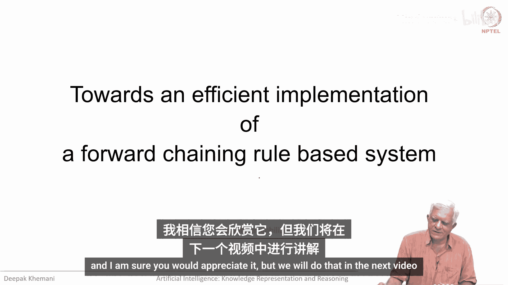

# 059：冲突解决策略 🎯


在本节课中，我们将学习前向链接产生式系统中推理引擎的一个关键环节：冲突解决。当多条规则同时匹配工作内存中的数据时，系统必须决定接下来执行哪一条规则的实例。我们将探讨几种常见的冲突解决策略，理解它们的原理和适用场景。

## 冲突解决概述

上一节我们介绍了前向链接产生式系统的结构，包括工作内存、规则以及匹配阶段。匹配阶段会产生一个**冲突集**，它包含了所有与当前数据匹配的规则实例。冲突解决的任务，就是从这些可用的规则实例中选择一个来执行。

## 冲突解决策略

当问题求解器在任意时刻面临多个选择时，有效求解的关键在于做出明智的决策。这与启发式搜索算法（如最佳优先搜索或A*算法）类似，需要一个评估函数来为每个选择打分。在基于规则的系统中，规则封装了人类专家的知识，我们需要决定在所有适用的规则中，接下来触发哪一条。

以下是几种常见的冲突解决策略。

### 1. 不重入性

**不重入性** 是一个必要的策略。它规定，一个规则实例只能与同一组匹配的工作内存元素触发一次。这是为了防止同一条规则反复触发，导致系统陷入无限循环。其思想源于神经元的触发机制：神经元在触发一次后，需要等待新的信号输入才能再次触发。

在基于规则的系统中，这意味着：
```
如果规则R已与数据D匹配并触发，则不允许R再次与相同的D匹配触发。
```

### 2. 词法顺序

**词法顺序** 策略将选择的责任交给了用户。它的做法是：在所有有匹配实例的规则中，选择用户最先陈述的那一条规则。如果一条规则有多个匹配不同数据的实例，则选择匹配最早数据的那个实例。

这种策略类似于Prolog语言的执行方式，它按照规则和事实在程序文件中出现的顺序进行处理。

### 3. 特殊性

**特殊性** 策略的直觉是：规则的条件越具体，它在给定情境下可能就越合适。该策略会选择条件最具体的规则实例。特殊性可以通过规则模式中测试条件的数量来衡量。

例如，假设有两条规则：
*   规则A需要匹配2个数据条件。
*   规则B需要匹配5个数据条件。
那么规则B的实例更具体，会被优先选择。

这种策略有助于实现**默认推理**。默认规则是通用规则，而更具体的规则在获得更多信息时覆盖默认规则。例如：
*   默认规则：`如果轮到玩家X叫牌，则X选择“不叫”。`
*   具体规则：`如果轮到玩家X叫牌，且X手牌有15-17点且牌型平均，则X叫“1无将”。`
当具体规则的条件满足时，系统会选择它，否则回退到默认规则。

### 4. 新近性

**新近性** 策略选择匹配了**最新**工作内存元素的规则实例。工作内存中的元素通常带有时间戳，新近性可以通过比较这些时间戳来实现。

其背后的思想是，当问题求解器向工作内存添加一个新元素时，很可能需要立即对这个新元素进行一些处理。优先触发匹配最新数据的规则，有助于维持连贯的推理链条，实现“如果A成立，则B成立；现在B成立了，那么C也成立”这样的连续推理。

### 5. 手段-目的分析

**手段-目的分析** 是一种更复杂的策略，基于Newell和Simon对人类问题求解的研究。其核心思想是根据**上下文**对规则集进行分区，并一次只专注于一个分区。

在MEA策略中，上下文由规则中的**第一个模式**设定。所有第一个模式相同的规则属于同一上下文（例如“执行活动X”）。该策略首先对新近性应用于第一个模式，确保系统会持续处理当前上下文，直到有规则显式地切换到另一个上下文。在同一个上下文内部，则可以使用特殊性等策略来选择最具体的规则。

## 总结与预告

本节课我们一起学习了前向链接产生式系统中的冲突解决策略。我们了解了**不重入性**、**词法顺序**、**特殊性**、**新近性**以及**手段-目的分析**这几种策略的基本原理和用途。这些策略帮助推理引擎在多个可用的规则中做出合理的选择，从而引导问题求解过程。



在下一节中，我们将看到一个名为 **Rete算法** 的高效算法，它能巧妙地实现规则匹配，并且像不重入性、新近性等策略会在该算法中自然地体现出来。这是一个非常精妙的算法，相信你会欣赏它的设计。