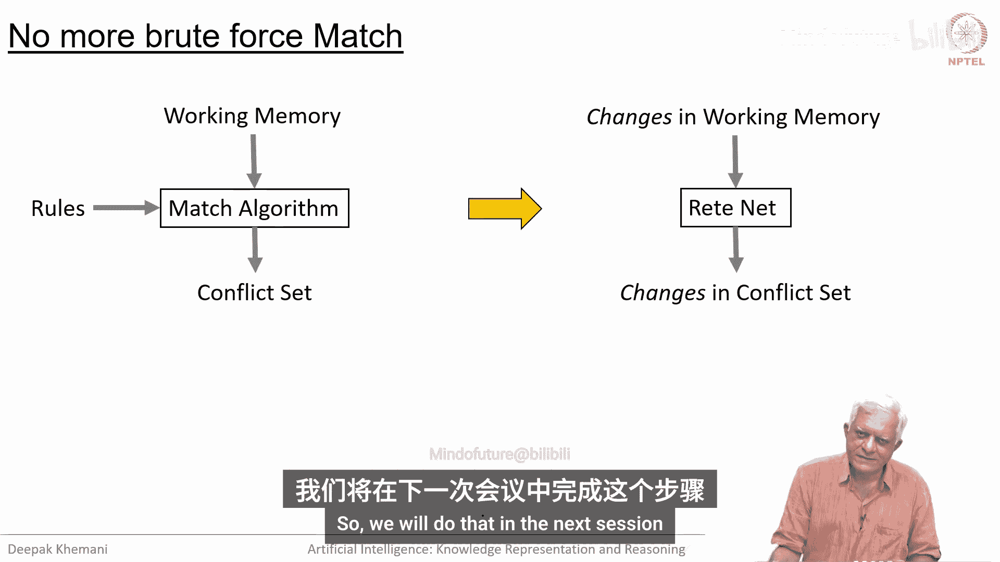

# 060：Rete算法 🧠

在本节课中，我们将学习一种名为 **Rete算法** 的高效匹配算法。该算法通过一种称为 **Rete网络** 的数据结构，显著提升了前向链接产生式系统中规则匹配环节的性能。我们将了解其核心思想、名称由来、发展历史以及它能带来的两种关键性能优化。

---

## 名称与历史 📜

上一节我们介绍了基于前向链接的产生式系统。本节中，我们来看看用于优化其匹配过程的Rete算法。

“Rete”一词源于拉丁语，意为“网络”或“网”，在解剖学中常指血管或神经构成的网状结构。因此，Rete网络本质上是一种网络结构。

该算法由 Charles Forgy 在20世纪70年代于卡内基梅隆大学攻读博士期间发明。其发展历程如下：

*   **Rete**： 最初的算法。
*   **Rete II**： Forgy 开发的版本，突破了所谓的“Rete墙”，即当工作内存元素数量增加时，性能不会急剧下降。
*   **Rete III**： 由 Sparkling Logic 公司在 Rete II 基础上演进而来，用于其商业规则引擎。
*   **Rete-NG**： 由 Forgy 创立的 Production Systems Technology 公司开发的新一代引擎，性能远超 Rete III，但其具体实现是商业机密，未公开。

Rete算法在商业规则管理系统（BRMS）中得到了广泛应用，特别是在电信网络告警监控等需要实时处理大量事件的场景中，它能将数小时的处理时间缩短至数秒。

---

## 算法要解决的问题 ⚡️

在传统的“匹配-消解-执行”循环中，“匹配”阶段需要将所有规则的所有模式与所有工作内存元素进行比较，计算开销巨大。Rete算法旨在解决此问题，它主要提供两种优化：

### 1. 周期内节省

周期内节省指的是，在同一个匹配周期内，避免对同一个工作内存元素重复进行相同的模式匹配。

例如，假设我们有以下两条规则：
*   **规则1**： `IF 课程=AI AND 分数>59 AND 分数<=70 THEN 等级=C`
*   **规则2**： `IF 课程=ML AND 分数>49 AND 分数<=60 THEN 等级=C`

如果学生“Neha”同时选修了AI和ML课程，那么她的信息（一个工作内存元素）需要分别与两条规则的第一模式（`课程=AI` 和 `课程=ML`）进行匹配。周期内节省的思想是：**只检查一次“Neha”的课程信息**，然后同时判断它是否匹配“AI”和“ML”，而不是分开检查两次。

### 2. 周期间节省

周期间节省指的是，在连续的“匹配-消解-执行”循环之间，避免重新进行全部匹配。

假设有300名学生，共选修1200门课程。在第一个周期，系统匹配出1200条可能的等级分配规则实例（冲突集），并选择其中一条（例如，为Neha的AI课分配C等级）执行。执行后，工作内存更新（Neha获得了C等级），但其他1199条匹配结果**仍然有效**。如果没有优化，下一个周期将重新进行全部1200次匹配。周期间节省的思想是：**记住上一周期的匹配结果**，只计算因工作内存变化（如上例中添加了Neha的等级）而导致的匹配结果变更。

---

## Rete算法的核心思想 🎯

Rete算法用一个新的处理框架取代了传统的匹配过程。

传统流程：
`规则 + 工作内存 --[匹配算法]--> 冲突集`

Rete算法流程：
`工作内存的变更 --[Rete网络]--> 冲突集的变更`

其核心思想是：
1.  **将规则编译到网络中**： Rete网络是一个数据结构，它**将规则的模式（条件部分）编码到网络节点中**。规则本身是长期记忆，不常变化，因此预编译是高效的。
2.  **增量式匹配**： 网络接收工作内存的**变化**（添加或删除元素），而不是整个工作内存快照。它利用网络结构，**只传播这些变化**，并增量式地更新冲突集。
3.  **保存中间结果**： 网络节点会缓存部分匹配的结果。这样，当新事实加入或旧事实移除时，算法无需从头开始匹配，只需重新计算受影响的部分。

这种方法避免了大量重复计算，使得系统性能不会随规则或事实数量的增长而线性下降。

---

## 总结 📝

本节课中，我们一起学习了Rete算法。我们了解了它的名称起源和发展历史，认识到它是商业规则引擎的核心。我们重点探讨了该算法旨在解决的两个关键性能问题：**周期内节省**和**周期间节省**。最后，我们掌握了Rete算法的核心思想——**将规则预编译到一个网络结构中，并通过增量式传播工作内存的变化来实现高效匹配**。在下一节中，我们将深入探讨Rete网络的具体结构和工作原理。