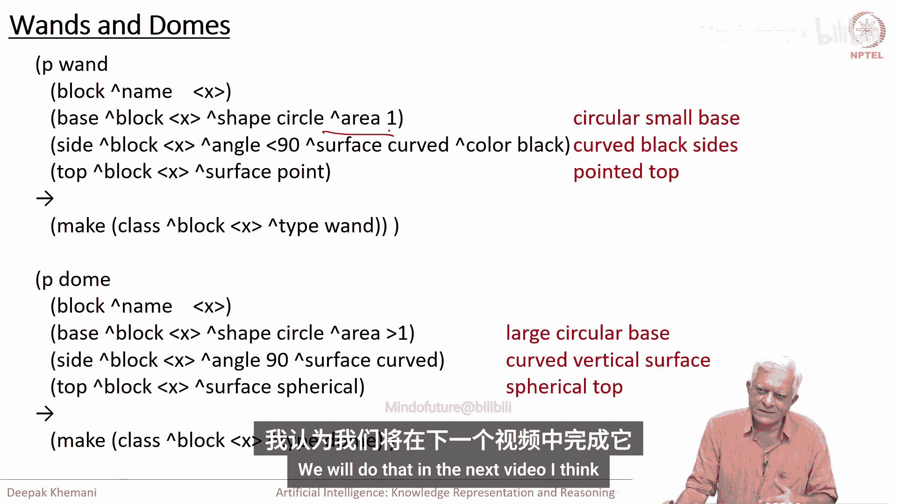

# 061：Rete网络 🧠


在本节课中，我们将学习Rete算法及其网络结构。这是一种比简单的模式匹配更高效的知识表示与推理方法。我们将了解Rete网络如何通过组织数据和记忆匹配结果来显著提升规则系统的性能。

## 概述

上一节我们介绍了基础的匹配算法，本节中我们来看看Rete网络。Rete是一种更高效地执行匹配操作的方法。基础的匹配算法是暴力搜索，它在每个周期都会检查所有规则中的所有模式与所有工作记忆元素是否匹配。而Rete网络，正如我们将看到的，每个工作记忆元素只会被处理一次。

## 数据组织与判别树

Rete网络高效的关键在于数据组织。我们不再使用顺序列表来存储工作记忆元素，而是以一种让规则更容易匹配的方式来组织它们。

以下是处理大量数据时的常见策略：
*   **分而治之**：将数据分割，当需要查找特定数据时，只需遍历部分数据。
*   **判别树**：这是一种树形结构。你在某一层进行测试，根据数据匹配的结果，将其发送到某个分支，然后进行下一个测试，依此类推。数据沿着树向下遍历。由于树的深度通常小于数据元素的数量，这种方法效率更高。

我们在许多地方都学过类似结构，例如：
*   **二叉搜索树**：这是基础。
*   **B树**：你可能也学过。
*   **决策树**：如果你接触过机器学习。
*   **四叉树和字典树**：字典树通常用于处理字母序列。

Rete网络的上半部分就是一个判别树，它由所谓的 **α节点** 构成。

## α节点与β节点

α节点是判别结构的一部分，它们充当规则库系统的工作映像。一个工作记忆令牌被插入到这个网络的根节点。如果动作是“创建”一个工作记忆元素，我们会添加一个正令牌；如果动作是“删除”，则添加一个负令牌。

然后，令牌在网络中向下遍历。你放入一个工作记忆元素，它进行一些测试，并根据测试值沿着某个分支前进。在绘制这些网络时，我们会使用更紧凑的表示方法。第一个测试通常查看类名，以确定你正在处理的数据类型。后续测试将查看某些属性的值。

构建高效Rete网络的关键在于组织测试和属性的顺序，使得更常见的属性先被测试，而不太常见的属性在它们出现的特定分支中被测试。

另一种节点称为 **β节点**。β节点本质上捕获了以下事实：假设这里有两个工作记忆元素，如果一个沿着左路径向下，另一个沿着右路径向下，这是两个不同的工作记忆元素，但它们会匹配同一条规则。一个匹配模式1，另一个匹配模式2。然后它们会在这里汇合。

通常，汇合是基于变量的值进行的。然后你会得到一个复合令牌，它可能在这里遍历并匹配第三个元素。这个节点代表一条具有3个模式的规则。当三个工作记忆元素被插入这个网络，并最终在此处汇合时，我们就知道这三个模式被匹配了，该规则得到满足。

β节点必须至少有一个父节点。更常见的是，两个或更多父节点必须满足某些连接条件。这时我们说模式来自某条给定规则。一个规则实例可以附加到任何β节点上，因此β节点基本上定义了我们要获取的规则。

## Rete网络实例

这里有一个Rete网络的例子。我们有四条规则：规则1、规则2、规则3和规则4。

例如，规则C需要两个模式，它们必须来自图中所示的方向。规则2也需要这两个模式。如果这两个模式存在，并且匹配（即有两个工作记忆元素匹配这两个模式），那么规则2就会匹配。

但规则1需要规则2所需的一切，再加上从这里来的两个令牌。所以规则2有2个模式，规则1有4个模式。你可以看到规则2是规则1的一个简化版本，它只关注规则1所看数据的一部分。因此，如果知识库或工作记忆中只有那两个模式，规则2就会被触发；如果所有四个模式都存在，规则1也会进入冲突集，规则2也会进入冲突集。如果你使用特异性原则，那么规则1会被选中。

## 一个OPS5程序示例

这里有一个小的OPS5程序示例，用于定义一些形状。

例如，你可以如下定义一个绿色金字塔：
```
(p green-pyramid
  (block ^name X ^base square ^area >1 ^side inclined ^surface plain ^color green ^top point)
-->
  (make green-pyramid ^name X)
)
```
我们声明：如果X是一个块，其基底是正方形且面积大于1，其侧面是倾斜的（非垂直），表面是平的且颜色为绿色，顶部是一个点，那么我们就说X是一个绿色金字塔。

类似地，你可以定义圆柱体：如果一个块的基底是圆形且面积大于1，侧面是垂直的曲面，顶部是平的，那么它就是圆柱体。

同样，你还可以定义另外两种形状：
1.  **圆锥**：基底是圆形且面积小（例如等于1），表面是弯曲的，顶部是尖的。它就像一个具有圆形横截面并逐渐变细成一点的棍子。
2.  **穹顶**：基底是圆形，形状类似球体。

我们定义了这四种形状。现在，让我们看看它们将如何在Rete网络中表示。Rete网络是规则的编译结果。因此，针对这个特定问题的Rete网络将基本上捕获这四条规则。这就是为什么我们说网络内部包含了规则。只有当数据到来时，我们才能判断它是否是金字塔或穹顶等形状。

我们将在下一个视频中详细探讨这一点。

## 总结



本节课中我们一起学习了Rete网络的基本原理。我们了解到，Rete网络通过构建判别树（α节点）来高效组织工作记忆数据，并通过β节点来组合匹配不同模式的元素，从而表示复杂的规则。这种方法避免了暴力匹配，通过记忆之前的匹配结果和智能的数据遍历，极大地提升了规则系统的推理效率。