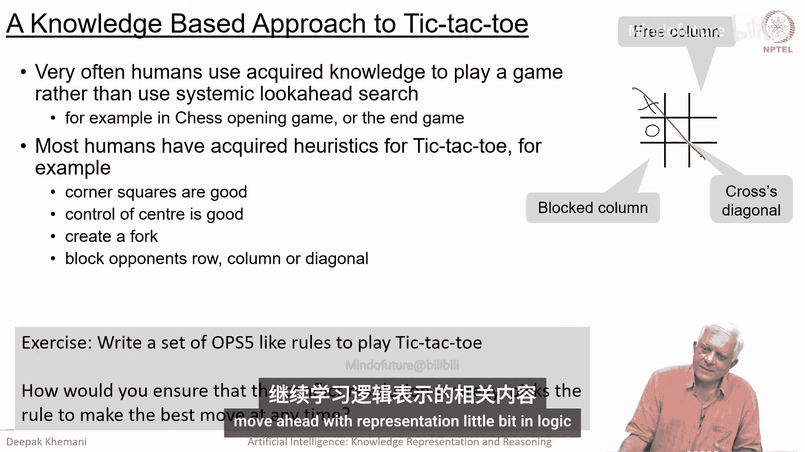

# 062：Rete网络示例 🧠

在本节课中，我们将通过一个具体的例子，深入探讨Rete网络如何工作。我们将看到Rete网络如何表示规则，以及工作记忆元素如何在这个网络中流动和匹配，从而触发规则。

## 概述

上一节我们介绍了Rete网络的基本结构，它由用于匹配工作记忆元素的Alpha网络和用于整合模式以构成规则的Beta网络组成。本节中，我们将通过一个具体的规则系统示例，来详细看看Rete网络的实际形态和工作流程。

## Rete网络结构回顾

Rete网络包含两个主要部分。顶部是Alpha网络，用于匹配工作记忆元素。底部是Beta网络，用于将构成规则的各种模式整合在一起。

## 示例规则系统

我们来看一个包含四条规则的小型系统，这些规则用于定义金字塔、方块、穹顶和圆柱体等形状，可能还涉及一些颜色属性。

下图展示了对应这组规则的Rete网络。图中，测试条件显示在下方。例如，我们在此测试属性的值：类别是“底座”、类别是“侧面”、类别是“方块”等等。随着向下遍历，我们查看属性的值，本质上就是进行测试。例如，这里我们说“面积大于1”。

如果令牌的值满足“面积大于1”，它将沿着这条路径向下传递；否则，它将走向另一条路径，那里是“面积等于1”。我们的两条规则中只有两种测试：一条要求面积大于1，另一条要求面积等于1。然后我们查看形状：有些是方形，有些是圆形等等。根据工作记忆元素的具体情况，它将沿着特定的路径向下遍历。

我们之前讨论的四条规则是：绿色金字塔规则、方块规则、穹顶规则和圆柱体规则。

我建议你在课后更仔细地查看此图，你会发现我们编写的四条规则都体现在这个网络中。如果你喜欢另一种表示法，将测试放在顶部，那么这里你会说“类别是什么”，然后说类别名是“底座”，接着下一个值是“面积”，然后判断是大于1还是等于1。你可以看到，这是同一个网络，只是书写方式不同，选择哪种方式取决于个人偏好。

## 工作记忆示例

假设这是我们的工作记忆。如果你是哈利·波特的粉丝，可能会认出其中一些角色。

这里我们有一些方块的名字，同时也包含了所有者的数据。但我们的分类规则本质上并不使用这些数据。正如我们所说，规则中的模式可能不一定包含数据中存在的所有属性。在数据库中，我们说有一个名为“1”的方块，其所有者是哈利，但规则本质上不会查看所有者的名字，可以忽略它。我们假设这是一个知识库或工作记忆元素。

我们有这四个方块：1、2、3、4。关于这四个方块的底座，我们有一些知识，如你所见，有些是圆形，有些是方形等等。然后我们有一些关于这四个方块侧面的信息，有些可能是弯曲的，有些可能是平的，有些可能有角度。接着我们有两个方块顶部的信息，但信息不完整。所以我们这里的知识库并不完整，只有部分信息。

## 匹配过程

让我们看看匹配部分。当一个工作记忆元素令牌被插入Rete网络时，它会遍历网络，在每一层根据测试结果向下遍历，并在适当的Beta节点等待其他匹配的工作记忆元素到达。记住，Beta节点收集不同的模式，然后判断某条规则是否匹配。

当我们说插入一个工作记忆令牌时，我们说过有两种令牌可以插入：`+`工作记忆元素或`-`工作记忆元素。`+`表示添加新工作记忆元素的操作，`-`表示删除一个元素。

假设这是我们放入令牌的工作记忆元素：它是一个底座，属于方块2，形状是方形，面积是20。那么它将沿着这条特定路径前进，并匹配所有条件。正如你在规则中看到的，方块名称是一个变量，所以任何值都会匹配它。工作记忆元素中的面积是20，这也会匹配，因为它大于1。形状是一个常量，所以也会匹配。

这就是令牌如何向下遍历的过程。你可以看到，一旦这个工作记忆元素被创建，它只被查看这一次，之后不会再被查看。我们已经把它放入网络，它已经向下遍历并停留在适当的节点上。绿色金字塔规则正在等待其他工作记忆元素的到来，当它们到来时，该规则就会进入冲突集。

那么它还需要哪些其他东西呢？它需要3样东西。它们必须来自这些路径，这些路径在这里用红色标出。如果你查看我们描述的工作记忆，你会看到所有节点都将位于这些位置。因此我们假设，工作记忆元素位于Alpha节点，而不是Beta节点，因为工作记忆元素会匹配不同的Beta节点，我们不希望它们在那里遍历，它们位于Alpha节点，而Beta节点只是保留一个指针，表示这个元素已经到达，那个元素已经到达等等。

## 冲突解决策略

现在我们来谈谈冲突解决策略。我们已经了解了这里发生的情况。我们创建了Rete网络，然后开始逐个放入工作记忆元素。在初始阶段，所有知识库元素一次性放入。然后，如果它们都稳定下来，一些规则会进入冲突集，其中一个将被选中，它将进行一些更改，然后再次被放回数据网络中，这就是整个过程。接下来我们要回答的问题是：如何实现我们之前讨论过的不同冲突解决策略？

当一个正令牌被放入时，它会向下遍历，并可能触发一些规则，因为这可能是某些规则等待的最后一个令牌，而这些规则的其他条件已经满足。如果发生这种情况，将这些规则放入一个“桶”中。它们都将具有相同的新近度，因为你知道，这是该工作记忆元素进入的时间。假设它触发了规则3、4和5。它同时触发了它们，所以所有这些规则3、4和5将具有相同的新近度，对吗？这样，你就可以跟踪新近度。所以，如果你使用新近度策略，那么当你放入一个工作记忆元素时，它遍历并选择一些规则，这意味着你必须从这些规则中选择一个来执行。当然，你可以有更精细的策略，你可能会考虑如果两条规则具有相同的新近度，那么你想采用什么策略，这是你可以进一步开发的。

对于冲突集中的每个规则实例，路径长度的总和定义了特殊性。记住，Alpha网络中的判别网络中的每条路径都在执行一系列测试，特殊性衡量了你进行了多少测试。所以，如果你只是将路径长度相加，就会得到特殊性，如果你使用特殊性策略，就可以利用这一点。

一旦一条规则被选中，想象一下这个Rete网络：你放入了所有工作记忆元素，它们已经向下遍历，现在某些规则就像挂在树上的果实。每个可触发的规则都挂在Rete网络上。一旦你移除并执行它，它就不再存在于冲突集中。因此，可触发性是直接实现的，它是自动的。

当一个负令牌被放入时，它可能会去移除一些原本匹配的规则。记住这个例子：假设我们逐个添加分数，学生A得了79分，有一条规则匹配，即没有人高于79分，因此它可能准备触发。但另一条规则被选中并触发了，它创建了一个新的工作记忆元素，关于另一个学生B，假设他的分数高于79，比如83分。然后这个令牌会向下遍历，并匹配学生A的排名规则的负模式，并说：好吧，有一个学生的分数超过了79分，所以那条规则必须被移除。这是一个稍微复杂的过程，但我希望你能理解这个思路。

## 练习：分析网络并编写规则

我将给你一些我们多年来创建的示例网络作为练习。我要求你做的是查看这些网络，并为它们执行的任务编写相应的规则，给它们起合适的名字。

例如，这里我们有名字：儿童票价、学生票价、游戏票价。还有获奖者，他们可以免费旅行等等。例如，学生回家可以享受优惠，儿童票价更低等等。这些规则旨在捕捉这些情况。作为练习，请用我们学过的OPS5类语言编写这些规则。你所要做的就是查看这个网络，并将其转换为四条规则，对应四种票价类型。

这是另一个关于贷款资格的网络，这里我们没有给出名字。所以，有四条规则。请给出合适的名字，并将它们写成规则。同样，这是一个包含四条规则的小型系统，用OPS5语言表达，使得这个网络能够表示它们。

这是另一个关于几何形状的例子。之前我们讨论过方块，但现在我们讨论的是二维图形。右侧有一系列图形：三角形、四边形、等腰三角形、直角三角形（有一个直角的三角形）、菱形、直角等腰三角形以及同样是直角的等腰三角形。你可以看到这个图上有许多Beta节点，并且可以看到存在更具体的描述和更一般的描述。例如，三角形比等腰三角形更一般。你可以从中找出它们。请尝试查看并编写实现此功能的规则。这里有很多几何形状对象。

这是绘制同一张图的另一种方式，不是将规则名称写在右侧，而是将它们画在网络本身中。所以你可以看到有很多很多规则。请仔细查看。

## 关于继承的说明

我们看到，有些事物比其他事物更一般。例如，看菱形和正方形。有四条边且四条边相等的图形是菱形。然后你可以说，一个角为90度的菱形是正方形。所以你可以看到，如果你描述了菱形，那么你可以将正方形描述为菱形的一个特例，它具有90度的角，因此可以继承其余属性，只添加一些新东西。当人们构建分类法时，这种情况经常发生，我们稍后会看一点这方面的内容。正方形比菱形更具体，而菱形又比四边形更具体。

默认规则具有底层的继承层次结构。例如，企鹅是一种鸟，因此你赋予鸟的任何属性都可以被企鹅继承。同样，你关于四边形的任何描述也将被正方形继承。

继承是我们使用的一种非常强大的机制。我已经提到，当我们将事物组织成类似对象的结构（我们称之为框架）时，继承将在那里发挥重要作用，它将导致你的知识库更加紧凑。例如，“所有哺乳动物都有两只眼睛”这样的知识可以在非常高的层次上表示，而不必分别为人类、猫和狗表示。这有一定的优势。

我们还将研究一种称为描述逻辑的东西，它允许你描述事物。描述逻辑也被称为名词短语逻辑，我们也会研究它。它们用于构建本体，而本体在最近几年因为互联网和商业的发展而变得非常重要。在描述逻辑中，你基本上会表示这种继承网络，你可能会这样表示：正方形是菱形，菱形是四边形。请留意这一点。

## 游戏玩法：基于规则的方法

我想以一个略有不同的问题来结束，即游戏玩法问题，我们在另一门关于搜索方法的课程中研究过。在搜索方法中，当你玩井字棋、象棋或围棋等游戏时，本质上是在搜索树上进行搜索。这张幻灯片来自那门课程，展示了如何进行深度优先搜索，从左到右移动，并进行某种称为Alpha-Beta剪枝的剪枝，因此有一种称为Alpha-Beta算法的搜索算法。

但人类并不总是使用搜索来玩游戏。这里有一个建议：编写一个程序来玩井字棋（也称为画圈打叉游戏），采用基于知识的方法，使用规则来玩游戏，而不是通过向前搜索来寻找最佳走法。人类利用习得的知识来玩游戏，而不是系统的前瞻搜索。例如，国际象棋的开局或残局，程序并不真正进行搜索。人类很少进行搜索。事实上，关于围棋有一种说法：围棋对机器来说很难，因为机器使用搜索，而围棋大师使用感知，这本质上是一种知识。

大多数人类已经获得了井字棋或画圈打叉游戏的启发式方法。你有一些想法，比如角落的方格很好，控制中心很好，或者你可以创造一个“叉”（双杀），这样对手只能堵住一行，还有一种策略是阻挡对手的行、列或对角线。这些是你在谈论启发式方法时会用到的特征，例如，有空列、被阻挡的列、交叉的对角线等等。

你可以编写一个使用一组规则来玩井字棋的程序。我鼓励你编写这组规则。例如，你可以简单地说从角落开始，或者如果对手从角落开始，则在某个位置下棋。尝试列举不同的规则，这样你就有了一个基于规则的程序来玩游戏。这是一种替代方案。

所以，编写一组OPS5类规则来玩井字棋。你如何确保冲突解决策略选择正确的规则？你可能有一条规则说现在是时候在边上下棋了，现在是时候在这个角落下棋了，无论你使用什么描述。你会使用什么冲突解决策略？这是一个小练习，说明在解决问题时，你可以使用不同的方法。例如，在游戏中你可以使用搜索，但你甚至可以思考规则，至少在像井字棋这样的简单游戏中。

## 总结

本节课中，我们一起学习了Rete网络的具体工作示例。我们回顾了其Alpha和Beta网络的结构，并通过一个形状分类的规则系统，详细观察了工作记忆元素如何在网络中匹配和流动，从而触发规则。我们还探讨了冲突解决策略的实现思路，并分析了几个练习网络以编写对应规则。最后，我们讨论了继承在知识表示中的重要性，并提出了使用基于规则的方法（而非搜索）来解决如井字棋等游戏问题的思路。至此，我们结束了基于规则的生产系统的学习，接下来将更多地回到逻辑表示上。