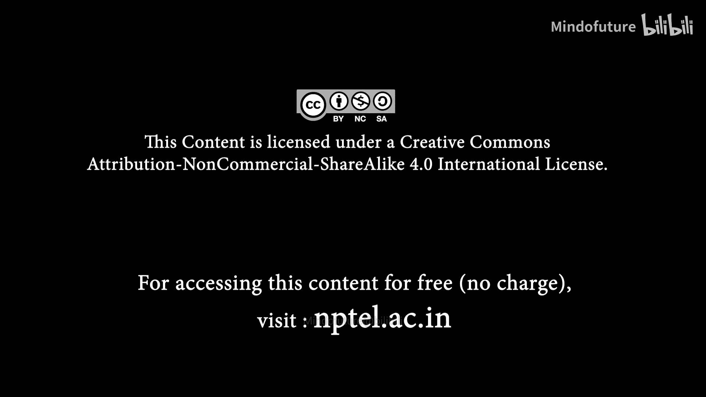
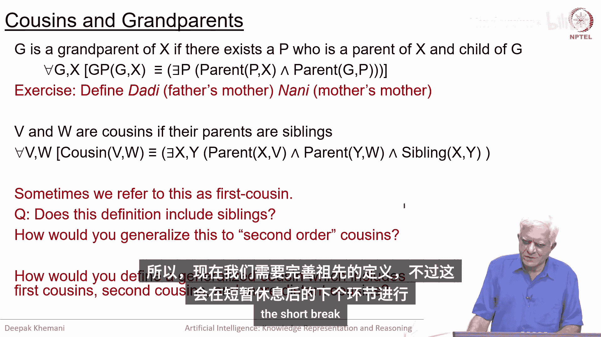

# 065：描述家庭关系 👨‍👩‍👧‍👦

在本节课中，我们将学习如何使用逻辑谓词和关系来构建一个家庭关系知识库。我们将从定义一些基本关系（如父母、性别）开始，然后展示如何通过这些基本关系推导出更复杂的亲属关系（如兄弟姐妹、叔叔、阿姨、祖父母和堂兄弟姐妹）。

## 概述

上一节我们讨论了二元关系。家庭关系是二元关系存在最丰富的领域之一。本节我们将探讨如何创建一个描述家庭成员间关系的知识库。例如，如何表示叔叔、阿姨、祖父母、兄弟姐妹、堂兄弟姐妹等关系。我们将定义一些基本关系存储在知识库中，然后通过定义基本关系与衍生关系之间的联系来推断其他关系。

## 基本关系定义

为了构建家庭知识库，我们需要从一组最基础的关系开始。以下是我们可以使用的最小基本关系集。

*   **父母关系**：`parent(x, y)`。这表示 `x` 是 `y` 的父母。在逻辑表示中，我们需要明确参数的顺序。这里我们约定第一个参数是父母，第二个参数是子女。
*   **性别信息**：我们需要两个谓词来表示性别。
    *   `male(x)`：表示 `x` 是男性。
    *   `female(x)`：表示 `x` 是女性。

> **注意**：我们也可以只定义一个性别谓词（如 `male`），并通过规则推断另一个性别（非男性即为女性）。但为了清晰起见，这里我们同时定义两者。

## 从基本关系推导其他关系

有了基本关系，我们就可以定义更具体的家庭角色。以下是使用基本关系定义的一些常见亲属关系。

*   **定义儿子**：`son(x, y)` 表示 `x` 是 `y` 的儿子。其逻辑定义为：`son(x, y) ≡ parent(y, x) ∧ male(x)`。即，`y` 是 `x` 的父母，且 `x` 是男性。
*   **定义母亲**：`mother(x, y)` 表示 `x` 是 `y` 的母亲。其逻辑定义为：`mother(x, y) ≡ parent(x, y) ∧ female(x)`。即，`x` 是 `y` 的父母，且 `x` 是女性。
    *   我们也可以用等式来定义：`x = mother_of(y) ≡ mother(x, y)`。

## 定义兄弟姐妹关系

接下来，我们定义兄弟姐妹关系。如果两个人有共同的父母，那么他们就是兄弟姐妹。

以下是兄弟姐妹关系的初始定义：
`sibling(z, y) ≡ ∃x [parent(x, y) ∧ parent(x, z)]`

这个定义存在一个问题：根据它，一个人会被认为是自己的兄弟姐妹（例如，Sureish 是 Sureish 的兄弟姐妹）。这通常不是我们想要的。

因此，我们需要一个更精确的定义，排除自身：
`sibling(z, y) ≡ (z ≠ y) ∧ ∃x [parent(x, y) ∧ parent(x, z)]`

此外，兄弟姐妹关系具有对称性和传递性，我们应该将这些属性作为事实或规则加入知识库。
*   **对称性**：如果 `x` 是 `y` 的兄弟姐妹，那么 `y` 也是 `x` 的兄弟姐妹。
*   **传递性**：如果 `x` 是 `y` 的兄弟姐妹，且 `y` 是 `z` 的兄弟姐妹，那么 `x` 也是 `z` 的兄弟姐妹。
    *   **注意**：对传递性需要谨慎。如果 `x` 和 `y` 有一个共同父母，`y` 和 `z` 有另一个共同父母，那么严格来说 `x` 和 `z` 可能不是兄弟姐妹（例如同父异母或同母异父的情况）。定义时需要根据具体需求调整。

基于兄弟姐妹关系，我们可以定义姐妹和兄弟：
*   **姐妹**：`sister(x, y) ≡ sibling(x, y) ∧ female(x)`
*   **兄弟**：`brother(x, y) ≡ sibling(x, y) ∧ male(x)`

## 定义阿姨（Aunt）关系

现在我们来定义更复杂的亲属关系，例如阿姨。阿姨可以是父母的姐妹。

`aunt(a, x)` 表示 `a` 是 `x` 的阿姨。其逻辑定义如下：
`∀a ∀x [aunt(a, x) ≡ ∃p (parent(p, x) ∧ sibling(p, a) ∧ female(a))]`

这个等价式可以分解为两个方向的蕴含：
1.  **从左到右（定义充分性）**：如果 `a` 是 `x` 的阿姨，那么存在一个 `p`，使得 `p` 是 `x` 的父母，`p` 是 `a` 的兄弟姐妹，并且 `a` 是女性。
2.  **从右到左（定义必要性）**：如果存在一个 `p`，使得 `p` 是 `x` 的父母，`p` 是 `a` 的兄弟姐妹，并且 `a` 是女性，那么 `a` 就是 `x` 的阿姨。

> **注意**：在从左到右的蕴含中，存在量词 `∃p` 在结论中，这里的 `p` 是 `a` 和 `x` 的斯科伦函数。在从右到左的蕴含中，存在量词 `∃p` 在前件中，当将其移出时，实际上相当于一个全称量词。因此，整个语句是一个全称语句：对所有 `a`, `x`, `p`，如果 `p` 是 `x` 的父母，且 `a` 是 `p` 的兄弟姐妹，且 `a` 是女性，那么 `a` 是 `x` 的阿姨。

作为练习，请尝试定义“叔叔”（父亲的兄弟）和“舅妈”（舅舅的妻子）等关系。

## 定义祖父母和堂兄弟姐妹关系

让我们将关系扩展到更远的家庭成员。

*   **定义祖父母**：`grandparent(g, x)` 表示 `g` 是 `x` 的祖父母。
    `∀g ∀x [grandparent(g, x) ≡ ∃p (parent(p, x) ∧ parent(g, p))]`
    即，存在一个 `p`，`p` 是 `x` 的父母，而 `g` 是 `p` 的父母。

    我们可以进一步定义特定的祖父母关系，例如：
    *   **奶奶（父亲的母亲）**：`dadi(g, x) ≡ grandparent(g, x) ∧ female(g) ∧ ∃f (parent(f, x) ∧ male(f) ∧ parent(g, f))`
    *   **外婆（母亲的母亲）**：`nani(g, x) ≡ grandparent(g, x) ∧ female(g) ∧ ∃m (parent(m, x) ∧ female(m) ∧ parent(g, m))`
    当然，你也可以直接用“父亲”和“母亲”关系从第一性原理来定义它们。

*   **定义堂兄弟姐妹（Cousins）**：`cousin(v, w)` 表示 `v` 和 `w` 是堂（表）兄弟姐妹。
    `∀v ∀w [cousin(v, w) ≡ ∃x ∃y (parent(x, v) ∧ parent(y, w) ∧ sibling(x, y))]`
    即，存在 `x` 和 `y`，`x` 是 `v` 的父母，`y` 是 `w` 的父母，并且 `x` 和 `y` 是兄弟姐妹。这通常被称为“第一代表亲”。

    **思考题**：根据这个定义，兄弟姐妹是否也被包含在“堂兄弟姐妹”关系中？请检查这个定义是否符合你的直觉。

## 关系的泛化与扩展

上述定义可以进一步泛化。
*   **第二代表亲**：可以定义为“父母是第一代表亲”的人。
*   **广义堂亲关系**：可以定义一个更通用的 `cousin` 关系，涵盖所有代数的堂（表）亲。一种常见思路是：如果两个人有一个共同的祖先，那么他们就是某种程度的堂亲。但这需要我们先精确定义“祖先”关系。

我们将在短暂的休息后，在下节课中探讨“祖先”关系的定义以及其他扩展。

## 总结

本节课我们一起学习了如何使用一阶逻辑构建家庭关系知识库。我们首先定义了`parent`、`male`、`female`等基本关系。然后，我们展示了如何通过这些基本关系推导出`son`、`mother`、`sibling`（需注意排除自身）、`aunt`、`grandparent`和`cousin`等更复杂的亲属关系。关键在于，只需存储少量基本事实，即可通过逻辑规则推断出庞大的家庭关系网络。我们还简要讨论了处理重名个体的方法（如使用唯一标识符）以及如何将关系泛化到更远的亲属。