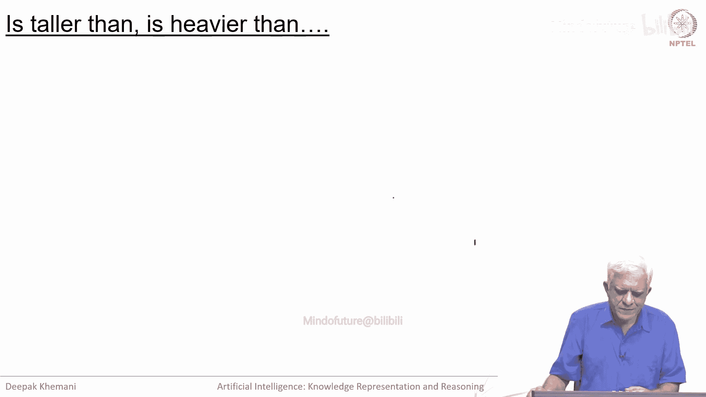

# 067：抽象实体与图论基础 🧠

在本节课中，我们将学习如何将图（Graph）作为一种抽象实体进行知识表示。我们将了解图的基本构成，并学习如何用逻辑语言定义图及其相关概念，如路径和连通性。

---

## 图是抽象实体

上一节我们讨论了如何表示具体事物及其关系。本节中，我们来看看如何表示更复杂的抽象结构——图。

图是一种由节点（Node）和边（Edge）组成的复合结构。当我们绘制一个图时，通常用圆圈表示节点，用连接圆圈的线表示边。

*   **节点**：存在于论域中的实体，属于“节点”这个类别。我们可以用 `x is a node` 这样的语句来描述。
*   **边**：我们通常将边建模为节点之间的二元关系。如果存在连接节点 `x` 和节点 `y` 的边，我们可以说 `edge(x, y)` 成立。有时，我们也可以将边本身视为一个名为“边”的抽象实体。

从概念上讲，一个图 `G` 是一个抽象实体，它由一组顶点（或节点）`V` 和一组边 `E` 构成，即 `G = (V, E)`。我们可以说 `G is a graph`。

---

## 定义图中的关系

现在，让我们更精确地定义图中的元素及其关系。

*   **节点属于图**：我们可以说节点 `n` 属于图 `G`，这表示 `n` 是图 `G` 中节点集合的一个元素。这可以表示为 `n is a node`, `G is a graph`, `n belongs to G`。
*   **边的解释**：谓词 `edge(n1, n2)` 为真，当且仅当节点 `n1` 和 `n2` 之间存在一条边。这意味着在论域中，存在一个由这样的节点对（元组）构成的关系。
*   **一个重要约束**：边只能存在于两个节点之间，正如“结婚”关系只能存在于两个“人”之间一样。因此，`edge(x, y)` 隐含了 `x is a node` 且 `y is a node`。

关于边的方向性：
*   如果 `edge` 关系是对称的（即 `edge(n1, n2)` 蕴含 `edge(n2, n1)`），则该图是**无向图**。
*   否则，该图是**有向图**。在有向图中，`edge(n1, n2)` 表示从 `n1` 指向 `n2` 的方向。

---

## 定义路径

在图论中，路径是一个核心概念。以下是路径的递归定义。

存在一条从节点 `n` 到节点 `m` 的路径，当且仅当满足以下条件之一：
1.  **基本情况**：存在一条直接从 `n` 到 `m` 的边，即 `edge(n, m)`。
2.  **递归情况**：存在某个节点 `p`，使得存在一条从 `n` 到 `p` 的边，并且存在一条从 `p` 到 `m` 的路径。

用逻辑公式可以表示为：
**`path(n, m) ↔ edge(n, m) ∨ ∃p (edge(n, p) ∧ path(p, m))`**

**注意**：这个定义允许自环（即 `edge(n, n)`）。如果我们不希望有自环，则需要额外声明。此外，这个“路径”的定义，与我们之前定义“祖先”关系的逻辑结构几乎完全相同，这再次说明了抽象表示的通用性。

---

## 图的属性：连通性

既然我们将图视为一个抽象实体，我们就可以讨论它的整体属性。一个重要的属性是连通性。

一个图是**连通的**，当且仅当对于图中的任意两个节点 `n` 和 `m`，都存在一条从 `n` 到 `m` 的路径。

用逻辑公式可以表示为：
**`connected(G) ↔ ∀n∀m ((node(n) ∧ node(m) ∧ belongs_to(n, G) ∧ belongs_to(m, G)) → path(n, m))`**

这意味着，在一个连通图中，你可以从任何一个节点出发，通过一系列边到达任何其他节点。

---

本节课中，我们一起学习了如何将图作为一种抽象实体进行知识表示。我们定义了图的基本组成部分（节点和边），用递归逻辑定义了“路径”概念，并介绍了“连通性”这一整体属性。这为我们表示和处理更复杂的抽象结构和关系打下了基础。下一节，我们将探讨其他类型的抽象关系，例如“比……高”或“比……重”。