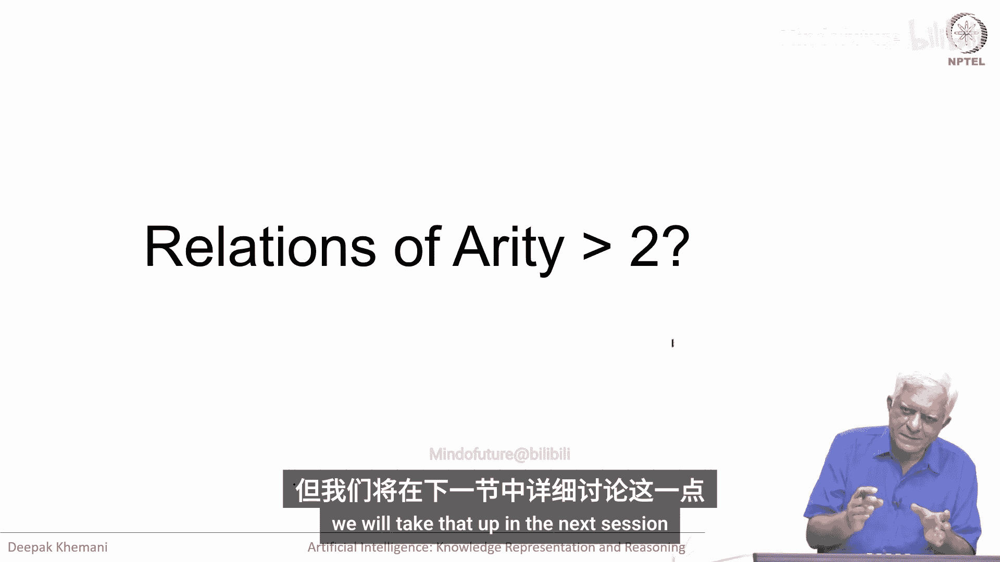

# 068：具体化度量单位 📏

在本节课中，我们将学习如何在谓词逻辑中表示和推理像“高度”、“长度”、“颜色”这类抽象概念。我们将探讨“具体化”这一核心思想，即如何将度量单位和属性本身作为领域中的抽象个体来处理，从而更精确地描述世界。

---

上一节我们介绍了通过聚合（如“团队”）来创建领域中的新实体。本节中，我们将看看另一种创建抽象实体的方法——具体化，特别是如何用它来处理度量单位。

## 为何需要具体化？🤔

当我们试图用逻辑描述世界时，会遇到一些语言概念难以直接转换。例如，如何定义“高”这个概念？你可以简单定义一个“高个子”类别，但这并不能满足推理需求。一个更基础的需求是比较，比如“Aisha比Sushma高”。我们需要一个概念化的表示方法，而不仅仅是手动填充一个名为 `taller` 的谓词。

## 引入抽象类型：长度 📐

具体化的核心是为领域引入新的抽象类型。我们创建一个名为“长度”的类型，它是领域的一个子集。

我们可以定义函数（如 `length`、`height`、`distance`）将领域中的具体对象映射到这个“长度”类型的抽象对象上。例如：
*   `height(Aisha)` 表示一个属于“长度”类型的抽象对象，即Aisha的高度。
*   `length(pencil71)` 表示铅笔71的长度。

这些函数本身并不命名具体的长度值，它们只是指向那些抽象的“长度”对象。

## 量化抽象对象：引入度量单位 🔢

仅有抽象的长度对象还不够，我们需要量化它们。为此，我们引入度量单位，同样用函数表示。

我们可以用两种方式定义“英尺”这个函数：
1.  **从长度到数字**：`feet` 函数将一个“长度”类型的对象映射到一个数字。
    *   例如：`feet(height(Aisha)) = 5.9` 表示“Aisha的身高是5.9英尺”。
2.  **从数字到长度**：`feet` 函数将一个数字映射到一个“长度”类型的对象。
    *   例如：`feet(5.9) = height(Aisha)` 表示“5.9英尺这个长度就是Aisha的身高”。

无论哪种定义，核心都是建立了抽象长度对象与具体数字之间的联系。

## 定义“比…高”关系 📈

有了量化的高度，我们就可以精确定义“比…高”这个关系。

以下是使用第一种函数定义（长度→数字）的逻辑表达：
`taller(x, y) ↔ ∃n, m ( feet(height(x)) = n ∧ feet(height(y)) = m ∧ n > m )`
这个公式表示：如果存在数字n和m，使得x的身高（英尺）等于n，y的身高（英尺）等于m，并且n大于m，那么x就比y高。

## 处理混合单位与实际问题 🧮

现实中我们常使用混合单位（如5英尺9英寸）。处理这类问题有两种主要方法：

**方法一：统一单位后计算**
将所有度量值转换为同一单位（如全部转换为米或全部转换为千米），然后进行数学运算。这需要定义单位转换函数，例如：
`kilometers(n) = meters(n * 1000)`
这个公式表示：n千米的长度等于 `n * 1000` 米的长度。

**方法二：分层计算（类似竖式加法）**
模仿小学数学加法，先计算最小单位（如米），处理进位，再计算更大单位（如千米）。

这类能力使得逻辑系统可以解决实际应用题，例如：“Sam骑行了3公里，步行了500米，然后又步行了600米，骑行了2公里。他总共走了多远？”

## 扩展到其他属性：以颜色为例 🎨

具体化的思想同样适用于颜色等属性。

我们可以简单地将“红色”定义为一个类别，断言“球33是红色的”。但更精细的方法是，将“颜色”本身定义为一个抽象类型，其中包含名为“红色”、“绿色”等的具体颜色对象。然后，用一个函数将物体映射到颜色对象：`color(ball33) = red`。

为了处理“相似颜色”这种模糊概念，我们可以利用颜色的RGB表示法。每种颜色是三维空间（红、绿、蓝）中的一个点。两个颜色的相似度可以通过计算它们在该空间中的距离，并归一化到[0,1]区间来定义：
`similarity(c1, c2) = 1 - normalized_distance(c1, c2)`
然后可以设定一个阈值（如0.7）来判断是否“相似”。

---

本节课中我们一起学习了“具体化”这一重要知识表示技术。我们看到了如何将“长度”、“颜色”等度量单位和属性视为领域中的抽象个体，并通过函数将它们与具体对象和数值联系起来。这种方法使我们能够精确地定义和推理像比较、单位转换和属性相似度等复杂关系，极大地增强了谓词逻辑的描述和推理能力。下一节，我们将探讨如何利用具体化来处理具有两个以上参数的关系。