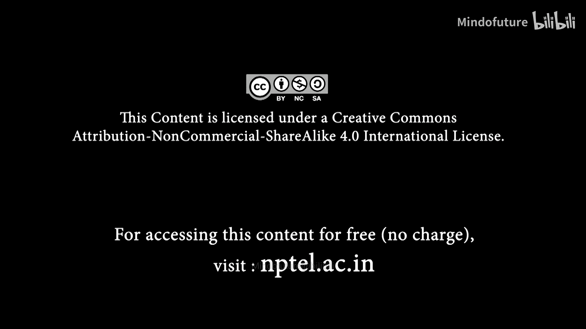
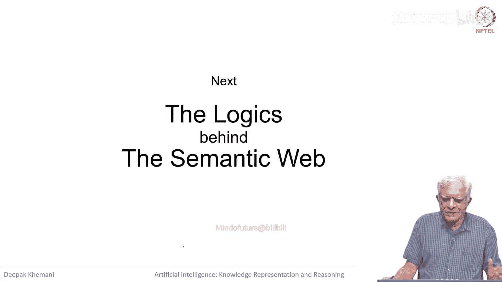

# 069：语义网络与知识图谱




在本节课中，我们将学习如何处理大于二元的复杂关系，并介绍一种称为“具体化”的有效机制。我们将看到如何将复杂关系分解为一系列二元关系，并最终引出语义网络和知识图谱的概念。这些是现代知识表示和互联网数据互联的基础。

上一节我们介绍了具体化的概念。本节中，我们来看看它在处理多元关系时如何发挥作用。

## 处理多元关系

在现实世界中，实体通常与多个其他实体相关联。问题在于，如何有效地捕捉这种复杂关系？这在描述事件和动作时尤为常见。

例如，考虑一个描述事件的句子：“昨天下午，迪维尔在公园用棍子打了阿图尔。” 我们如何表示这个信息？

一种简单但随意的方法是发明一个多参数的谓词：
`hit(Divyar, Atul, stick14, yesterday_afternoon, park28)`
这种方法的语义是任意的，用户必须记住每个参数代表什么。如果句子中省略了某些信息（如地点或工具），或者我们想用不同的方式描述同一事件，这种表示方法就会变得混乱且难以处理。

核心问题在于为一阶逻辑选择合适的谓词。例如：
*   “迪维尔打了阿图尔” 可以表示为 `hit(Divyar, Atul)`。
*   “迪维尔用棍子打了阿图尔” 可以表示为 `hit(Divyar, Atul, stick14)`。
*   若要表示“一根棍子”，则需要引入存在量词：`∃x (stick(x) ∧ hit(Divyar, Atul, x))`。

这带来了几个挑战：
1.  参数顺序的歧义：`hit(Divyar, Atul, stick, yesterday)` 和 `hit(Divyar, Atul, yesterday, stick)` 有何区别？
2.  缺乏语义角色：与自然语言（如印地语中的格标记）不同，一阶逻辑的谓词参数没有明确标识“施事者”、“受事者”、“工具”、“时间”等角色。
3.  相对术语的处理：“昨天”是一个相对时间，更好的表示是使用具体日期。

## 解决方案：具体化与二元关系分解

现代趋势是将复杂句子分解为**二元关系**。所有要存储的关系都应该是二元的。

具体做法是，为事件创建一个抽象实体（即“具体化”），然后将所有相关信息与该实体实例关联起来。

对于“迪维尔打阿图尔”的例子，我们可以创建一个名为 `E45` 的事件实例，并将其定义为“击打”类型的事件。然后，用二元关系描述该事件的各个方面：

```
instanceOf(E45, HittingEvent)
actor(E45, Divyar)
object(E45, Atul)
date(E45, March_21)
location(E45, Park28)
instrument(E45, stick14)
```

通过这种方式，我们将涉及多个元素（施事者、受事者、工具、日期、地点）的复杂关系，分解为一系列与抽象实体 `E45` 相关联的二元关系。这使表示更加系统化。

## 三元组表示与图数据库

上述二元关系可以方便地表示为**三元组**（Triple），格式通常是（主语，谓语，宾语）或（主语，属性，值）。

以下是使用三元组表示相同信息的方式：

```
(E45, instanceOf, HittingEvent)
(E45, actor, Divyar)
(E45, object, Atul)
(E45, date, March_21)
(E45, location, Park28)
(E45, instrument, stick14)
```

每个三元组都陈述了关于主语（第一个元素）的某个属性（第二个元素）及其值（第三个元素）。这种表示是标准化和统一的。

我们可以将这种表示视为一个图：
*   **节点**代表实体（如 `E45`, `Divyar`, `Atul`）。
*   **有向边**代表关系，边的**标签**是属性名（如 `actor`, `object`）。

这种结构化的数据可以存储在专门的**图数据库**中，并使用相应的查询语言进行高效检索。

## 另一个示例：知识图谱表示

让我们看一个更复杂的例子，关于一次音乐表演的信息：
> “哈迪卡·基拉尼于2012年6月10日在‘可乐工作室’演唱了苏菲派歌曲‘瓦利’。该表演由罗希特·夏尔马制作，在YouTube上播出。这首歌也被拉哈特·法塔赫·阿里·汗和阿姆贾德·萨布里演唱过。歌曲‘瓦利’由著名印度诗人阿米尔·胡斯劳创作。胡斯劳创作的另一首苏菲派歌曲名为‘Chap Tilak Sab Chheeni’。”

我们可以创建一个名为 `Performance101` 的抽象实体（表演），并用三元组构建一个知识图谱：

```
(Performance101, singer, HadiqaKiani)
(Performance101, title, Wali)
(Performance101, genre, Sufi)
(Performance101, type, Song)
(Performance101, date, June_10_2012)
(Performance101, producer, RohitSharma)
(Performance101, hostedOn, YouTube)
(Performance101, venue, CokeStudio)

(Performance102, singers, {RahatFatehAliKhan, AmjadSabri})
(Performance102, venue, CokeStudio)

(Wali, poet, AmirKhusro)
(AmirKhusro, nationality, Indian)
(AmirKhusro, wrote, ChapTilakSabChheeni)
(ChapTilakSabChheeni, genre, Sufi)
(ChapTilakSabChheeni, type, Song)
```

这种表示方法灵活且可扩展，便于不同程序在互联网上访问和链接信息。

## 从语义网络到知识图谱

几十年前，在知识表示领域，除了基于逻辑语句的方法，还有一个学派主张使用**语义网络**。在这种网络中，知识库包含显式的链接或指针，连接着各个实体。推理算法（如**标记传播算法**）可以通过遍历图中的路径来发现实体间的关系。

例如，在家族关系数据库中，“阿姨”可以通过路径来定义：一个人的阿姨是其父母的父母的女性后代。在图数据库中，查询语言可以很好地识别这种模式。

语义网络的思想后来演化为**知识图谱**。知识图谱本质上是分布在互联网上的大规模语义网络。2012年，谷歌正式采用“知识图谱”一词来指代其用于增强搜索的数据表示。

知识图谱（或语义网络）是一种用带标签的边表示实体（对象、事件、概念）及其关系的网络模型。信息通常存储在图数据库中，并可视化为图结构。

## 本体与Web本体语言

在语义网背景下，**本体**是一个核心概念。本体本质上是分类法，但可以包含更丰富的关系。它扩展了知识图谱的思想，对概念和关系进行形式化定义。

万维网联盟为网络本体开发了一种标准化语言——**OWL**。OWL建立在描述逻辑之上，为在互联网上构建和共享本体提供了框架，是实现语义网（有时称为Web 3.0）愿景的关键技术之一。

## 总结

本节课中我们一起学习了：
1.  处理多元关系的挑战，以及使用多参数谓词表示的局限性。
2.  通过**具体化**创建抽象事件实体，并将复杂关系**分解为二元关系**的解决方案。
3.  如何使用**三元组**（主语-谓语-宾语）标准化地表示知识，并将其视为**图**结构。
4.  通过音乐表演的示例，了解了如何用三元组构建**知识图谱**。
5.  回顾了知识表示的历史脉络，从**语义网络**到现代互联网规模的**知识图谱**的演变。
6.  简要介绍了**本体**和**OWL**在语义网中的角色。



这种基于图和三元的表示方法，为知识的组织、共享和机器推理提供了强大而灵活的基础。