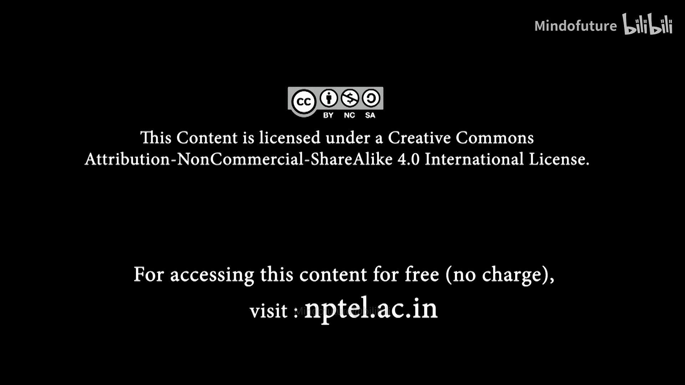
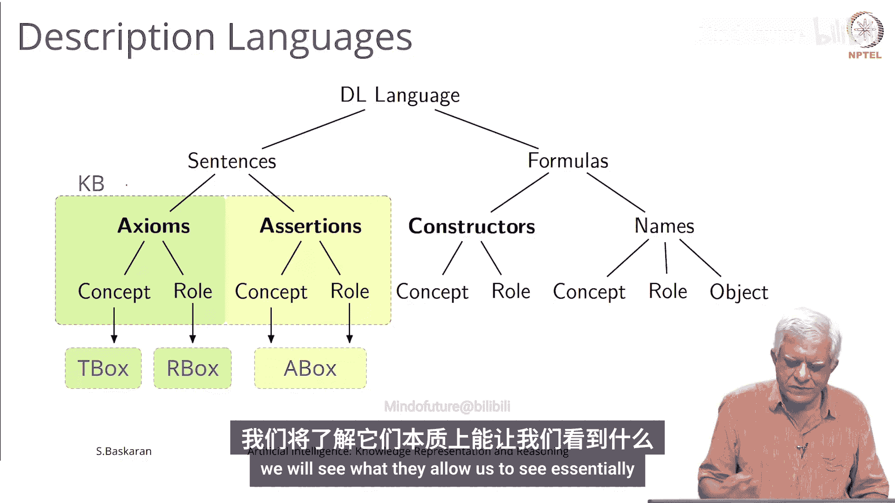

# 070：描述逻辑中的语句

在本节课中，我们将学习描述逻辑知识库的构成，具体了解TBox、RBox和ABox中可以包含哪些类型的语句。我们将通过简单的例子和清晰的解释，帮助你理解这些核心概念。

## 概述

描述逻辑是一种用于表示领域知识的逻辑语言。一个描述逻辑知识库通常由三部分组成：TBox（术语公理）、RBox（角色公理）和ABox（断言公理）。上一节我们介绍了如何从原始概念和角色构建复杂概念，本节中我们来看看在这三个部分中，我们可以做出哪些具体的陈述。

## TBox：概念公理

TBox用于定义概念之间的层次关系和等价关系。以下是TBox中可以包含的四种主要语句类型。

### 1. 概念包含
概念包含定义了概念之间的层次结构，类似于分类学。它表示一个概念是另一个概念的子集。
*   **公式**：`C ⊑ D`
*   **含义**：概念C被概念D包含。所有属于C的个体也属于D。
*   **示例**：`山羊 ⊑ 哺乳动物` 表示“所有山羊都是哺乳动物”。

### 2. 概念等价
概念等价为同一个概念定义不同的名称，类似于同义词。
*   **公式**：`C ≡ D`
*   **含义**：概念C和概念D是等价的，即 `C ⊑ D` 且 `D ⊑ C`。
*   **示例**：`父亲的兄弟 ≡ 叔伯`。

### 3. 原始概念定义
这用于为一个原始概念命名，并声明它是某个（可能是复杂的）概念的子类。
*   **公式**：`A ⊑ C`
*   **含义**：原始概念A被概念C包含。与概念包含的区别在于，这里的A必须是一个原始（已命名）概念，而C可以是任意复杂的概念表达式。
*   **说明**：这仅说明A是C的一个子类，但未精确定义A的具体构成。

### 4. 定义概念
这是为复杂概念表达式赋予一个名称的完整定义。
*   **公式**：`A ≡ C`
*   **含义**：原始概念A等价于概念表达式C。这为C定义了一个新名称A。
*   **示例**：`阿姨 ≡ 女性 ⊓ ∃有兄弟姐妹.∃有孩子.⊤`

## RBox：角色公理

RBox用于定义角色（关系）之间的层次和等价关系。以下是RBox中可以包含的三种语句类型。

### 1. 角色包含
角色包含定义了角色之间的层次关系。
*   **公式**：`R1 ⊑ R2`
*   **含义**：角色R1被角色R2包含。如果个体a和b之间存在R1关系，那么它们之间也存在R2关系。
*   **示例**：`兄弟 ⊑ 兄弟姐妹` 表示“如果a是b的兄弟，那么a也是b的兄弟姐妹”。

### 2. 角色等价
角色等价为同一个关系定义不同的名称。
*   **公式**：`R1 ≡ R2`
*   **含义**：角色R1和角色R2是等价的。
*   **示例**：`是…的父亲 ≡ 有…作为孩子` 的逆关系。

### 3. 角色链包含
这声明一个角色链（多个角色的组合）被另一个角色包含。
*   **公式**：`R1 ◦ R2 ⊑ R`
*   **含义**：如果存在个体x，使得 `a R1 x` 且 `x R2 b`，那么 `a R b` 也成立。
*   **示例**：`有孩子 ◦ 有兄弟姐妹 ⊑ 有侄子侄女`。

## ABox：个体断言

ABox用于对具体的个体进行断言，描述它们属于哪个概念或彼此之间存在何种关系。

### 1. 概念断言
断言一个个体属于某个概念。
*   **公式**：`C(a)`
*   **含义**：个体a是概念C的一个实例。
*   **示例**：`山羊(斑斑)` 表示“斑斑是一只山羊”。
*   **推理效应**：如果断言的概念是定义的（如“阿姨”），系统会自动推导出该个体满足定义中的所有条件（如“是女性”、“有兄弟姐妹”等）。

### 2. 角色断言
断言两个个体之间存在某种角色关系。
*   **公式**：`R(a, b)`
*   **含义**：个体a和个体b之间存在关系R。
*   **示例**：`有孩子(小明， 小红)` 表示“小明是小红的孩子”。

### 3. 个体相等与不等
由于描述逻辑没有“唯一命名假设”，两个不同的名称可能指向同一个体。因此需要显式声明个体是否相同。
*   **个体相等公式**：`a ≈ b`
*   **个体不等公式**：`a ≉ b`
*   **含义**：声明两个名称`a`和`b`代表（或不代表）现实世界中的同一个个体。

## 总结

本节课中我们一起学习了描述逻辑知识库的核心组成部分。我们了解到：
1.  **TBox** 通过**概念包含**、**概念等价**等公理来构建概念的分类层次和定义。
2.  **RBox** 通过**角色包含**、**角色等价**等公理来定义关系之间的层次。
3.  **ABox** 通过**概念断言**、**角色断言**和**个体相等断言**来描述具体个体的属性和关系。

这些语句共同构成了一个描述逻辑知识库，为后续基于这些知识的自动推理奠定了基础。下一节，我们将具体看看一些不同的描述逻辑语言及其表达能力。