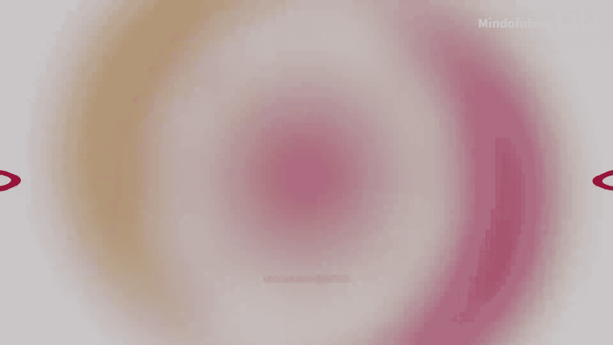
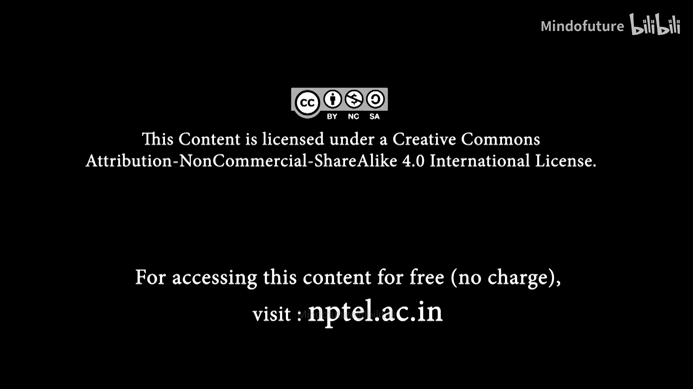
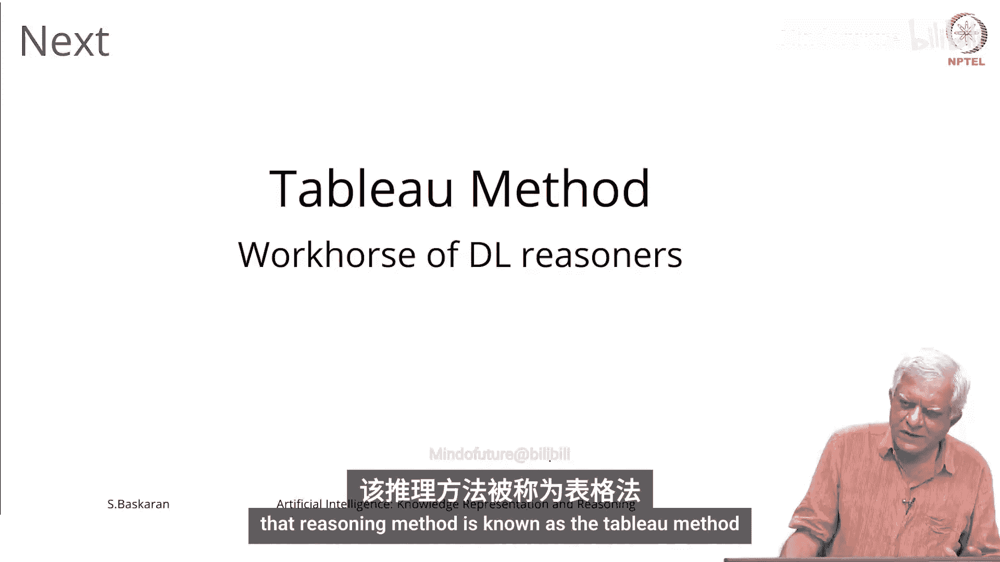

知识表示与推理：P72：描述逻辑示例

在本节课中，我们将通过一系列具体示例，深入探讨描述逻辑如何用于表示和定义概念及其关系。我们将学习如何使用描述逻辑的构造子来组合概念，并理解开放世界假设与封闭世界假设在推理中的关键区别。

---

上一节我们介绍了描述逻辑的基本概念，本节中我们来看看如何运用这些构造子来定义具体的概念。

描述逻辑本质上是名词短语的逻辑，它允许我们描述概念以及概念之间的关系。例如，“勤奋的学生”这个概念，可以通过“勤奋的”和“学生”这两个概念的**交集**来定义。

以下是使用描述逻辑构造子定义新概念的一些基本方式：
*   **交集**：`EagerStudent ≡ Eager ⊓ Student`
*   **并集**：`BusOrCar ≡ Bus ⊔ Car`
*   **补集**：`NotElectric ≡ ¬Electric`

在描述逻辑中，我们先定义一些**原始概念**，然后基于这些原始概念来定义新的复合概念。这与一阶逻辑不同，一阶逻辑中的谓词名称本身没有预设含义。描述逻辑的目标是建立一个共享的词汇表，确保所有使用者对概念的理解是一致的。

---

理解了基本概念定义后，我们来看看如何描述更复杂的关系，特别是涉及量词的角色限制。

我们可以使用存在量词和全称量词来定义与关系相关的概念。例如，“拥有汽车的人”可以定义为“人”与“至少拥有一辆汽车”的交集。

以下是几个使用角色限制定义概念的示例：
*   **拥有至少一辆电动汽车的人**：`Person ⊓ ∃owns.ElectricCar`
*   **只拥有电动汽车的人**：`Person ⊓ ∀owns.ElectricCar`
*   **拥有带电池的物品的人**：`Person ⊓ ∃owns.(∃hasPart.Battery)`

---

在定义概念时，子类声明与等价声明有重要区别。子类声明是单向的，而等价声明是双向的，这使我们能够对概念进行精确分类。

如果我们说 `Car ⊑ (≥4 hasWheel) ⊓ (≤4 hasWheel)`，这只是声明“汽车是至少有4个轮子且至多有4个轮子的东西”。但如果我们说 `Car ≡ (≥4 hasWheel) ⊓ (≤4 hasWheel)`，则是在定义“汽车就是恰好有四个轮子的东西”。等价声明建立了双向关系，使我们能够根据定义对个体进行分类。

---

描述逻辑中的角色（关系）本身也可以被赋予属性，这有助于更精确地刻画领域知识。

我们可以为角色指定定义域和值域，或者声明其具有对称性、传递性等特性。

以下是关于角色属性的几个示例：
*   **定义域与值域**：`∃attends.⊤ ⊑ Student`（定义域：参加者都是学生）；`⊤ ⊑ ∀attends-.Lecture`（值域：被参加的只能是讲座，这里使用了逆角色 `attends-`）
*   **逆角色**：`hasParent ≡ hasChild-`
*   **角色包含**：`hasGrandchild ≡ hasChild ◦ hasChild`
*   **角色特性**：`Sibling ≡ Sibling-`（对称性）；`Sibling ◦ Sibling ⊑ Sibling`（传递性）；`¬∃x.Sibling(x, x)`（反自反性，即自己不能是自己的兄弟）

---

在逻辑推理中，一个根本性的区别是开放世界假设与封闭世界假设。描述逻辑遵循开放世界假设。

考虑一个知识库，其中陈述了“Lucy喜欢苹果”和“Lucy喜欢橙子”，但没有其他关于她喜好的信息。在遵循**封闭世界假设**的数据库查询中，如果我们查询“只喜欢水果的人”，系统可能会返回Lucy，因为它假设已知信息是完整的。然而，在遵循**开放世界假设**的描述逻辑中，我们**不能**推断出“Lucy只喜欢水果”，因为可能存在我们尚未知晓的事实（例如，Lucy也可能喜欢手机）。因此，“Lucy只喜欢水果”这个陈述在开放世界下为假。

我们将在后续课程中探讨一种称为**默认推理**的方法，它允许在开放世界下得出可废止的结论，这些结论在未来可能被新信息推翻。

---

本节课中我们一起学习了描述逻辑的具体应用。我们通过示例看到了如何使用交集、并集、量词限制等构造子来定义复杂概念，区分了子类声明与等价声明的不同，了解了如何为角色赋予属性，并重点讨论了开放世界假设对逻辑推理的根本影响。下一节，我们将开始学习描述逻辑中一种重要的推理方法——Tableau算法。