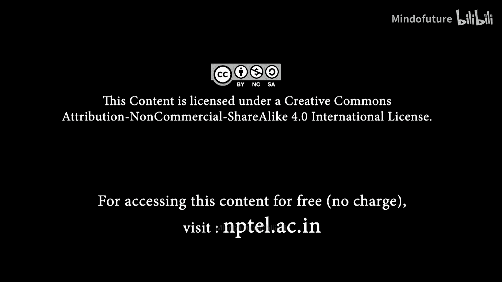
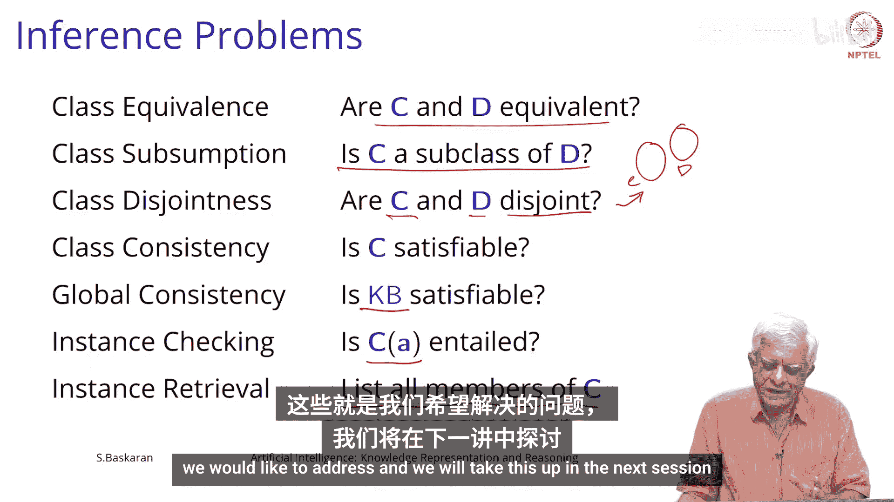

# 073：ALC 表算法

在本节课中，我们将学习描述逻辑中的推理过程，特别是针对 **ALC** 逻辑的 **表算法**。我们将了解如何将知识库中的语句转换为适合算法处理的**否定范式**，并理解表算法如何通过寻找模型来验证概念的可满足性或推导蕴含关系。

---

## 概述

上一节我们介绍了描述逻辑的基本概念和构造方式。本节中，我们来看看如何进行推理。我们将重点介绍**表算法**，这是一种模型检查方法，用于判断描述逻辑中的概念是否可满足，或知识库是否蕴含某个结论。

## 从语句到概念

在描述逻辑中，我们关心的语句主要有两类：**包含关系**（C ⊑ D）和**实例关系**（a : C）。为了使用表算法进行推理，我们需要先将包含关系语句转换为一个特定的概念形式。

*   **包含关系转换**： 语句 **C ⊑ D** 可以转换为概念 **¬C ⊔ D**。从语义上看，这个转换是合理的，因为“所有C的实例都是D的实例”等价于“不存在是C的实例但不是D的实例的个体”，即“所有个体要么不是C的实例，要么是D的实例”。
*   **等价关系转换**： 语句 **C ≡ D** 可以转换为两个包含关系：**C ⊑ D** 和 **D ⊑ C**。

## 否定范式

表算法要求所有概念都处于**否定范式** 中。在否定范式中，否定符号（¬）只直接出现在原子概念之前。将任意概念转换为NNF的规则如下：

以下是转换规则列表：
*   ¬⊤ 转换为 ⊥。
*   ¬⊥ 转换为 ⊤。
*   原子概念 A 的 NNF 是 A 本身。
*   ¬A 的 NNF 是 ¬A（原子概念的否定保持不变）。
*   ¬¬C 的 NNF 是 C 的 NNF。
*   对于合取与析取，否定需要内推，并遵循德摩根定律：
    *   ¬(C ⊓ D) 的 NNF 是 (¬C) ⊔ (¬D) 的 NNF。
    *   ¬(C ⊔ D) 的 NNF 是 (¬C) ⊓ (¬D) 的 NNF。
*   对于角色限制，否定内推时量词会翻转：
    *   ¬(∃R.C) 的 NNF 是 (∀R.(¬C)) 的 NNF。
    *   ¬(∀R.C) 的 NNF 是 (∃R.(¬C)) 的 NNF。

**转换示例**：
假设我们有概念 ¬(A ⊓ ¬(∃R.B))。
1.  首先，将外层否定作用于合取：¬A ⊔ ¬¬(∃R.B)。
2.  消除双重否定：¬A ⊔ (∃R.B)。
3.  ¬A 已是NNF，(∃R.B) 也是NNF。
4.  因此，最终NNF为：**¬A ⊔ (∃R.B)**。

## 可满足性与蕴含

在描述逻辑的语义中，我们基于**解释** 来定义真值。一个解释 I 为每个概念分配一个域中的集合，为每个角色分配一个二元关系。

*   **可满足性**： 如果存在一个解释 I，使得概念 C 对应的集合不是空的（即 **C^I ≠ ∅**），则称概念 C 是**可满足的**。如果知识库 KB 存在一个模型（即满足其中所有语句的解释），则 KB 是可满足的。
*   **蕴含**： 如果知识库 KB 的**每一个**模型也都是语句 α 的模型，则称 **KB 蕴含 α**（记作 KB ⊨ α）。

为了证明 KB ⊨ α，我们可以采用反证法：将 **¬α** 加入 KB，然后检查新的知识库 **KB ∪ {¬α}** 是否**不可满足**。如果不可满足，则原蕴含关系成立。这正是表算法和之前学过的归结反驳法的核心思想。

## 表算法原理

表算法是一种**模型构造算法**。其基本思想如下：
1.  给定一个待检查的概念 C（或一组公理），算法试图为 C 构建一个模型。
2.  算法从包含初始个体（标记为属于概念 C）的图开始。
3.  通过应用一组**扩展规则**，算法系统地添加新的个体和标签，以尝试满足概念定义中的所有约束（例如存在量词 ∃R.C 要求存在一个通过角色 R 关联的个体属于 C）。
4.  如果在扩展过程中出现**显式矛盾**（例如同一个体被标记为同时属于 A 和 ¬A），则当前分支封闭，表示此路径无法构造出模型。
5.  如果所有分支都因矛盾而封闭，则概念 C **不可满足**。如果至少有一个分支能完成扩展而不产生矛盾，则该分支描述了一个模型，证明概念 C **可满足**。

**应用于蕴含检查**： 要检查 KB ⊨ (C ⊑ D)，我们检查概念 **C ⊓ ¬D** 相对于 KB 是否不可满足。如果不可满足，则蕴含成立。

## 可回答的推理问题

基于表算法，我们可以解决描述逻辑中的多种推理问题：

以下是主要的推理问题类型：
*   **概念包含**： C 是 D 的子类吗？（C ⊑ D?）
*   **概念等价**： C 和 D 等价吗？（C ≡ D?）
*   **概念可满足性**： 概念 C 是可满足的吗？（是否存在实例？）
*   **知识库可满足性**： 整个知识库 KB 是一致的吗？
*   **实例检查**： 个体 a 是概念 C 的实例吗？（KB ⊨ a : C?）
*   **实例检索**： 找出知识库中所有属于概念 C 的个体。

## 总结

本节课我们一起学习了描述逻辑 **ALC** 的推理基础。我们了解了如何将包含语句转换为概念，以及如何将概念转换为适合算法处理的**否定范式**。我们明确了**可满足性**和**蕴含**的语义定义，并介绍了**表算法**的基本原理——通过尝试构造模型来判定可满足性。最后，我们列举了利用表算法可以解决的一系列核心推理问题。下一节，我们将深入表算法的具体规则和步骤。