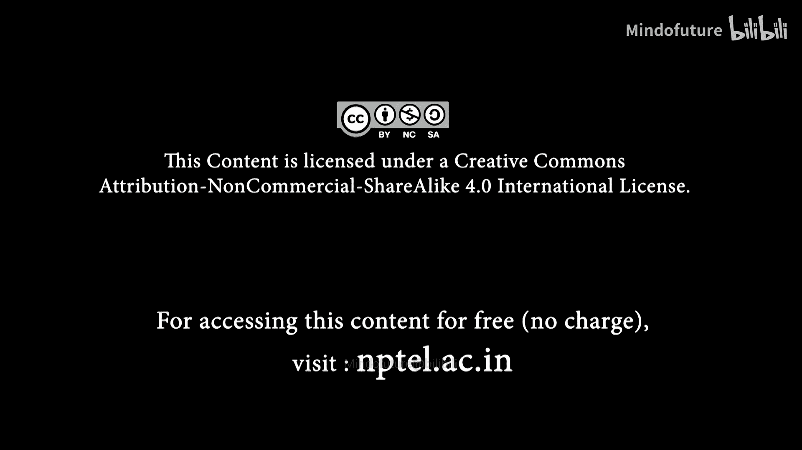
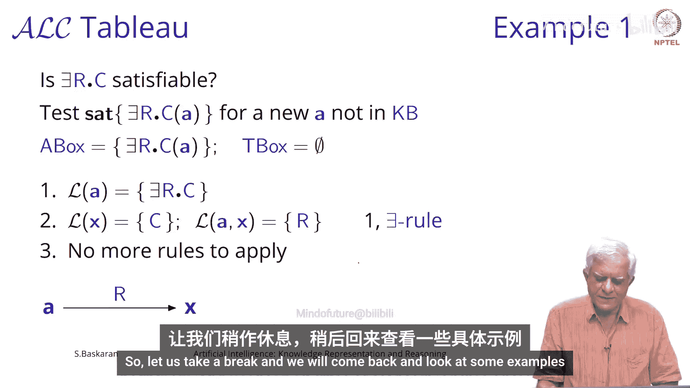

# 074：ALC中的模型检查

## 概述
在本节课中，我们将学习如何使用模型检查（Model Checking）来解决描述逻辑ALC中的一系列推理问题。我们将重点介绍如何将概念等价、包含、互斥、一致性等复杂问题，转化为可计算的公式检查问题，并学习一种名为“Tableau”的算法来执行这些检查。

---

## 从推理问题到公式检查
上一节我们列出了描述逻辑中需要解决的关键推理问题。本节中，我们来看看如何将这些逻辑问题转化为具体的公式检查任务。

以下是几个核心推理问题及其对应的逻辑公式检查方法：

1.  **概念等价检查**
    要判断概念C是否等价于概念D，即 `C ≡ D`，需要证明以下两个陈述都是知识库KB的逻辑结论：
    *   `KB ⊨ C ⊑ D`
    *   `KB ⊨ D ⊑ C`
    因此，等价性问题可以分解为两个包含（Subsumption）检查。

2.  **概念包含检查**
    要判断概念C是否被概念D包含，即 `C ⊑ D`，这是一个核心问题。我们将其转化为检查公式 `C ⊓ ¬D` 是否不可满足。
    *   逻辑原理：`KB ⊨ C ⊑ D` 当且仅当 `KB ∪ { (C ⊓ ¬D)(a) }` 不可满足，其中 `a` 是一个新个体。
    *   直观理解：如果C完全在D内部（被D包含），那么C与“非D”部分的交集必然是空的。如果存在一个个体同时属于C和“非D”，则说明C没有被D完全包含。

3.  **概念互斥检查**
    要判断两个概念C和D是否互斥（不相交），即 `C ⊓ D ⊑ ⊥`，需要证明知识库蕴含它们的交集为空。
    *   方法：假设存在个体 `a` 同时属于C和D（即 `(C ⊓ D)(a)`），然后检查知识库加入此假设后是否变得不可满足。如果不可满足，则证明不存在这样的个体，即C和D互斥。

4.  **知识库全局一致性检查**
    要判断整个知识库是否一致（即是否存在一个模型），只需检查是否存在至少一个个体。
    *   方法：引入一个新个体 `a`（不在知识库中提及），检查知识库本身是否可满足。如果可满足，则知识库全局一致。

5.  **概念一致性检查**
    要判断一个概念C本身是否一致（即非空），需要证明C不是空集。
    *   方法：检查 `C ⊑ ⊥`（即C是空集）**不是**知识库的逻辑结论。等价地，检查 `C(a)`（`a`为新个体）与知识库是否可满足。如果可满足，则C一致；如果不可满足，则C不一致。

6.  **实例检查**
    要判断个体 `a` 是否属于概念C，即 `KB ⊨ C(a)`。
    *   方法：将 `¬C(a)` 加入知识库，检查结果是否不可满足。如果不可满足，则原结论成立。

7.  **实例检索**
    要找出所有属于概念C的个体，需要收集知识库中所有满足 `KB ⊨ C(a)` 的个体 `a`。

---

## Tableau算法基础
类似于命题逻辑中的Tableau方法，描述逻辑的Tableau算法也通过应用一系列扩展规则来构建模型，以检查公式的可满足性。

算法从一个包含所有ABox断言的根节点开始，不断应用扩展规则。目标是构建一个完整的、无冲突的图（称为完成图），它对应一个模型。如果所有分支都因冲突而关闭，则原公式不可满足。

以下是算法的核心组件：

*   **完成图**：一个带标签的有向图 `G = (V, E, L)`。
    *   `V`：节点（个体或变量）集合。
    *   `E`：边（角色断言）集合。
    *   `L`：为每个节点和边分配标签的函数。
        *   节点标签 `L(x)`：一个概念集合，表示个体 `x` 属于这些概念。
        *   边标签 `L(<x, y>)`：一个角色集合，表示 `x` 和 `y` 之间存在这些角色关系。

*   **冲突**：当一个节点的标签集合同时包含某个概念及其否定（如 `A` 和 `¬A`），或包含底概念 `⊥` 时，发生冲突。该分支被视为关闭。

*   **算法流程**：
    1.  将所有公式转换为否定范式。
    2.  初始化完成图，包含ABox中的所有个体和断言。
    3.  对图中的所有个体应用TBox公理（通用规则）。
    4.  系统地应用扩展规则。
    5.  如果分支出现冲突，则回溯尝试其他分支。
    6.  如果找到一个无冲突且无法再应用规则的完整分支，则公式可满足。
    7.  如果所有分支都关闭，则公式不可满足。

---

## Tableau扩展规则
以下是ALC中关键的Tableau扩展规则。每个规则都旨在根据逻辑含义分解复杂概念，逐步消除运算符。

**合取规则**
如果节点 `x` 的标签集合包含 `C ⊓ D`，但未同时包含 `C` 和 `D`，则将 `C` 和 `D` 都加入 `x` 的标签集合。
*   **公式**：若 `C ⊓ D ∈ L(x)`，且 `{C, D} ⊈ L(x)`，则令 `L(x) = L(x) ∪ {C, D}`。
*   **逻辑依据**：`x ∈ (C ⊓ D)` 意味着 `x ∈ C` 且 `x ∈ D`。

**析取规则**
如果节点 `x` 的标签集合包含 `C ⊔ D`，但既不包含 `C` 也不包含 `D`，则创建两个分支：一个将 `C` 加入 `x` 的标签，另一个将 `D` 加入。
*   **公式**：若 `C ⊔ D ∈ L(x)`，且 `{C, D} ∩ L(x) = ∅`，则创建两个分支，分别令 `L(x) = L(x) ∪ {C}` 和 `L(x) = L(x) ∪ {D}`。
*   **逻辑依据**：`x ∈ (C ⊔ D)` 意味着 `x ∈ C` 或 `x ∈ D`（或两者）。

**存在量词规则**
如果节点 `x` 的标签集合包含 `∃R.C`，并且当前不存在一个通过角色 `R` 与 `x` 相连、且标签包含 `C` 的节点 `y`，则创建一个新节点 `y`，添加边 `<x, y>` 并标记为 `R`，并将 `C` 加入 `y` 的标签。
*   **公式**：若 `∃R.C ∈ L(x)`，且不存在 `y` 使得 `R ∈ L(<x, y>)` 且 `C ∈ L(y)`，则：
    *   创建新节点 `y`。
    *   令 `L(<x, y>) = {R}`。
    *   令 `L(y) = {C}`。

**全称量词规则**
如果节点 `x` 的标签集合包含 `∀R.C`，并且存在一个通过角色 `R` 与 `x` 相连的节点 `y`，且 `C` 不在 `y` 的标签中，则将 `C` 加入 `y` 的标签。
*   **公式**：若 `∀R.C ∈ L(x)`，且存在 `y` 使得 `R ∈ L(<x, y>)` 且 `C ∉ L(y)`，则令 `L(y) = L(y) ∪ {C}`。
*   **逻辑依据**：`∀R.C` 表示所有通过角色 `R` 与 `x` 相连的个体都必须属于 `C`。

**TBox规则**
对于知识库中的每个TBox公理 `C ⊑ D`（等价于 `¬C ⊔ D`），以及图中的每个节点 `x`，如果 `(¬C ⊔ D)` 不在 `x` 的标签中，则将其加入。
*   **公式**：对于每个 `C ⊑ D ∈ TBox` 和每个节点 `x ∈ V`，若 `(¬C ⊔ D) ∉ L(x)`，则令 `L(x) = L(x) ∪ {¬C ⊔ D}`。
*   **逻辑依据**：TBox公理是全局性的，适用于论域中的所有个体。

---

## 阻塞机制
在应用存在量词规则时，可能会无休止地创建新节点，导致算法无法终止。

例如，假设TBox包含公理 `⊤ ⊑ ∃R.C`（即每个个体都有一个 `R` 关系的、属于 `C` 的后继）。从个体 `a` 开始，规则会创建 `x1`，然后对 `x1` 应用规则创建 `x2`，依此类推，形成无限链。

为了防止这种情况，我们引入**阻塞**机制：
*   一个节点 `y` 被节点 `x` **阻塞**，如果：
    1.  `y` 不是ABox中的命名个体。
    2.  `x` 是 `y` 的祖先节点。
    3.  `y` 的标签集合 `L(y)` 是 `x` 的标签集合 `L(x)` 的子集。
*   如果一个节点被阻塞，则不再对其应用可能创建新后继的扩展规则（如存在量词规则）。
*   这确保了Tableau算法的终止性，因为标签集合是有限的，无限链中必然会出现标签集合重复或包含的情况。

---

## 总结
本节课我们一起学习了在描述逻辑ALC中进行模型检查的核心方法。我们首先将各种推理问题（如包含、等价、一致性）统一转化为公式的可满足性检查问题。接着，我们深入探讨了Tableau算法，这是一种通过系统应用扩展规则（合取、析取、存在、全称、TBox规则）来构建可能模型，从而判定可满足性的算法。最后，我们了解了阻塞机制，它是确保Tableau算法在处理包含循环公理的知识库时能够终止的关键技术。掌握这些内容，是使用计算工具进行知识库推理的基础。