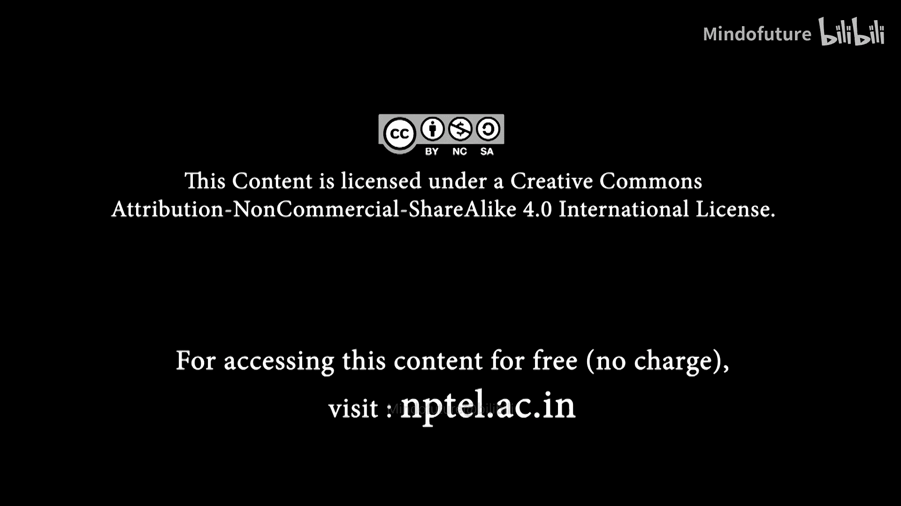
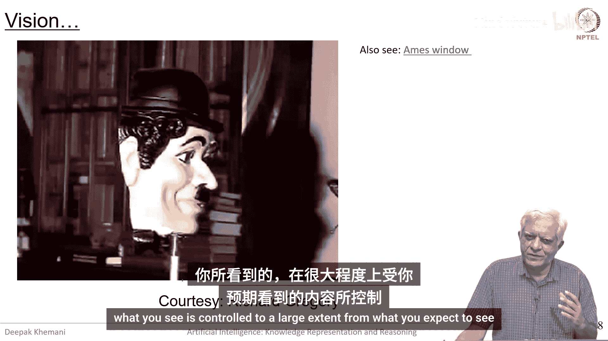
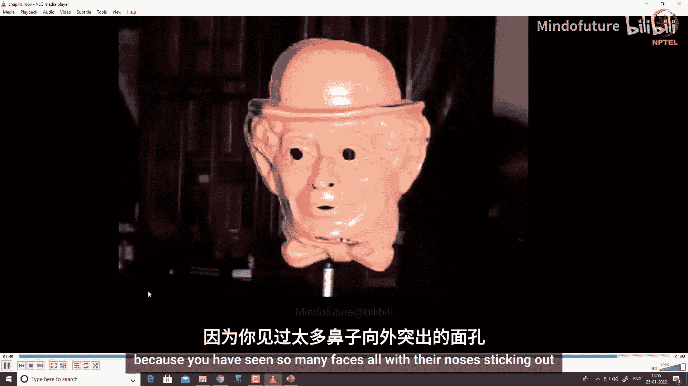
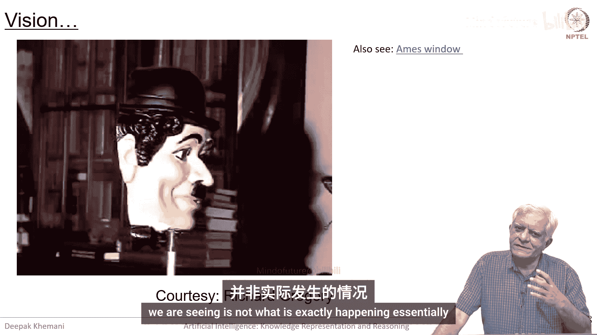
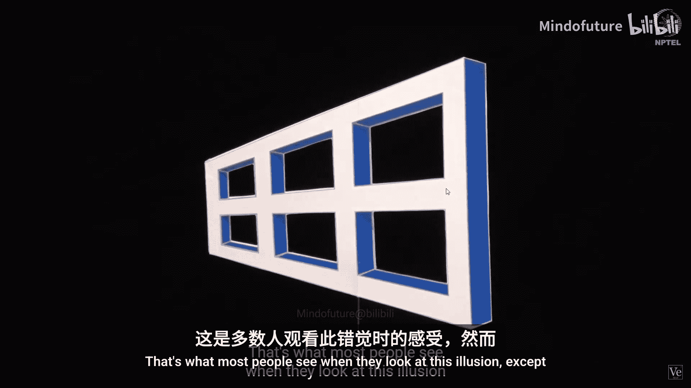
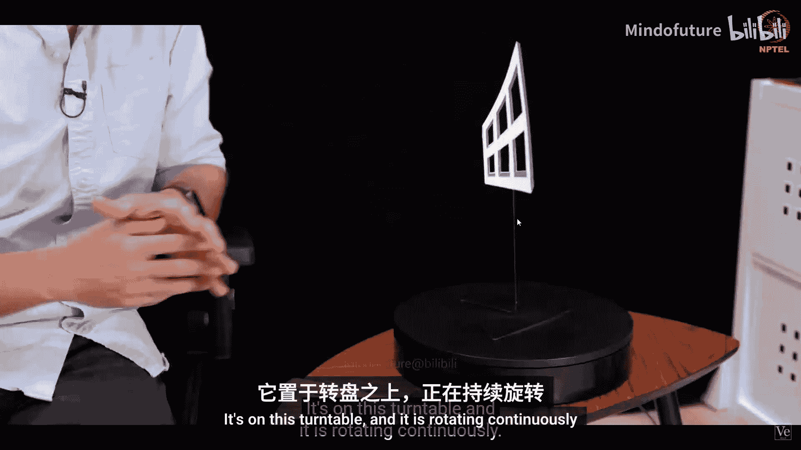
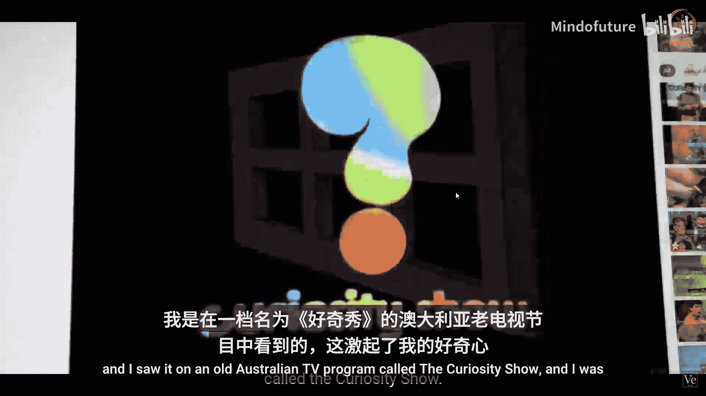
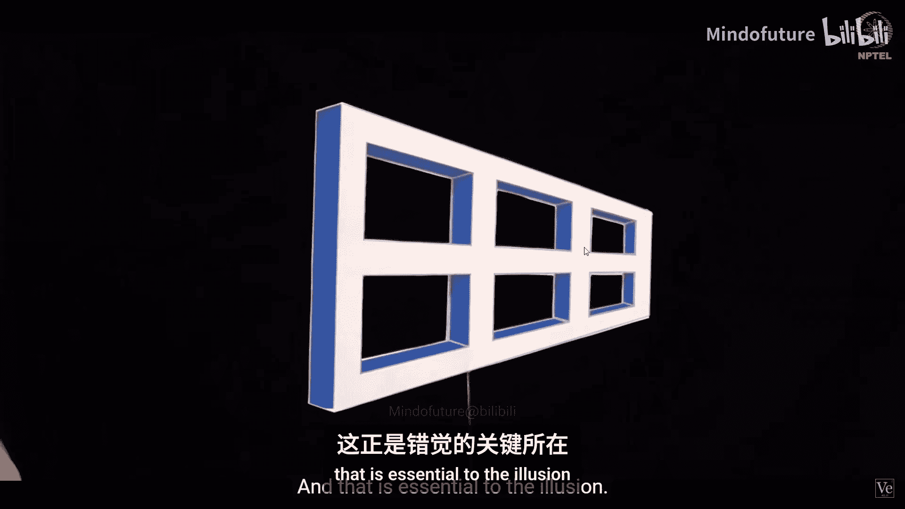
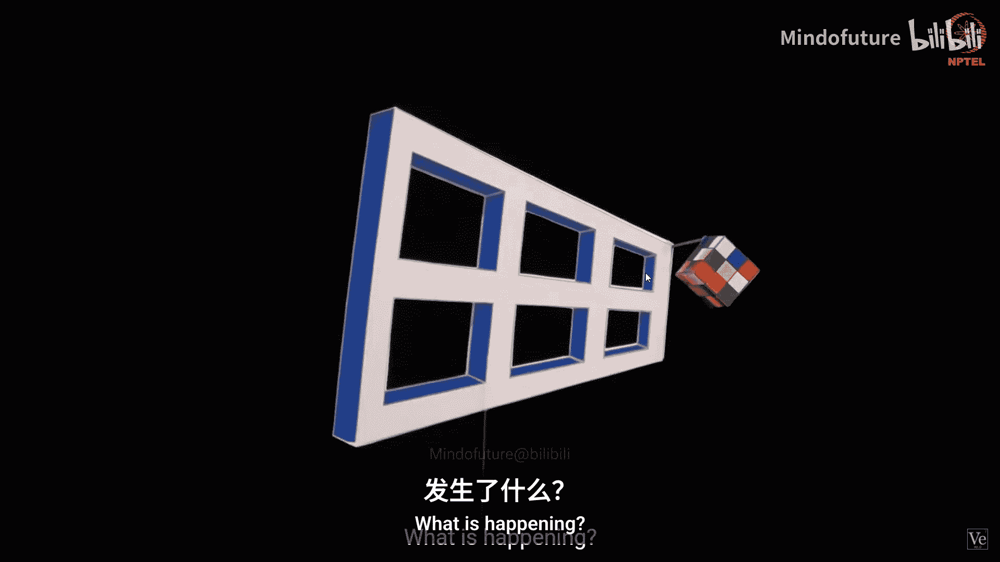
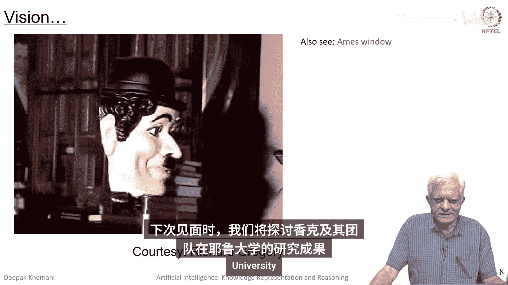

# 075：语言无关的表示

在本节课中，我们将探讨知识表示中一个核心问题：谓词的选择。我们将了解为何依赖自然语言词汇来定义谓词可能存在问题，并介绍一种旨在超越特定语言、基于概念本身的表示方法——概念依存理论。我们还将通过视觉错觉的例子，理解“自上而下”的理解过程如何影响我们的感知。

## 概述：谓词选择的重要性

在之前的课程中我们多次强调，谓词的选择至关重要。逻辑学家可能更关注定理证明策略等问题，但从知识表示的角度看，谓词的选用极为关键。

让我们回顾一下之前提到的一些观点。随意选择谓词会迫使你添加与之配合工作的规则。因为如果你要在知识库中添加谓词，这些谓词唯一的作用就是有规则能对它们进行操作，从而允许你进行推理。你选择的谓词越多，你需要添加的规则就越多。

这基本上意味着，如果你使用英语，那么从英语中随意选择谓词是没有意义的，因为你需要为每一个这样的谓词编写规则。我们曾看到，可以使用像WordNet这样的工具将其转换为同义词，但那是另一种方法。

我们现在要探讨的是：能否定义一个独立于自然语言术语的概念领域？我们定义的谓词在某种意义上不是英语的。我们已经说过，谓词使用的名称无关紧要，因为我们可以为任何谓词赋予任何解释。

但现在我们看到的是：探索概念世界，并选择一组规范的谓词，使你能够用这组谓词表达其他一切。我们能构想出这样一组谓词吗？

正如我之前所说，Roger Schank和他的团队在20世纪70年代中期于耶鲁大学在这方面做了大量工作，他们发展出了所谓的**概念依存理论**。它拥有一组非常少的谓词，接下来我们将快速了解一下。

由于各种原因，这种方法未能持续流行，主要是因为它是非常手工作业密集型的，需要有人坐下来完成所有工作。但最终，如果你想获得知识表示的好处，就必须以某种方式投入其中。当然，我们可以尝试学习或教学方法，用我们定义的谓词来教会机器单词的含义，但这留待以后讨论。现在，让我们试着看看这个整体想法是如何运作的。

## 理解与感知：自上而下的过程

Roger Schank及其耶鲁团队的工作重点是理解自然语言故事。他们的想法是阅读英语材料并理解它（我们将看到“理解”的含义），并能够据此回答问题。

用语言无关的格式表示你所阅读的内容有一个优势：如果你想从中生成语言，你可以为不同语言放置生成器。例如，你可以阅读一段英文文本，将其转换为概念依存理论表示，然后如果你有印地语生成器，就可以生成印地语。这是一个中间语言的想法，即一种对多种语言通用的表示形式，但最近这种方法又不再流行，因为在许多领域，使用平行文本语料库已被证明是有效的。

当我们说“理解”时，基本上指的是感知意义上的理解，即理解某些输入的含义，而不仅仅是给它贴标签。这意味着为你所看到、听到或阅读的内容创建一种内部表征。你可以在自然语言理解、语音理解、语言理解中做到这一点。

该小组提出的论点是：理解具有很强的自上而下成分，它涉及将信息映射到预先构想的概念中，而不是自下而上的数据驱动方法。实际上，你头脑中已经具备了你能理解的东西，问题只是将传入的信息映射到那些内部表征中。

我们之前见过这个例子，所以不再赘述，只是将其保留在幻灯片中供大家复习。基本上，这是一个关于约翰和玛丽的故事，随着对话进行，听者会产生一些期望。我们列出了期望可能来自各种来源：语言句法、人们说话的含义、对话发生的语境、会话规则（例如人们出于某种原因交谈）、我们对世界的了解、你对对方的了解以及文化规范（因为不同文化有不同的互动方式）。

然后我们说过，如果他说“换个话题，哦，我想去吃鱼”，你会非常惊讶。我们也观察到，笑话常常利用这种对期望的违反。因此，自上而下理解的整体思想是：当你获取信息时，你正在处理它并生成对接下来内容的期望。当你看到你期望的东西时，在某种意义上，你不断添加信息。

接下来，我们将通过一个例子来具体说明这一点。

## 视觉错觉：期望如何塑造感知

这里有一个小视频，由Richard Gregory提供，它说明了这样一个事实：你在很大程度上看到的东西受你期望看到的东西控制。

这是一个查理·卓别林的面具，这个面具是一个空心面具，它将围绕垂直轴旋转。Gregory解释了那里发生的情况：这个空心头实际上此刻是一个完全正常的卓别林头像，但是等等，当它转过来时，你会看到它是空心的，现在转过来的背面实际上是一个空心面具。它开始向相反方向旋转。令人惊讶的是，鼻子凸出来了，尽管它实际上是凹进去的。现在转过来的是正常的、正确的脸。再等等，当它转过来时，你会看到这种像杰基尔与海德一样的奇特现象：两个鼻子都凸出来，因为鼻子凹进去、脸是空心的可能性太小了，所以你把它看成凸面的，尽管事实上它是凹面的。然后它会再次变成正常的脸。注意，一旦特征出现在空心内部，它看起来就会是凸面的，就像一张正常的脸，尽管它不是。一旦特征出现，你的大脑就拒绝将其视为空心的，仅仅因为这太不可能了。这展示了自上而下知识的巨大力量，它实际上可以对抗来自感官的自下而上的信号，并迫使产生一种非凡的错觉，其中当前的感官信息被来自过去的巨大知识所对抗，因为你见过太多鼻子凸出来的脸了。

还有一个关于“艾姆斯窗”的网站，讨论了类似的错觉。错觉的整体思想是：我们对自己所看到的东西有某些期望，有时我们拒绝接受我们所看到的并非完全真实的情况。

让我倒回一点。这是一个三部分错觉的第一部分。你看到了什么？嗯，有一扇窗户在转动，但它会停下来并反转方向。所以窗户在来回摆动。这是大多数人在看这个错觉时看到的，但这不是窗户实际在做的事情。它在这个转盘上，并且是连续旋转的。这被称为艾姆斯窗错觉。窗户本身不是矩形，而是梯形。你可以看到这边比那边短得多，这对错觉至关重要。同时，它被着色以看起来是3D的，但实际上它只是一张二维卡片，两面图像相同。现在你完全知道这个物体是什么样子以及它在做什么，你能正确感知旋转而不是摆动吗？我仍然不能。我的大脑仍然觉得这扇窗户在来回移动。

好吧，我有个主意。我要把这个魔方贴在梯形的短边上，这样我们就能在它转动时跟踪它。准备好了吗？好的，魔方在转圈，一切看起来正常。但现在那是什么，看起来魔方在继续转圈，但窗户在来回摆动。魔方转到后面去了，我甚至不知道发生了什么。哇，看那个，看起来魔方自己漂移出来，漂到了整个错觉的前面。发生了什么？

好吧，新计划，我要取下魔方。

好的，我们回来了，这应该能让你对我们的思维如何影响我们所看到的东西有一些了解。

## 总结

本节课我们一起探讨了知识表示中谓词选择的核心问题。我们了解到，依赖自然语言词汇定义谓词可能导致需要大量人工编写规则，因此引入了一种语言无关的表示方法——概念依存理论。通过视觉错觉的例子，我们深刻体会到“自上而下”的理解过程如何主导我们的感知，即我们已有的知识和期望会强烈影响我们对输入信息的解释。下次课，我们将具体了解Schank及其团队在耶鲁大学所做的研究工作。