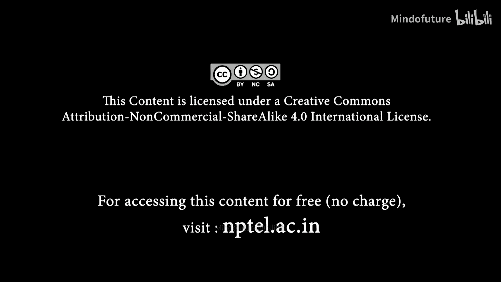
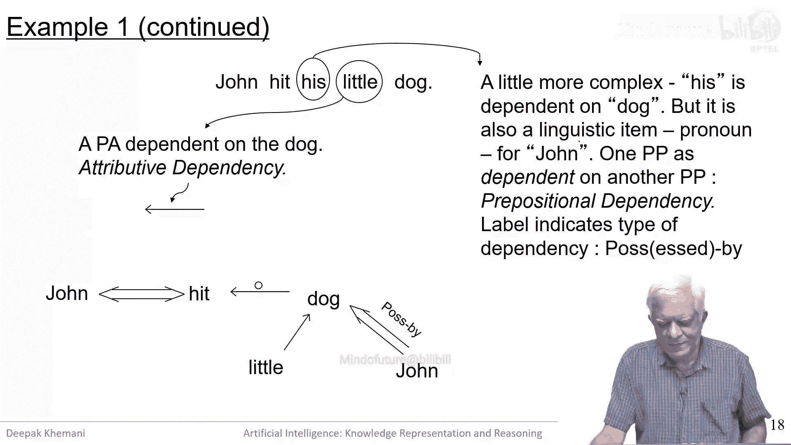

# 076：概念依从理论 🧠

在本节课中，我们将学习概念依从理论。这是一种由Roger Shank及其团队开发的知识表示方案，旨在用一小套基础谓词来表示日常行为，为自然语言提供一个语义基础。

## 概述

概念依从理论的核心目标是理解自然语言故事。它通过将句子翻译成一套定义好的基础动作和状态来表示其含义。理解是否成功，可以通过程序能否回答关于故事的问题来验证。该理论为不同的句子，只要含义相同，提供一种**唯一的、规范的表示形式**。

## 基本概念

上一节我们介绍了概念依从理论的目标。本节中，我们来看看其基本构成单元。

该理论的基本单位是 **概念化**，它类似于逻辑中的合式公式。一个概念化由概念以及概念之间的关系构成。

以下是概念的主要类型：
*   **名词性概念**：也称为“图像生产者”，代表物体和人（如“彼得”、“狗”）。
*   **动作概念**：也称为“行为”，代表名词性概念执行的动作（如“划船”、“打”）。
*   **修饰符**：为概念提供额外信息，包括修饰名词的“图像辅助器”（如形容词“小的”）和修饰动作的“行为辅助器”（如副词“快速地”）。

名词和动作可以作为独立概念存在，而修饰符则**依赖于**一个主导概念（如形容词必须修饰某个名词）。

## 概念依赖关系

我们了解了概念的类型，现在来探讨它们如何相互关联。

Roger Shank将概念化定义为一组概念关系，其中至少存在一种双向依赖关系，这种关系描述了世界的某些信息。概念依赖理论定义了一小套基础动作（最初有11或14个），可以用类似逻辑的语法描述，也可以用**概念图**进行图形化描绘。

以下是该理论的关键特征：
*   它使用一小套**状态谓词**和**概念动作**作为原语。
*   所有其他含义都用这些原语来描述。
*   其研究目的是通过将故事表达为CD动作和状态来“理解”自然语言故事。

## 应用与程序

概念依赖理论不仅是一个理论框架，还催生了许多实践程序。以下是Shank团队开发的一些代表性程序：
*   **ELI**：英语语言解释器，一个将英语转换为CD理论的语义分析器。
*   **MARGIE**：基于输入句子的含义进行推理的程序（注意，这不是逻辑演绎，而是基于含义的推断）。
*   **BABEL**：将CD输出转换回英语的程序。
*   **SAM**：脚本应用机制，利用“脚本”这种表示刻板情景的结构来理解故事。
*   **FRUMP**：通过脚本理解故事并生成摘要的程序。
*   **PAM**：计划应用机制，能够对目标、计划和行动进行推理。
*   **POLITICS**：能从自由派或保守派视角推理政治故事中主观目标的程序。
*   **QUALM**：专注于理解问题意图并给出恰当答案的程序。
*   **TALESPIN**：一个能用英语生成故事的程序。
*   **BORIS**：一个整合了多项技术、能够理解相当复杂故事的大型程序。
*   **CYRUS**：一个模拟情景记忆的程序，其关于动态记忆的研究催生了“基于案例的推理”领域。

## 表示原则与示例

前面我们看到了概念依从理论的应用。本节我们通过一个具体例子，来学习其表示句子的基本原则。

概念依赖理论表示句子含义的基本思想是：为不同语言中含义相同的句子提供**唯一的规范表示**。任何句子中隐含的信息，都必须通过推理在表示中**显式化**。

概念化主要分为两类：
1.  **主动概念化**：涉及行动者、动作、对象和方向感。用双箭头表示，例如：`John ->(PTRANS)-> 球`（表示“约翰移动了球”）。
2.  **状态概念化**：描述对象所处的状态。用三向箭头表示，例如：`John <-(HEALTH)-> 健康`（表示“约翰是健康的”）。

让我们以句子“**John hit his little dog**”为例，构建其概念化表示。

以下是构建此表示的关键步骤：
1.  “John”和“dog”是**名词性概念**（图像生产者）。
2.  “hit”是一个**动作概念**。
3.  “John”与动作“hit”之间存在**双向依赖**：John是“打”这个动作的施事者。
4.  “dog”与动作“hit”之间存在**对象依赖**：狗是“打”这个动作的对象。
5.  “little”是一个**修饰符**（图像辅助器），作为“dog”的一个属性，体现**属性依赖**。
6.  “his”是一个代词，指代“John”，体现**所有格依赖**，表明狗为John所拥有。

这个例子目前仍使用英语单词作为动作，但概念依从理论的核心在于最终使用其定义的那一小套基础动作原语来描述所有行为。

## 总结

本节课中，我们一起学习了概念依从理论。我们了解到它是一种旨在为自然语言提供语义基础的知识表示方案，通过一小套定义好的原语动作和状态来表示含义。我们探讨了其基本构成单元“概念化”，区分了名词性概念、动作概念和修饰符，并通过“John hit his little dog”的例子，演示了如何利用依赖关系（如施事依赖、对象依赖、属性依赖）来构建句子的图形化表示。该理论强调为相同含义提供唯一规范表示，并将隐含信息显式化，其思想在早期的自然语言理解程序中得到了广泛应用。