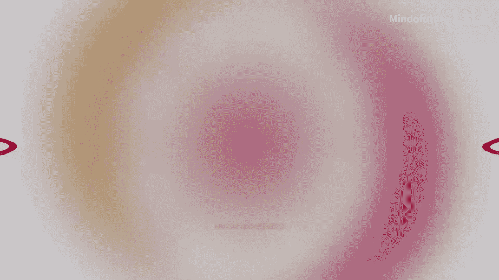
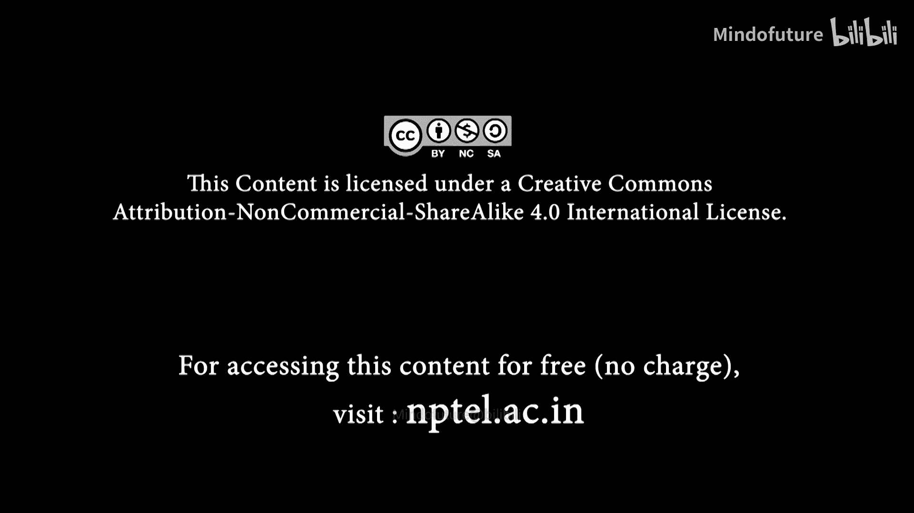
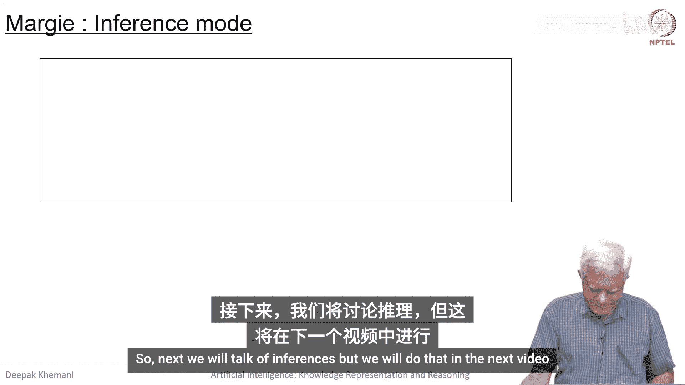

# 077：概念依赖状态变量

在本节课中，我们将继续学习概念依赖理论，重点探讨如何构建概念依赖关系，并引入一个核心工具——状态变量。我们将了解如何用一组紧凑的谓词和变量值来描述复杂的状态和情感。

上一节我们介绍了概念依赖的基本构成，本节中我们来看看概念之间具体的构建方式。

## 概念依赖的构建方式

概念依赖通过多种方式将不同元素联系起来，以表达自然语言句子的含义。

以下是概念之间主要的依赖关系类型：

*   **施事者与动作**：一个图像制造者可以执行一个动作。
*   **图像制造者与属性**：图像制造者可以拥有属性。例如，“玫瑰是红色的”可以用 `PP(rose) <-- ATTR(red)` 表示。
*   **动作与对象**：动作可以作用于一个对象。
*   **动作与方向**：对于移动类动作，可以指定源位置和目的位置。
*   **动作与接收者**：动作可以有一个接收者。例如，“我给你书”涉及书从“我”转移到“你”。
*   **动作与概念对象**：动作（尤其是心理活动）的对象本身可以是一个概念化结构。例如，“约翰告诉彼得房子着火了”中，“告诉”这个动作的对象是“房子着火了”这个完整概念。
*   **动作与工具**：一个动作可以通过另一个概念化结构作为工具来完成。例如，“约翰骑自行车去食堂”中，“骑自行车”是“去食堂”的工具。
*   **图像制造者与所处情境**：图像制造者可以由其所在的概念化情境来描述。
*   **概念化与时空**：概念化可以拥有发生的时间和地点。

## 概念之间的关系

除了内部构成，概念化结构之间也存在逻辑关系。

以下是概念之间的主要关系类型：

*   **导致状态改变**：一个事件或动作可以导致图像制造者的状态发生变化。在图表中，状态变化通常用底部从一种状态到另一种状态的转换来表示。
*   **成为原因**：一个事件或动作可以是另一个概念化发生的原因。
*   **启用事件**：一种状态或状态变化可以启用某个概念化的发生。例如，“房子着火了”这个状态，启用了“他打电话给消防部门”这个动作。
*   **等价或实例关系**：一个图像制造者可以是另一个的等价物或实例。例如，“拜登是美国总统”。
*   **动作的属性**：动作本身可以拥有属性，如速度、维度等。

## 状态变量

我们的核心目标是使用一组紧凑的谓词来表示各种事物。耶鲁大学的研究小组为此定义了一套状态变量。

状态变量拥有取值范围，在编写推理规则时，我们需要检查这些变量的值并将其与其他事物关联起来。

以下是几个关键的状态变量及其含义：

*   **健康**：取值范围为 `-10` 到 `+10`。
    *   `-10`：代表死亡。
    *   `+10`：代表完全健康。
    *   中间值对应“病重”、“不适”、“良好”、“极佳”等程度。

*   **身体状态**：类似于健康，但适用于包括机器在内的更广实体。取值范围同样为 `-10` 到 `+10`，代表从“损坏/死亡”到“完好”的状态。

*   **愤怒**：取值范围为 `-10` 到 `0`。
    *   `-10`：暴怒。
    *   `0`：平静（即不愤怒）。

*   **精神状态**：取值范围为 `-n` 到 `+10`。
    *   一端是“紧张症”，另一端是“狂喜”，中间包括“悲伤”、“高兴”等。

*   **恐惧**：一种负面情绪，取值范围为 `-10` 到 `0`。
    *   `-10`： terrified。
    *   `0`：平静。

*   **意识**：一种正向状态变量。
    *   `0`：无意识。
    *   `5`：睡眠（部分意识）。
    *   `10`：清醒。
    *   `>10`：更高层次的意识。

*   **惊讶**：取值范围为 `0` 到 `10`，可表示“惊讶”、“震惊”、“目瞪口呆”等。

*   **饥饿**：取值范围为 `-10` 到 `+10`。
    *   `-10`： starving。
    *   `+10`：饱足。

*   **厌恶**：一种负面情绪，取值范围为 `-10` 到 `0`，表示从“恶心”到“轻微困扰”的程度。

## 复合状态

我们可以通过组合多个状态变量来描述更复杂的复合状态。

例如：
*   **震惊** = 惊讶值(`5`) + 厌恶值(`-5`)
*   **平静** = 惊讶值(`0`) + 厌恶值(`0`) + 恐惧值(`0`) + 愤怒值(`0`) + 意识值(`>0`)

这种方法试图用一小组核心状态变量及其取值来表征各种状态。这类似于印度哲学或心理学中对九种基本情感的归类，旨在识别一些核心状态，并通过赋值来量化其存在程度。

本节课中我们一起学习了概念依赖关系的构建方式，并重点介绍了状态变量这一强大工具。我们看到了如何用一组带有取值范围的核心变量（如健康、愤怒、意识等）来精确描述实体和人物的状态，甚至可以通过组合变量来定义复杂的复合状态。这为后续进行基于概念的推理奠定了重要基础。下一节，我们将探讨基于这些表示如何进行推理。