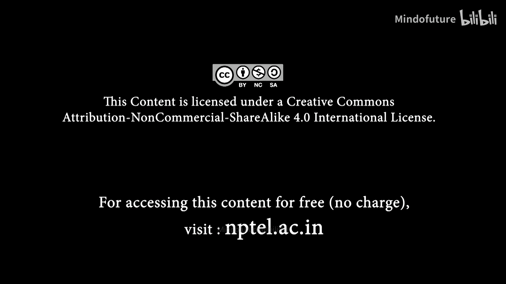
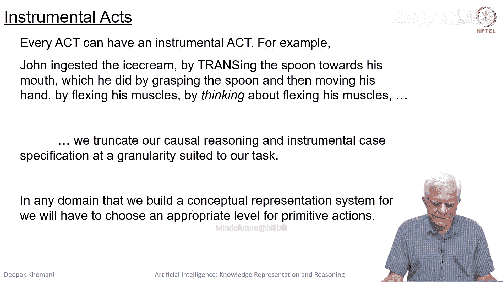

# 079：概念依赖中的动作表示 🧠

在本节课中，我们将学习概念依赖理论如何表示动作。我们将重点关注其核心的谓词选择，理解如何用一组有限的“原始动作”来分解和表示复杂的日常行为，并探讨“工具格”等概念依赖关系。

---

上一节我们介绍了概念依赖理论的基本框架和“槽位”的概念。本节中，我们来看看概念依赖理论定义的核心“原始动作”集合，以及如何用它们来表示句子。

概念依赖理论定义了一组有限的原始动作，用以表示所有复杂行为。这类似于用基本积木搭建复杂结构。

以下是CD理论中的核心动作列表：

*   **ATRANS**：抽象关系的转移。表示所有权、控制权或抽象属性的转移。例如，“给”（give）、“拿”（take）、“买”（buy）都可以用 **ATRANS** 表示。
    *   **公式**：`ATRANS(所有者, 对象, 原拥有者, 新拥有者)`
*   **PTRANS**：物理位置的转移。表示物体物理位置的变化。例如，“走”（go）、“放”（put）、“扔”（throw）都涉及 **PTRANS**。
    *   **公式**：`PTRANS(主体, 对象, 起始位置, 目标位置)`
*   **PROPEL**：施加物理力。表示对物体施加物理力，无论物体是否移动。例如，“推”（push）、“拉”（pull）、“踢”（kick）的核心是 **PROPEL**。
*   **MOVE**：移动身体部位。表示有意识的生命体移动自身的某个身体部位。这常作为工具性动作。
*   **GRASP**：抓握物体。表示用手或类似部位抓取或释放物体。例如，“抓”（grab）、“放开”（let go）。
*   **INGEST**：摄入。表示生物体将外部物体摄入体内，如“吃”（eat）、“喝”（drink）。
*   **EXPEL**：排出。表示生物体将物体从体内排出，如“吐”（spit）、“出汗”（sweat）。
*   **MTRANS**：心智信息转移。表示心智信息在生物体内部或之间的传递。这基于一种“大众心理学”模型，将心智分为意识处理器（CP）、长期记忆（LTM）等部分。
    *   **示例**：“告诉”（tell）是人与人之间的 **MTRANS**；“记住”（remember）是从长期记忆到意识处理器的 **MTRANS**；“看”（see）是从眼睛到意识处理器的 **MTRANS**（需借助 **ATTEND** 动作）。
*   **MBUILD**：构建心智信息。表示从旧信息中构建新心智信息或结论。例如，“决定”（decide）、“推断”（conclude）、“想象”（imagine）。
*   **SPEAK**：发出声音。表示产生声音（不一定是语言）。常作为 **MTRANS** 的工具。
*   **ATTEND**：专注感知器官。表示将感觉器官（如眼睛、耳朵）聚焦于某个刺激源。常作为 **MTRANS** 的工具性动作。

---

理解了原始动作后，我们来看一个关键概念：工具格。它展示了动作之间如何关联。

考虑句子“约翰用勺子吃冰淇淋”。在语言学上，“勺子”是工具。在概念依赖中，“吃”（INGEST）这个主要动作，是通过一个工具性动作完成的，这个工具性动作以“勺子”为对象。

其概念表示可能如下：
1.  主要动作：`INGEST(约翰, 冰淇淋)`。
2.  工具动作：`PTRANS(约翰, 勺子, 冰淇淋, 约翰的嘴)`。即约翰用勺子将冰淇淋物理转移到自己嘴里。
3.  关系：`工具(INGEST, PTRANS)`。

这个 **PTRANS** 本身可能又由更基础的动作（如 **GRASP**（抓勺子）和 **MOVE**（移动手））作为工具。这形成了一个动作链。我们根据任务需要，将因果链和工具格截断在合适的粒度上。

---

概念依赖理论为我们提供了一种用语义原语分解动作的方法。它强调，理解语言不仅需要语法，更需要世界知识来填充这些概念槽位。虽然CD理论的动作集是针对日常领域设计的，但其思想可以推广：在为任何特定领域构建表示系统时，都需要定义一组适合该领域的原始动作。

本节课中，我们一起学习了概念依赖理论的核心动作集合，包括 **ATRANS**、**PTRANS**、**MTRANS** 等，并理解了如何用“工具格”来连接主要动作和工具性动作，从而构建出对复杂事件的概念化表示。