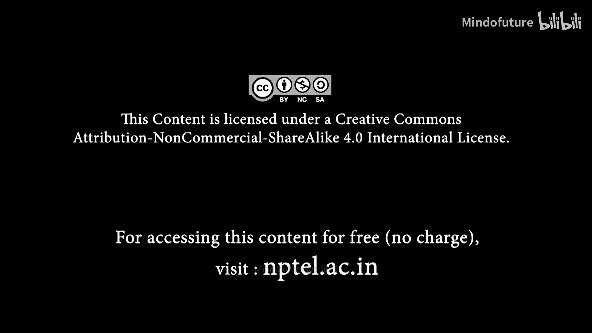
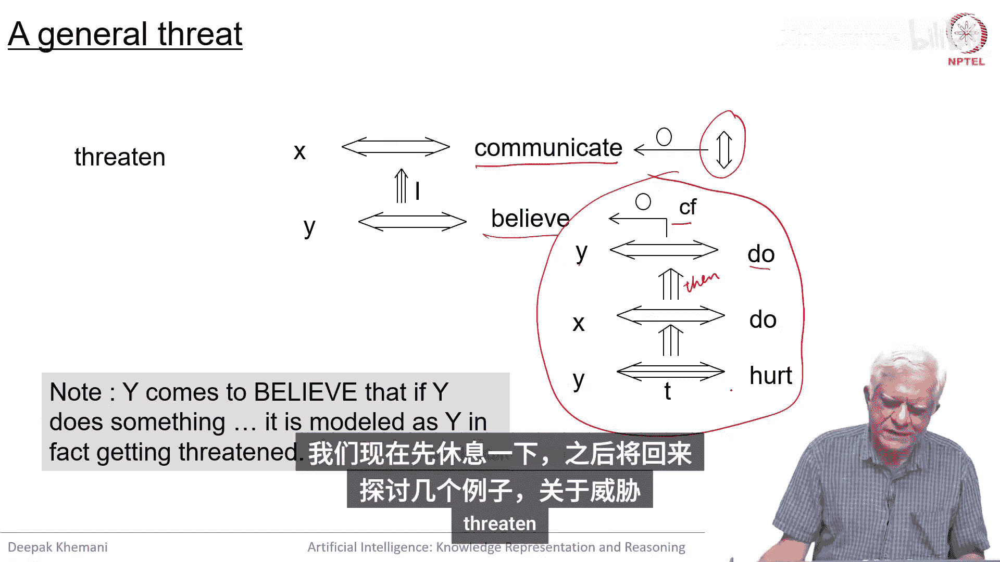

# 080：英语到概念依赖的映射

## 概述
在本节课中，我们将学习如何将英语句子映射到概念依赖这种语义表示形式上。我们将看到，许多英语动词在概念上并非动作，而是描述了动作与状态变化之间的因果关系。我们将通过多个例句，学习如何构建清晰、无歧义且独立于语言的概念依赖表示。

---

## 从英语句子到概念依赖表示

上一节我们介绍了概念依赖的基本思想和核心动作。本节中，我们来看看如何将具体的英语句子转化为概念依赖图。

以下是几个例句及其概念依赖表示的分析。

**例句 1：John was sad because Mary hit him.**

*   **分析**：这个句子描述了一个动作导致了一个状态变化。动作是“Mary hit John”，状态变化是“John became sad”。
*   **表示**：在概念依赖中，“hit”不是一个基本动作，它被建模为“Mary 对 John 施加了强力接触”，这涉及到 `PROPEL`（推动）这个基本动作。这个动作导致了 John 进入“悲伤”的状态。

**例句 2：When Fred gave Mary a peach, she ate it.**

*   **分析**：这个句子描述了两个按时间顺序发生的事件。第一个事件是“Fred gave Mary a peach”，第二个事件是“Mary ate the peach”。
*   **表示**：“gave”可以建模为 `ATRANS`（抽象关系转移），即 Fred 将桃子的所有权转移给了 Mary。随后，Mary 对桃子执行了 `INGEST`（摄取）动作。整个事件发生在过去。

---

## 状态变化动词

许多英语动词在语法上是动词，但在概念上并非直接的动作，而是强调动作引发的结果。这类动词被称为“状态变化动词”。

**例句 3：John killed his teacher.**

*   **分析**：“killed”是一个动词，但它不是一个我们可以直接想象的具体动作。John 可能做了十件不同的事（例如射击、下毒），最终导致了他的老师死亡。
*   **表示**：这个句子的核心是老师从“活着”的状态变为“死亡”的状态。这个状态变化是由 John 所做的某个未指定的动作引起的。因此，概念依赖表示会突出这个因果关系，而不具体说明 John 做了什么。

**例句 4：John killed his teacher by shooting him in the head.**

*   **分析**：这个句子比上一个更具体，它指明了导致死亡的动作是“shooting”。
*   **表示**：表示的上半部分（状态变化）与例句3相同。下半部分则具体描述了动作：John 用枪将子弹 `PROPEL`（推动）到了老师头部所属的位置。

**例句 5：Sam flew his plane to San Francisco.**

*   **分析**：“flew”也是一个状态变化动词。Sam 做了某事（驾驶），导致飞机状态改变（飞往旧金山）。
*   **表示**：Sam 执行了某个动作（可能是控制飞机），结果飞机从某处移动到了旧金山方向。飞行本身可以建模为在空气中 `PTRANS`（物体转移）。

**例句 6：John comforted Mary.**

*   **分析**：“comforted”表示导致心理状态变化的动作。
*   **表示**：John 做了某事（未知），导致 Mary 进入了“舒适”的心理状态。

---

## 处理复杂句与时间信息

概念依赖可以表示更复杂的逻辑关系和时间信息。

**例句 7：Since smoking can kill you, I stopped.**

*   **分析**：这个句子包含一个因果关系和一个动作。因果关系是“吸烟可能导致死亡”，动作是“我停止了吸烟”。
*   **表示**：
    1.  左边表示一个条件关系：**如果**一个人从香烟中 `INGEST`（摄取）烟雾，**那么**他可能从“活着”状态变为“死亡”状态。
    2.  右边表示“我停止了吸烟”：我在过去终止了“我从香烟中摄取烟雾”这个动作。
    3.  左边的整个条件关系是右边动作（停止吸烟）的原因。

**例句 8：While going home I saw a frog.**

*   **分析**：这个句子描述了一个事件（看见青蛙）发生的时间背景（在回家的过程中）。
*   **表示**：我们可以用时间标签来标记事件。一个概念化（我 `PTRANS` 自己回家）可以标记另一个概念化（我 `ATTEND` 眼睛到青蛙）发生的时间。

以下是概念依赖中用于表示时间的一些标签：
*   `p` - 过去时
*   `f` - 将来时
*   `t` - 转换时
*   `ts` - 转换开始
*   `tf` - 转换结束
*   `k` - 持续
*   `?` - 疑问（何时发生）
*   `nil` - 否定（未发生）
*   `c` - 可能性（可能发生）
*   `delta` - 时间流逝

**例句 9：Yesterday the boy in the chair hit the boy on the piano in the mouth in the park.**

*   **分析**：这个句子包含大量具体信息（时间、地点、所有关系）。
*   **表示**：概念依赖可以无歧义地、完整地表示所有这些信息：
    *   动作：一个男孩 `PROPEL` 某物到另一个男孩的嘴。
    *   属性：第一个男孩的位置是椅子；第二个男孩的位置是钢琴附近；嘴被第二个男孩所拥有。
    *   时间：整个事件发生在昨天（可用 `p` 标签）。
    *   地点：整个事件发生在公园。

---

## 构建概念依赖词典

为了自动进行从英语到概念依赖的转换，我们可以预先构建一个词典，将英语单词映射到其对应的概念依赖结构模板。

以下是几个单词的词典条目示例：

**单词：prevent (阻止)**
*   **结构**：`X` 做了某事，导致 `Y` 不能做某事。
*   **语义约束**：`X` 和 `Y` 可能需要是能执行动作的实体。

**单词：instigate (煽动)**
*   **结构**：与“prevent”类似，但增加标签表明 `X` 是**有意地**做某事，导致 `Y` 做某事。

**单词：hurt (伤害)**
*   **结构**：我们已经见过（Mary hit John, he was hurt）。即一个动作导致 `Y` 进入“受伤”状态。

**单词：comfort (安慰)**
*   **结构**：`X` 做了某事，导致 `Y` 进入“舒适”的心理状态。
*   **更具体的分析**：“安慰”可以具体化为一系列事件。例如，“I comforted John by feeding him”（我通过给John喂食来安慰他）可以表示为：
    1.  我 `ATRANS` 食物给 John（给予食物）。
    2.  这导致 John `INGEST` 了食物（吃下食物）。
    3.  这导致 John 从“不安”状态变为“舒适”状态。

**单词：threaten (威胁)**
*   **结构**：这是一个更复杂的心理状态交互。
    1.  `X` 向 `Y` `MTRANS`（心理转移/传达）一个信息。
    2.  这个信息本身是一个概念化：**如果**在未来，`Y` 做了某事，**那么** `X` 就会做某事导致 `Y` 被伤害。
    3.  这个传达动作导致 `Y` **相信**了这个条件化的概念化。

---

## 总结
本节课中，我们一起学习了如何将英语句子映射到概念依赖表示。我们认识到，许多英语动词在概念上表示的是“动作导致状态变化”的因果关系，而非动作本身。我们通过多个例子，练习了如何分解句子、识别核心动作与状态，并用概念依赖图无歧义地表示时间、地点、所有关系等附加信息。最后，我们了解了构建概念依赖词典的思想，这是实现自然语言理解系统的重要一步。