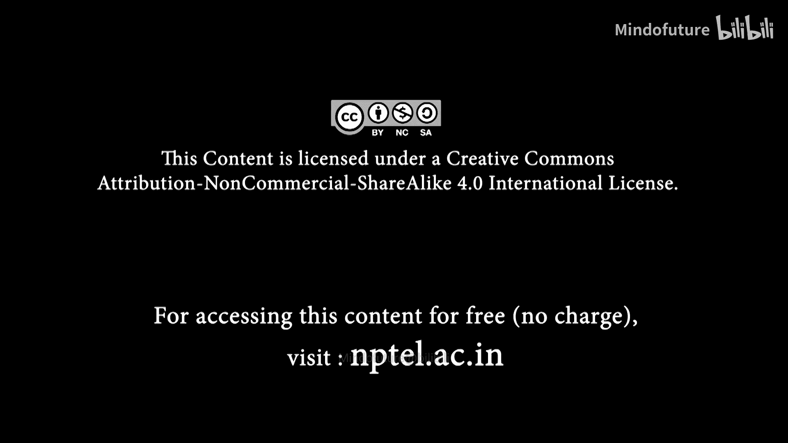
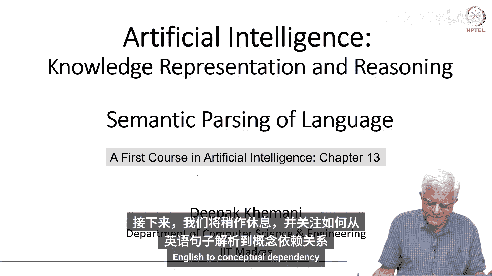

知识表示与推理：P81：表示复杂动词

在本节课中，我们将学习如何使用概念依赖理论来表示和理解英语中的复杂动词。我们将看到，通过将动词分解为更基本的概念原语和它们之间的关系，可以清晰地捕捉句子的核心含义。

---

### 概述

概念依赖理论的核心思想是建立一个“词典”，为每个英语单词存储一个概念化结构。这个结构包含空槽。当我们阅读包含该单词的句子时，会根据语义匹配或关于施事者、受事者等的规则来填充这些空槽。

上一节我们介绍了概念依赖的基本框架，本节中我们来看看如何用这个框架表示更复杂的动词，如“威胁”、“建议”、“想要”等。

---

### 威胁 (Threaten)

动词“威胁”的结构是：**X** 向 **Y** 传达某事，结果是 **Y** 相信，如果他在未来做某事 **X**，那么 **X** 就会做某事 **Y**，从而导致 **Y** 受到伤害。

以下是“威胁”的表示示例。

**例句**：我威胁要打断他的鼻子。

*   **施事者 (Actor)**：我
*   **动作 (Action)**：传达 (Communicate)
*   **受事者 (Recipient)**：他
*   **传达内容 (Object)**：一个概念化结构
    *   如果他在未来做某事 **X**
    *   那么我将做某事 **Y**（例如，施加一个动作）
    *   结果：他的鼻子处于“断裂”状态。

这个结构填充了句子中“我”是施事者、“他”是受事者以及涉及“断鼻”的额外信息。

---

### 建议 (Advise)

“建议”的结构与“威胁”类似，但传达的内容和预期结果不同。

**例句**：我建议他尝尝回锅肉。

*   **施事者**：我
*   **动作**：传达 (Communicate)
*   **受事者**：他
*   **传达内容**：一个概念化结构
    *   我 **相信** 某事
    *   我相信的内容：如果他吃回锅肉，那么他会感到 **高兴**。

---

### 想要 (Want)

“想要”具有特定的时间感。它表示：如果 **X** 做了某事，那么 **Y** 会感到高兴。

**例句**：约翰想要它（但他自己没意识到）。

*   **结构**：存在一个说话者，描述约翰的状态。
*   **约翰的状态**：如果约翰做了某事（得到“它”），那么约翰会高兴。
*   **关键点**：约翰 **无法** 将这个事实概念化（即意识到自己想要它）。这与“他打了比尔的车但不知道”类似，都是行动发生了，但主体无法在意识中构建相应的概念。

---

### 记忆与感知 (Remember & Perceive)

记忆、感知、学习等动词都与信息在记忆系统间的转移有关。

**记忆 (Remember)**

**例句**：我记得我们吃牡蛎的时候。

*   **动作**：概念化 (Conceptualize)
*   **对象**：“我们吃了牡蛎”这个事实
*   **工具性动作 (Instrumental Act)**：从长期记忆转移到意识处理器 (Mtrans from LTM to CP)。

**感知 (Perceive)**

**例句**：我看到约翰在喝汤。

*   **动作**：概念化 (Conceptualize)
*   **对象**：“约翰在喝汤”这个事件
*   **工具性动作**：通过 **Mtrans** 将这个对象从眼睛转移到意识处理器。
*   **实现“看”的动作**：另一个工具性动作，如 **Attend**（关注）约翰和汤的场景。

其他相关动词：
*   **学习 (Learn)**：将信息从意识处理器转移到即时记忆。
*   **忘记 (Forget)**：无法将信息从长期记忆转移到意识处理器。

---

### 爱、恨与相信 (Love, Hate & Believe)

**爱 (Love) 与 恨 (Hate)**

可以视为同一枚硬币的两面。它们表示一种状态：
*   每当 **X** 想到 **Y** 时，**X** 就处于“爱”或“恨”的状态中。

**相信 (Believe)**

“相信”有两种含义：
1.  **因果性相信**：**A** 告诉 **B** 某事，结果 **B** 将此事存入记忆。
    *   **结构**：A Mtrans (事件) 给 B -> B 思考此事 -> B 将其加入记忆。
2.  **一致性相信**：**A** 在向别人说某事，而 **B** 也相信同样的事。
    *   **结构**：A 在向他人 Mtrans (事件)。同时，B 的脑海中也有同样的概念化结构（位于其记忆中）。

若要建模推理过程，可以类似地进行：已知一组事实，从中推断出新事实，然后将新事实加入记忆。

---

### 物理动作与推断 (Physical Actions & Inference)

概念依赖理论使用一组基本的物理动作原语。

以下是主要的物理动作原语：

*   **MOVE**：移动身体部位（只有有知觉的生物可以）。
*   **PROPEL**：施加力。
*   **INGEST**：摄入（吃）。
*   **EXPEL**：排出。
*   **PTRANS**：改变物体的位置。
*   **ATRANS**：改变抽象关系（如所有权）。
*   **GRASP**：抓握。

**从动作进行推断**

看到某个动作，应能自动推断出相应的状态变化。

*   **PTRANS 的推断**：如果发生 **PTRANS**，应推断物体 **不再** 位于原位置，而 **存在** 于目标位置。
    *   *例句*：“我把书给你。” 推断：你拥有了书（所有权改变，涉及 **ATRANS**），书的位置也改变了（**PTRANS**）。
*   **MTRANS 的推断**：与 **PTRANS** 不同。如果我告诉你某事（**MTRANS**），信息在我和你脑中 **同时** 存在。
*   **事件演算**：这种动作与状态变化的关系，在“事件演算”这种逻辑方法中会形式化地处理。例如，“苏希娜去了食堂”应能推断出“苏希娜到达了食堂”。

**复杂动作的分解**

让我们看一些例句，将复杂动词分解为基本动作和推断。

**例句1**：我走向食堂。
*   **核心动作**：**PTRANS**（我自己，方向：食堂）。
*   **推断**：我最终在食堂。
*   **工具性动作**：因为用了“走”，所以涉及 **MOVE**（移动我的脚朝向食堂）。

**例句2**：约翰向山姆扔石头。
*   **核心动作**：**PTRANS**（物体：石头，从约翰到山姆）。
*   **工具性动作**：**PROPEL**（在空中）石头，方向山姆。
*   **时态**：过去时 (P)。

**例句3**：约翰把铅笔扔给山姆。（注意“给”与“向”的区别）
*   **高层概念**：**ATRANS**（约翰将铅笔的所有权转移给山姆）。
*   **实现方式**：通过“扔给”，即 **PTRANS**（铅笔，在空中，用 **PROPEL**，方向山姆）。

**例句4**：约翰打了玛丽。
*   **动作**：**PROPEL**（某个物体 X，方向玛丽）。
*   **结果**：X 与玛丽发生物理接触。
*   **细化（如果是“拳击”）**：**PROPEL** 的物体是“拳头”（为约翰所拥有）。工具性动作可增加 **MOVE**（约翰将拳头移向玛丽）。

**例句5**：一辆车撞了玛丽。
*   **动作**：**PROPEL**（物体：车，方向玛丽）。
*   **结果**：车和玛丽发生物理接触。
*   **注意**：我们不知道施事者（司机）是谁。

**例句6**：我把桌子移到角落。
*   **最准确的表示**：我做了某事，结果桌子进入了“位于角落”的状态。
*   **可能的具体方式**：
    1.  我 **PTRANS** 了桌子（通过 **PROPEL** 它）。
    2.  我让别人为我做这件事（涉及更复杂的社会动作）。

---

### 总结

本节课中，我们一起学习了如何使用概念依赖理论表示复杂的动词。我们看到，通过将动词分解为基本的概念原语（如 **PTRANS**、**ATRANS**、**MTRANS**、**PROPEL**）并明确它们之间的因果关系、工具关系，可以精确地捕捉句子的含义。同时，系统应能根据这些动作自动进行合理的状态推断（如位置改变、所有权转移）。这种方法为智能体理解语言、尤其是理解未明确陈述的意图和目标奠定了基础。接下来，我们将关注如何将英语句子解析成这种概念依赖结构。