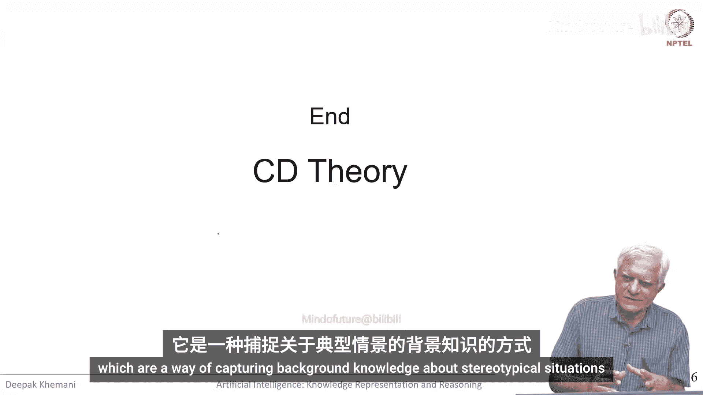

# 082：语言的语义分析 🧠

在本节课中，我们将学习如何将英语句子转换为一种规范化的内部表示，这个过程被称为语义分析。我们将以概念依赖理论为基础，探讨如何解析句子，处理多义词，并最终构建出统一的语义表示。

---

## 语义分析的过程

上一节我们介绍了概念依赖理论，本节中我们来看看如何将英语句子映射到规范化的内部表示。这个过程的核心目标是，让表达相同含义的不同句子都映射到相同的内部结构。

语义分析从左到右处理句子，逐步构建概念化结构。当遇到动词时，会从词典中检索其所有可能的含义（即“义项”），然后根据上下文选择最匹配的一个。

## 动词“Want”的语义分析

以下是动词“want”的几个主要义项：

1.  **状态动词**：表示“如果未来某个事件发生，某人X会感到高兴”。其核心是一个条件性的未来事件。公式表示为：`IF Event THEN PLEASED(X)`。
2.  **及物动词**：表示“如果某人将某物Y转移给我，我会感到高兴”。例如，“I want the book”。
3.  **使役动词**：表示“X希望Y执行某个动作P”。例如，“I want you in my office”。

在分析句子“I want to go to the park with the girl”时，我们首先遇到“want”。根据上下文，我们选择第一个义项（状态动词），因为它需要一个完整的“概念化”来填充“Event”部分。

## 处理介词“With”的歧义

接下来，我们分析“go to the park with the girl”。介词“with”在英语中有多种含义，需要根据语义进行匹配。

以下是“with”的几个常见义项：

1.  **工具格**：表示PP是动作的工具。例如，“I hit the boy with the bat”。
2.  **附加行动者**：表示PP是概念化的另一个参与者。例如，“I went with the girl to the park”。这正是我们当前句子需要的义项。
3.  **前一个PP的属性**：表示PP是紧邻其前的名词短语的属性。例如，“I hit the boy with the girl”（男孩和女孩在一起）。
4.  **行动者的属性**：表示PP是行动者本身的属性。例如，“I hit the boy with vengeance”（我怀着复仇心打了男孩）。

通过语义匹配（例如，“女孩”很难作为“去公园”这个动作的工具），我们确定在当前句子中，“with the girl”应采用第二个义项，即“女孩是共同行动者”。

## 语义匹配与歧义消解

语义分析器会尝试将单词义项与已有概念结构进行匹配。例如，动词“eat”的义项要求其宾语通常是“食物”类型。当遇到“The boy ate a book”时，虽然“书”不是食物，但系统仍会使用“eat”的义项，同时标记存在语义失配。

这种自上而下的匹配有时会出错，形成“花园路径句”。例如句子“The old man glasses were filled with whiskey”，读者可能首先将“glasses”理解为“眼镜”，但遇到“filled”（装满）后，必须回溯并选择“玻璃杯”这个义项。

## 句法相似性与语义差异

有时，句法结构完全相同的句子，其语义表示却截然不同。这凸显了依赖语义分析而非纯句法分析的重要性。

请看以下两个例句：

*   **例句A**：John‘s love of Mary was harmful.
    *   **语义表示**：`[John LOVES Mary] CAUSES [Someone IS-HURT]`
    *   “love”被表示为一个状态（John爱Mary），这个状态导致了伤害。

*   **例句B**：John’s can of beans was edible.
    *   **语义表示**：`[Beans] INSIDE [Can] POSSESSED-BY [John] & [Beans CAN BE INGESTED]`
    *   “can”被表示为一个容器，其中装有豆子，并且这些豆子是可食用的。

尽管两句句法相同，但核心名词（“love” vs. “can”）的语义不同，驱动了完全不同的解析路径和最终表示。

---

## 总结

本节课中我们一起学习了语义分析的过程。我们了解到如何利用概念依赖理论，从左到右解析句子，处理多义词的歧义（如“want”和“with”），并通过语义匹配选择正确的义项。我们还看到了句法结构相同但语义迥异的例子，这证明了深层语义分析在语言理解中的关键作用。通过这套方法，我们可以将多样的自然语言句子转换为规范化的内部表示，为后续的推理奠定基础。

接下来，我们将学习“脚本”的概念，它是一种用来捕捉关于模式化情境的背景知识的方法。