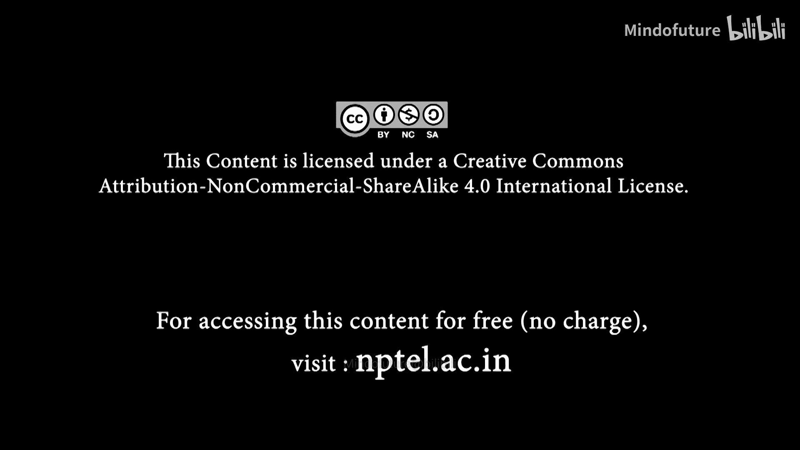
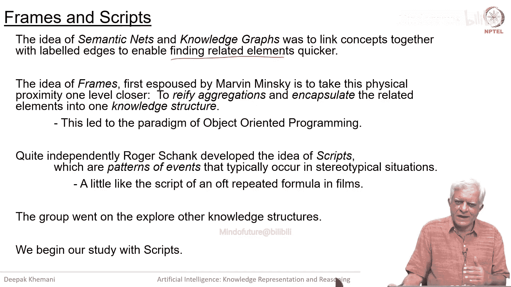

**知识表示与推理：第83讲：知识结构概述**

在本节课中，我们将开始学习一个新的主题：**知识结构**。我们将探讨如何将零散的知识片段组织成更大的、有意义的单元，以理解和推理更复杂的特定情境。

---

上一节我们介绍了概念依赖理论，它使用一组有限的谓词作为原语来表示日常行为的知识。我们看到如何将英语动词翻译成概念依赖表示，以及如何基于句子的语义进行通用推理。

本节中，我们将目光转向更宏观的特定情境。这些情境在某种意义上规模更大，需要一种不同类型的知识表示方法，即**知识结构**。

---

当我们听到一个故事时，例如“阿妮莎走进了一家书店”，我们会基于对“书店”的了解，产生一系列预期和推理。我们知道书店里会发生什么，因此可以推断阿妮莎可能会浏览书籍、寻找特定书籍、去柜台付款，最后拿着一本书离开。这些预期源于我们头脑中关于“书店”这个情境的**结构化知识**。

**知识结构**旨在回答如何将不同的信息片段整合成一个整体结构。例如，我们如何表示关于餐厅或牙科诊所的知识？这些都是**典型情境**，其中会发生一系列类似的事件。我们收集并组织关于这些实体的典型事实，创建出聚合的表示形式。

罗杰·尚克将此类结构称为**脚本**。马文·明斯基则称它们为**框架**。框架的思想后来催生了如今流行的**面向对象编程系统**。

回顾概念依赖理论，我们的目标是理解自然语言句子和故事。理解意味着将其映射到某种内部表示（例如一阶逻辑）。更重要的是，理解包含一个**自上而下**的组件，涉及将输入映射到**预先存在的概念**。我们并非从零开始解读句子，而是试图将句子与我们已有的知识结构相匹配。

我们已经在头脑中创造了诸如人、树、狗、国家、组织等概念。现在，我们将看到如何对这些表示进行**进一步聚合**和**抽象**。脚本和框架允许我们显式地表示之前讨论过的**抽象层次**和**聚合层次**。我们不仅表示整体和部分，还明确表示部分之间以及部分与整体之间的关系。

以下是之前讨论过的例子：

*   **抽象层次**：例如，“猫”是一个类别。我们可以将其进一步抽象为“哺乳动物”。同样，狗、马、人类等类别也可以抽象为“哺乳动物”。这形成了**分类学**或**抽象层次结构**。描述逻辑就允许我们表示这种分类。
*   **聚合层次**：例如，四个部件可以组合起来，我们赋予其一个整体名称，比如“笔”。在体育团队的例子中，一个桥牌队由搭档（两个桥牌手）组成，而桥牌手可以是人类或计算机程序。这体现了**部分-整体**关系。

我们已经在描述逻辑中学习过如何表示其中一些关系，现在我们将进一步探索。

---

我们关注的重点是**框架**和**脚本**。

*   **语义网络**：我们曾见过RDF和知识图谱，其原始思想即**语义网络**。它通过带标签的边连接概念，便于查找不同元素间的关系。
*   **框架**：由马文·明斯基提出。它更进一步，不仅连接相关元素，还将这些元素**精炼并聚合**成一个新的、封装好的知识结构，即**框架**。这催生了**面向对象编程范式**，其中封装和继承等概念直接对应。
*   **脚本**：由罗杰·尚克独立提出。脚本用于表示**典型情境中事件发生的模式**。例如，在餐厅或书店里通常会发生的系列事件。脚本就像一个大型的、抽象层次的数据结构，其名称源于它类似于戏剧或电影的“剧本”。

明斯基的框架本质上是**语义性**的，关注领域内元素间的关系。而尚克的脚本本质上是**情节性**的，关注典型情境中发生的事件序列。

尚克在耶鲁大学的研究小组（70年代中期至80年代中期）探索了许多其他知识结构，但我们将从**脚本**这一基础性贡献开始学习。

---

本节课中，我们一起学习了知识结构的基本概念。我们了解到，为了理解和推理更复杂的情境，我们需要将知识组织成如**脚本**和**框架**这样的更大单元。这些结构基于我们对世界的典型认知，允许进行自上而下的推理和预期生成。

在下一讲中，我们将开始详细探讨**脚本**的具体内容。