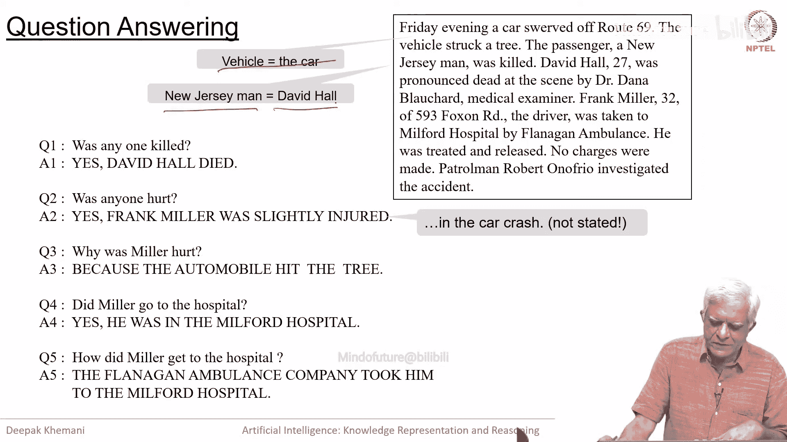

# 084：脚本知识表示

在本节课中，我们将学习一种称为“脚本”的结构化知识表示方法。脚本用于描述典型情境中的事件序列，使我们能够对故事进行预测性理解和推理。

## 概述

上一节我们介绍了结构化知识的概念。本节中，我们将聚焦于“脚本”这一具体的知识结构。脚本是罗杰·尚克和克里斯托弗·瑞斯贝克在《计算机理解》一书中提出的概念，并在理查德·库林福德的博士论文项目“脚本应用器机制”中得到实现。

## 脚本的基本概念

脚本是相互关联的概念化模式的集合。在概念依赖理论中，概念化表示概念间的双向依赖关系。一个脚本则包含多个按典型顺序连接的概念化。

脚本包含**角色**和**道具**。
*   **角色**：指在脚本中执行特定动作的人物，例如电影院中的收银员。
*   **道具**：指脚本中存在的物体。

由于脚本组织的是关于典型情境的知识，因此我们能够基于脚本**生成预期**，预测接下来可能发生的事件。

## 脚本示例：地铁场景

以下是一个地铁（或城轨）脚本的示例，它展示了两个层次：情节层和概念化层。

1.  **乘客进入车站**：表示为 `patron P TRANS to inside station`。
2.  **通过闸机**：存在两个分支。
    *   直接通过闸机。
    *   先购票，再通过闸机。
3.  **在站台等候**。
4.  **列车进站**。
5.  **判断列车**：如果这不是目标列车，则循环等待下一班。
6.  **登上列车**。
7.  **等待目的地**：列车经过多个车站，直至目的地到达。
8.  **离开车站**：表示为 `patron P TRANS from station outside`。

这种相互关联的事件模式就是尚克所定义的脚本。它描述了一个人乘坐地铁的典型过程。

## 基于脚本的故事理解

在SAM系统中，故事阅读是**预测性**的。系统读取第一句话，并尝试确定激活了哪个脚本。脚本是情节的集合，其余情节则成为对故事后续内容的**预期**。

当后续句子输入时，系统的任务是将它们与脚本中的某个情节进行匹配。例如，一个三句话的故事可能分别映射到脚本中的三个情节。

在描述典型情境时，我们通常不会详述每个细节。例如，只说“我去了食堂，吃了个卷饼喝了咖啡”，听者就能基于食堂脚本推断出排队、付款、取餐等未提及的步骤。这正是知识表示的核心目标：**进行推理**。

## 脚本支持的推理类型

基于脚本可以进行多种推理，其中许多是**溯因推理**，即推断可能为真但非必然的结论。

以下是两种主要推理：

**1. 因果链补全**
推断故事明确提及的事件之间必须发生的中间事件。如果故事只有两三行，而脚本有二十行，那么可以推断其他步骤很可能发生了。

**2. 角色实例化与合并**
*   **角色实例化**：确定故事中的人物扮演脚本中的哪个角色（如乘客、收银员、司机）。
*   **角色合并**：识别不同指称（如“约翰”、“他”）指向的是同一个角色填充者（即同一个人）。

## 推理实例分析

让我们通过几个例子来看这些推理如何运作。

**例1：简短故事**
故事：“约翰走进了地铁站。他去了快线站台。”
*   **因果链补全**：可以推断他必须买了票（或持有通票）。
*   **角色实例化与合并**：“约翰”和“他”被识别为脚本中的“乘客”角色，并合并为同一个人。

**例2：电影院故事**
故事：“约翰去了电影院。他走到售票处要了一张票。”
假设我们有一个电影院脚本，可以进行以下推理：
*   售票处与脚本中的“收银员”角色相关联。
*   根据连续性，此时顾客预期会购票。
*   可以推断收银员坐在售票处（情境推理）。
*   可以推断顾客必须为票付了款。

## SAM系统运行示例

SAM系统实际处理英文故事，并与多个组件协同工作：ELI负责将英语解析为概念依赖表示，SAM负责基于脚本理解故事，Wendy Lehnert的系统负责问答，BABEL负责生成文本回答。

以下是一个SAM处理过的例子：
**输入故事**：“约翰去了餐厅。他点了一个热狗。服务员说他们没有热狗。他要了一个汉堡。汉堡端上来时烤焦了。他离开了餐厅。”

**SAM系统回答的部分问题**：
*   问：约翰点热狗了吗？ 答：是的。
*   问：约翰吃热狗了吗？ 答：没有，服务员告诉他无法提供。
*   问：服务员为约翰提供了什么？ 答：服务员为约翰提供了一个汉堡。（故事未明确说“提供”，但脚本推理得出）
*   问：约翰为什么没吃汉堡？ 答：因为汉堡烤焦了。
*   问：约翰付账了吗？ 答：没有，约翰因为汉堡烤焦了而生气离开。（基于脚本的推测）

## 复杂情境脚本：交通事故

脚本可以聚合到更大的“情境”中。例如，一个交通事故情境可能包含多个脚本：**车辆事故脚本**、**救护车运送脚本**、**医院治疗脚本**、**警方调查脚本**。

**输入故事**：“周五晚上，一辆汽车在69号公路失控。车辆撞上了一棵树。乘客，一名新泽西州男子，当场死亡。大卫·霍尔，27岁，被医生宣布当场死亡...司机弗兰克·米勒，32岁...被救护车送往米尔福德医院，接受治疗后释放。未提出指控。巡警罗伯特·莫努洛调查了事故。”

**SAM的推理与回答**：
*   **角色合并**：识别“乘客”、“新泽西州男子”、“大卫·霍尔”是同一人。
*   **因果链补全**：推断司机弗兰克·米勒在事故中受伤（因为他被送往医院）。
*   **问答示例**：
    *   问：有人死亡吗？ 答：是的，大卫·霍尔死了。
    *   问：有人受伤吗？ 答：是的，弗兰克·米勒轻微受伤。
    *   问：米勒为什么受伤？ 答：因为汽车撞上了树。
    *   问：米勒怎么去的医院？ 答：弗兰根救护车公司送他去的。

## 总结

本节课中，我们一起学习了**脚本**这种知识表示方法。脚本通过描述典型情境中的事件序列、角色和道具，为我们提供了丰富的背景知识。基于脚本，我们可以对故事进行**预测性阅读**、**因果链补全**和**角色推理**，从而理解那些未在文本中明确陈述的信息。SAM系统展示了如何利用脚本实现深层的自然语言理解与推理。这种方法的优势在于对特定领域理解深刻，但其局限性在于知识是领域特定的，难以处理超出已知脚本范围的故事。在接下来的课程中，我们将探讨更复杂的知识组织结构。