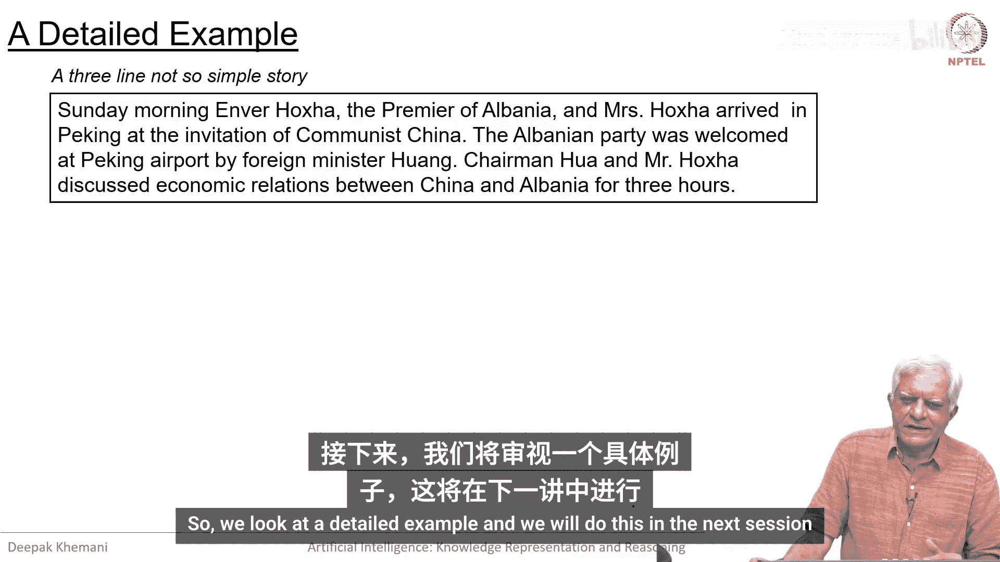

# 085：SAM脚本应用器机制

在本节课中，我们将学习脚本应用器（Script Applier）的工作原理，这是SAM（脚本应用器机制）系统的核心组件。我们将了解它如何将输入的故事文本与预定义的脚本模式进行匹配，并生成包含推断信息的完整故事表示。

上一节我们介绍了脚本的基本概念，本节中我们来看看脚本应用器（SAM）的具体工作机制。

## SAM系统架构概述

SAM是一个由多个程序和数据组成的系统。其核心目标是将自然语言描述的故事，通过匹配预定义的脚本模式，转化为包含推断信息的内部表示。

以下是SAM的主要组成部分：

*   **L（语言分析器）**：这是一个程序，负责将输入的英文故事文本转换为概念依赖（Conceptual Dependency, CD）表示。它只处理文本中明确提及的信息，不进行任何推断。
*   **PP Memory（图像生成器记忆）**：这是一个程序，也是一个语义记忆库。它存储了关于脚本中角色（Roles）和道具（Props）的知识。它的任务是将输入的概念元素与脚本中预期的元素进行匹配和关联。
*   **脚本应用器（Script Applier）**：这是核心程序。它接收来自PP Memory的信息，并尝试将输入的概念化序列映射到具体的脚本模式中。它负责选择脚本、进行匹配、生成预测并最终构建故事表示。

数据流和控制流如下：`L` -> `PP Memory` -> `脚本应用器`。`L`的输出（CD表示）作为数据输入`PP Memory`，`PP Memory`的输出再作为数据输入`脚本应用器`。最终，系统输入一个英文故事，输出一个完整的、语言独立的概念依赖故事表示。

## 各组件功能详解

### L（语言分析器）

`L` 程序的功能是进行语义解析。它提取文本中明确的概念元素，并将其转换为概念依赖结构。它避免进行任何推断，也不尝试解析代词指代或填补缺失信息。例如，对于句子“他走向售票处”，`L` 只会生成“某人走向某处”的概念，而不会推断“他”是谁或“售票处”的具体角色。

### PP Memory（图像生成器记忆）

`PP Memory` 是一个语义记忆程序，它了解脚本中的典型角色、道具和类别信息。

它的主要功能包括：
*   将输入的概念标记（Tokens）与脚本中预期的标记进行匹配。
*   为角色和动作分配标记。
*   识别并处理“永久标记”，如“曼哈顿”、“BMT（地铁）”等地名或专有名词。

例如，在处理故事“约翰乘BMT去曼哈顿看戏”时，`PP Memory` 会识别“BMT”和“曼哈顿”为永久标记。对于后续句子“在剧院，他走向售票处要了一张票”，`PP Memory` 会创建“售票员”和“引座员”的标记，并推断句中的“它”指的是“票”，“带他到他的座位”意味着“约翰的座位”。

### 脚本应用器（Script Applier）

`脚本应用器` 是系统的核心推理引擎。它从`PP Memory`接管处理流程，并需要解决三个关键问题：

1.  **脚本定位**：在它的脚本数据库中，为当前输入的故事找到最相关的脚本。脚本通过“头部信息”和“前提条件”来被选择和激活。例如，“顾客饿了”可能触发“餐厅脚本”或“烹饪脚本”。
2.  **预测生成**：一旦选定一个脚本，它就会根据脚本的典型模式，预测接下来可能出现的输入内容。这有助于理解和解释后续的句子。
3.  **实例化与推断**：根据已输入的故事部分，实例化脚本中相应的片段，并创建明确的故事表示，这个表示包括了从脚本中推断出的、未在原文中明确陈述的信息。

一个“活跃脚本”由以下部分定义：
*   **上下文**：一组模式，用于预测在故事的给定点将看到什么输入。
*   **绑定列表**：将`PP Memory`产生的标记与脚本中的变量链接起来（例如，将“约翰”绑定到“顾客”角色）。
*   **活跃场景记录**：记录脚本中当前正在进行的场景（场景是比脚本更小的单元）。
*   **脚本推断列表**：记录已发生的、可能影响脚本正常流程的事件。
*   **脚本全局强度指示器**：SAM用它来标记其对当前所做推断的确信程度，即它有多相信正在使用的脚本是正确的。

## 脚本应用器内部结构

`脚本应用器` 程序本身包含三个主要组件：

1.  **模式匹配控制器**：首先被激活。它负责设置上下文，依次尝试匹配明确提及的脚本、当前活跃的脚本，最后是主导脚本（当无法与现有脚本匹配时使用）。它进行主干匹配、角色适配和角色合并。
2.  **预测器**：根据当前脚本状态，更新对后续输入的预期。它会清除已满足或未满足的旧预测，并加载下一个预期的事件或决策点（如果脚本有分支）。
3.  **片段初始化器**：创建最终的故事表示。它实例化脚本中适当的片段，并整合推断信息（例如，在事故故事中推断“弗兰克·米勒受了轻伤”）。

最终，整个流程 (`L` -> `PP Memory` -> `脚本应用器`) 产生一个明确的故事表示。这个表示可以被后续的问答模块用来回答问题，或者被摘要生成模块用来创建故事摘要。其结果是，我们得到了一个不仅包含原文信息，还包含了基于活跃脚本所推断出的隐含信息的故事内部模型。

本节课中我们一起学习了SAM脚本应用器机制的核心架构和工作流程。我们了解了`L`、`PP Memory`和`脚本应用器`这三个核心程序如何协作，将英文故事文本匹配到脚本模式，并生成包含丰富推断的完整故事表示。下一节，我们将通过一个详细的例子来具体演示这个过程。