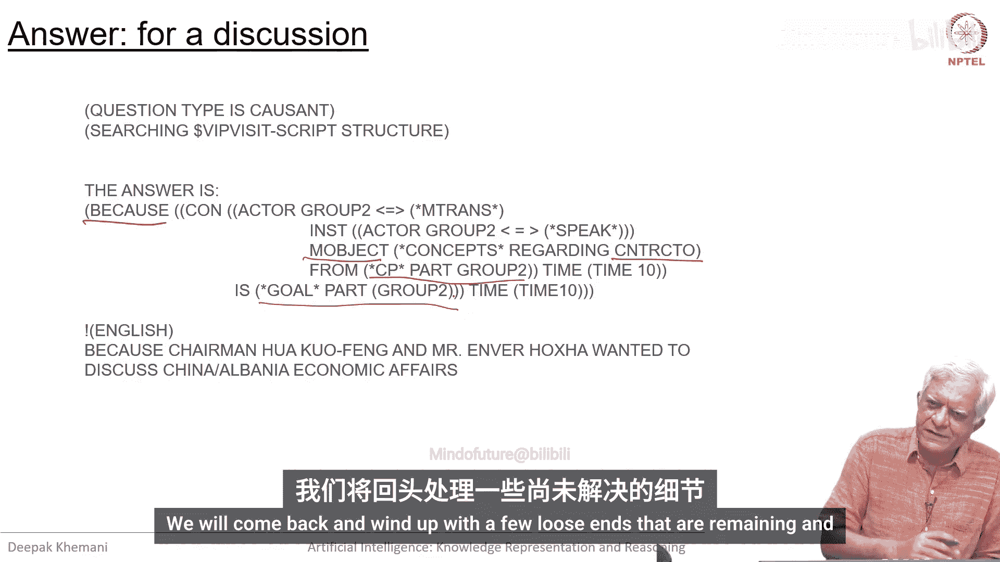

# 086：SAM系统与脚本应用实例解析

在本节课中，我们将通过一个具体的例子，深入了解SAM系统如何利用脚本（Scripts）来理解故事、进行推理并回答问题。我们将看到系统如何解析输入、匹配脚本、填充角色，并最终生成故事的内部表示和自然语言摘要。

上一节我们介绍了SAM系统的整体结构，本节中我们来看看它如何实际处理一个关于“贵宾访问”的故事。

## 故事输入与解析

首先，系统启动名为`apply`的脚本应用器程序。此时，其内存中存有三个脚本：火车旅行脚本、贵宾访问脚本和车辆事故脚本。程序等待输入。

我们输入以下故事：
> “周日早上，阿尔巴尼亚总理恩维尔·霍查及其夫人应中国共产党邀请抵达北京。阿尔巴尼亚代表团在北京机场受到外交部长黄华的欢迎。华主席与霍查先生就中阿经济关系进行了三小时的讨论。”

程序中的解析器（parser）开始工作，将故事的第一句话转换为概念依赖（Conceptual Dependency）表示。

以下是解析过程的关键点：
*   它创建了代表行动者（actor）的令牌（token），例如`temp32`。
*   行动（action）被识别为`Ptrans`（物理转移）。
*   目的地被识别为“北京”这个政治实体。
*   时间信息被解析为“周日早上”。
*   解析器识别出“邀请”事件，创建了邀请者（Communist China）、受邀者（一个团体）等表示。
*   受邀团体被进一步解析为两个成员：一位男性（恩维尔·霍查，头衔为阿尔巴尼亚总理）和一位女性（霍查夫人）。

## 脚本匹配与激活

解析产生的令牌被传递给PP记忆（永久性记忆）进行匹配。PP记忆识别出故事涉及“贵宾”和“政治实体”。

此时，脚本供应商（script supplier）开始行动。它在内存的三个脚本中搜索匹配项。火车旅行脚本匹配失败，随后它成功匹配了“贵宾访问脚本”。

由于识别出从一个国家到另一个国家的“国事邀请”，贵宾访问脚本的VIP轨道被激活。系统现在知道接下来可以期待欢迎仪式、宴会、会谈等场景。

## 信息补全与推理

故事的第二句提到“阿尔巴尼亚代表团在北京机场受到外交部长黄华的欢迎”。

系统已经激活了贵宾访问脚本，因此识别出这是一个“欢迎场景”。它识别出欢迎者（黄华，外交部长）和受欢迎的团体（来自阿尔巴尼亚）。

关键的一步推理发生了：系统需要理解他们是如何到达机场的。脚本中没有明确说明交通方式。然而，系统根据“在机场被欢迎”这一事实，推断出“乘坐飞机”是可能的交通方式。它搜索脚本并找到了匹配的“主干”部分，推断出是某家航空公司负责将他们运抵。

## 故事整合与表示

故事的第三句是：“华主席与霍查先生就中阿经济关系进行了三小时的讨论。”

这被解析为概念依赖中的`Mtrans`（精神转移）行动，即信息从一方的意识处理器传递到另一方的意识处理器。讨论的双方被识别为中国党和阿尔巴尼亚党，讨论主题是关于经济的某些概念。

至此，SAM系统整合了整个故事：
*   它创建了包含“抵达”、“欢迎”、“会谈”等子场景的事件图。
*   所有这些事件都被组织在“贵宾访问脚本”之下。
*   系统利用PP记忆中关于“国家元首”等永久令牌的信息，丰富了故事细节（例如，明确识别出“华主席”是“中国政府首脑”）。

基于这个内部表示，系统可以生成一个英文摘要：
> “阿尔巴尼亚政府首脑恩维尔·霍查总理与中国政府首脑华国锋主席讨论了阿尔巴尼亚与共产主义中国的经济事务。”

## 基于脚本的问答

现在，我们看看SAM系统如何回答关于这个故事的问题。问答由温迪·莱纳德的程序完成。

以下是问答过程的示例：

**问题1：谁去了中国？**

*   解析器将问题转化为概念依赖表示：某个实体（变量）通过`Ptrans`行动到了中国。
*   问答程序在故事显式表示中搜索匹配该模式（变量已绑定）的部分。
*   找到匹配项后，程序生成英文答案：“恩维尔·霍查总理和霍查夫人。”

**问题2：他们怎么去中国的？**

*   问题被解析为寻找使`Ptrans`成为可能的工具性行动（`Instrual act`）。
*   程序在故事表示中搜索，找到了之前推理出的“乘坐飞机”事件。
*   因此，答案是：“他们飞往了共产主义中国。”

**问题3：他们为什么去中国？**

*   问题被解析为寻找导致“去中国”这一事件的原因（`Causal connection`）。
*   程序在故事表示中搜索，找到了“讨论经济合同/关系”这一目标状态。
*   因此，答案是：“因为他们想交流关于合同的概念信息。” 或者说，他们的目的是讨论经济事务。

## 总结

本节课中，我们一起学习了SAM系统处理“贵宾访问”故事的全过程。我们看到了系统如何：
1.  **解析**自然语言故事为概念依赖表示。
2.  **匹配**并**激活**合适的脚本（贵宾访问脚本）。
3.  **进行推理**，补全故事中未明确说明的信息（如交通方式）。
4.  **构建**故事的内部事件图表示。
5.  **生成**故事摘要和回答基于故事内容的问题。

这个例子展示了脚本作为知识表示方法的强大之处：它允许系统利用关于典型场景的结构化知识来理解叙述、进行常识推理并回答问题。然而，构建和维护覆盖广泛领域的庞大脚本库非常复杂，这也是此类方法当前应用受限的原因之一。