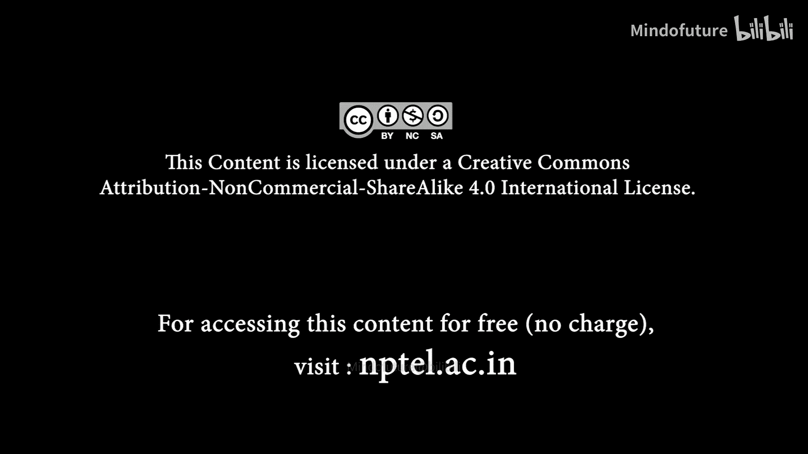
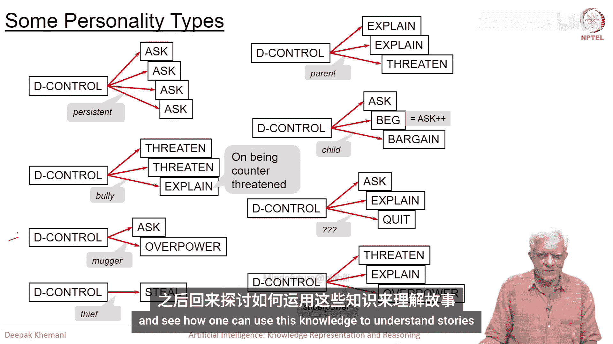

知识表示与推理：P88：目标、计划与行动 🎯

在本节课中，我们将学习如何通过理解故事中角色的目标、计划和行动来构建语义表示，从而实现对故事的理解和问答。我们将重点介绍耶鲁大学开发的PAM（Plan Applier Mechanism）系统，它通过分析角色的目标、为实现目标而制定的计划以及计划中的具体行动来理解非模式化的故事情节。

---

上一节我们介绍了脚本理论，它通过预定义的脚本来理解模式化的场景。然而，现实中的故事往往涉及角色基于个人目标采取的非模式化行动。本节中，我们来看看如何通过分析目标、计划和行动来理解这类复杂故事。

PAM系统由Robert Wilensky开发，其核心思想是：角色由目标驱动，并通过执行计划中的行动来实现目标。理解故事的关键在于识别角色的目标，并将角色的行动解释为实现该目标的计划的一部分。

以下是理解过程的核心概念：

*   **目标**：角色希望达成的状态。例如，`获取金钱`、`给人留下深刻印象`。
*   **计划**：为实现目标而设计的一系列步骤或子目标。例如，`借钱`是达成`获取金钱`目标的一个计划。
*   **行动**：计划中可执行的具体步骤。例如，`打电话给姐姐`是`借钱`计划中的一个行动。

当我们在故事中读到“约翰需要一笔钱”时，我们识别出他的**目标**是`获取金钱`。接着读到“他打电话给他姐姐”，我们将其理解为执行`借钱`**计划**中的一个**行动**，从而将两句话连贯地理解。

---

上一部分我们了解了目标、计划和行动的基本关系。现在，我们通过更多例子来加深理解。

有时，行动与目标之间的连接链可能更长。一个计划可能包含子目标，而子目标又有自己的子计划。

例如，在故事“约翰想成为公司的合伙人。他去弄了些砒霜。”中，理解的关键在于推断一个可能的**计划链**：`成为合伙人`（目标）可能需要`除掉竞争对手`（子目标/计划），而`获取砒霜`（行动）可能是`下毒`计划（子计划）的一部分。这种推理依赖于我们对世界的常识知识。

---

为了系统地进行推理，PAM等系统将常见的**目标类型**和对应的**计划类型**组织成知识结构。一种重要的目标是 **“D-控制”目标**，即获得对某物的控制权。

为了实现D-控制目标，角色可能采取多种计划。以下是六种可能的计划：

1.  **请求**：直接向对方索要。
2.  **解释**：向对方说明需要此物的理由。
3.  **讨价还价**：提出交换条件。
4.  **威胁**：警告对方如果不给将采取不利行动。
5.  **制服**：使用武力夺取。
6.  **偷窃**：暗中拿走。

不同的角色性格会倾向于按不同顺序尝试这些计划。例如：
*   一个**固执的人**可能反复使用“请求”计划：`请求 -> 请求 -> 请求`。
*   一个**孩子**可能尝试：`请求 -> 哀求 -> 讨价还价`。
*   一个**强盗**可能直接采用：`威胁 -> 制服`。
*   一个**小偷**则直接执行“偷窃”计划。

通过将故事中角色的行动与这些预存的计划模式进行匹配，系统可以推断角色的意图和性格，从而理解故事。

---

本节课中，我们一起学习了如何超越固定的脚本，利用目标、计划和行动的知识来理解故事。PAM系统通过识别角色的目标，并将观察到的行动解释为实现目标的计划的一部分，从而能够处理非模式化的、由角色目标驱动的复杂故事情节。这种基于目标与计划的推理，为我们构建更灵活、更深入的自然语言理解系统提供了重要框架。