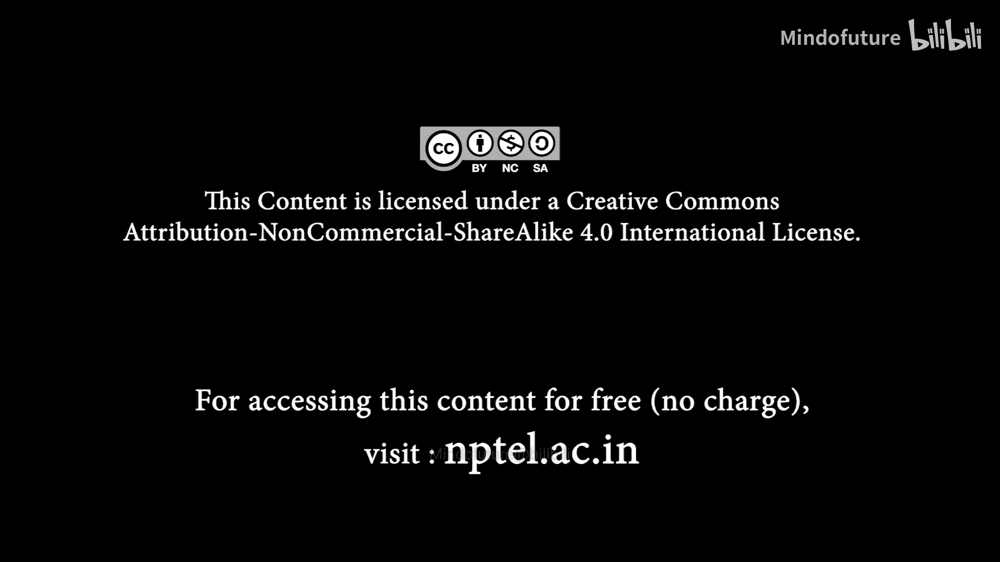
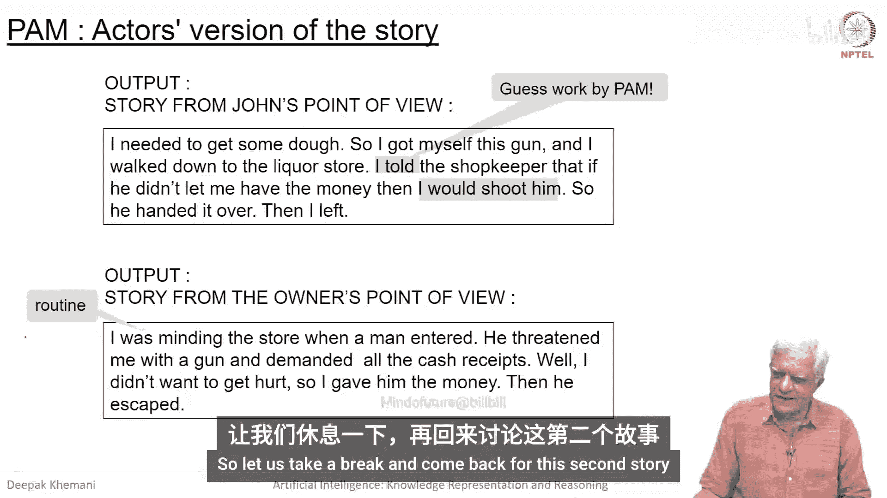

知识表示与推理：P89：目标交互 🎯

在本节课中，我们将学习目标（Goals）如何相互作用，以及程序如何利用关于目标、计划和行动的知识来理解故事。我们将以程序PAM为例，探讨其在故事理解中的应用，并分析目标之间的各种交互关系，如替代、冲突与合作。

---

### 概述

程序PAM利用关于目标、计划和行动的知识来理解英文故事。这种知识结构不仅适用于语言理解，在其他情境（如游戏设计）中也很有用。智能体需要从用户的操作（如键盘输入）中推断其意图，而目标与计划正是理解这些意图的关键。它们通常不是明确陈述的语言实体，而是需要被表示的概念结构。我们经常看到的只是一系列行动。

上一节我们介绍了概念依赖理论，本节中我们来看看目标之间的交互如何影响对故事的理解和智能体的规划。

### 目标交互的类型

当存在多个目标时，情况会变得复杂。目标之间会产生多种交互。

以下是目标交互的几种主要类型：

1.  **目标替代**：一个行动者可能同时为某个目标的多次出现做计划。
    *   **例子**：约翰喜欢喝热咖啡，所以他买了一个保温瓶。
    *   **解释**：“喝热咖啡”是一个**反复出现的目标**。为了实现这个目标，他制定了“使用保温瓶”的计划，这又引出了“拥有保温瓶”的子目标，最终导致了“购买保温瓶”的行动。

2.  **目标协同**：实现一个目标可能为实现另一个目标提供机会。
    *   **例子**：雅各布去城里进行医疗检查，趁此机会他也预订了火车票。
    *   **解释**：“去城里”这个行动（源于医疗检查的目标）为实现“预订车票”这个独立目标创造了便利条件。

3.  **目标冲突（单个行动者）**：一个行动者的多个目标可能因资源（如时间）限制而相互冲突。
    *   **例子**：潘克没有完成作业，他的朋友们想去看电影，于是潘克逃课了。
    *   **解释**：潘克面临两个冲突的目标：“完成作业”和“与朋友看电影”。两者都需要时间，他只能选择其一。理解这个故事需要识别这种**目标冲突**。

4.  **目标竞争（多个行动者）**：不同行动者的目标相互竞争。
    *   **例子**：约翰想看足球赛，玛丽想看芭蕾舞。他们只有一台电视机。约翰打了玛丽一拳，然后调到了足球频道。
    *   **解释**：两个行动者（约翰和玛丽）有相互竞争的目标（看不同节目）。约翰通过**破坏对手的计划**（攻击玛丽）来实现自己的目标。

5.  **目标共谋（多个行动者）**：不同行动者的目标可以相互支持，形成合作。
    *   **例子**：苏克拉姆想买一辆新车，穆克什需要有人签署他的文件。于是穆克什给了苏克拉姆一些钱，苏克拉姆签署了文件。
    *   **解释**：两个行动者通过**协商**，使各自的计划能够支持对方目标的实现，这是一种互利合作。

### PAM程序的工作原理

PAM是一个利用目标、计划知识来理解故事的程序。其知识结构可以表示为一个层次网络：
*   一个**目标**可能对应多个**计划**。
*   一个**计划**可能包含多个**子目标**。
*   一个**子目标**又可能对应多个**子计划**。
*   最终，**计划**由具体的**行动**构成。

PAM主要在三种模式下工作：

1.  **预测模式**：已知一个目标，预测可能采取的计划和行动。
    *   `已知目标 -> 预测可能的计划 -> 预测可能的行动`
2.  **自底向上模式**：观察到行动，反向推理其所属的计划和目标。
    *   `观察到行动 -> 推断所属计划 -> 推断潜在目标`
3.  **故事表征构建模式**：整合推断出的目标、计划和行动，构建出完整的故事内部表征。

在故事中，实际叙述的路径（例如：目标 -> 计划2 -> 子目标 -> 子计划 -> 行动）可能只是整个知识网络中的一部分。

### 实例分析：抢劫故事

让我们通过一个例子看PAM如何工作。

**输入故事**：
> 约翰需要钱。他拿了一把枪，走进一家酒类商店。他告诉店主他想要一些钱。店主把钱给了约翰，然后约翰离开了。

**PAM可回答的问题及推理**：
*   **问**：约翰为什么拿枪？
    *   **答**：因为约翰想抢劫酒店。（“抢劫”一词并未在故事中出现，这是基于“需要钱”这一目标和“持枪威胁”是抢劫的常见计划这一知识推断出来的。）
*   **问**：约翰为什么威胁店主？
    *   **答**：因为那是获取钱的计划的一部分。（从“需要钱”的目标，推断出“威胁”是达成该目标的可行计划。）
*   **问**：店主为什么给约翰钱？
    *   **答**：因为店主不想受伤。（这体现了店主内部的**目标冲突**：保护财产 vs. 维护健康。PAM假定“维护健康”是一个长期目标，在此情境下优先级更高。）
*   **问**：约翰为什么离开？
    *   **答**：因为约翰不想被抓住。（PAM假定“避免被捕”是一个长期目标。）

**PAM生成的故事版本**：
PAM可以从不同角色的视角重新讲述故事，这证明了其对故事深层结构的理解。

*   **约翰的视角**：“我需要弄点钱，所以我拿了这把枪去了酒店。我告诉店主，如果不把钱给我，我就开枪打他。于是他把钱给了我，然后我就离开了。”
*   **店主的视角**：“我正在看店，一个男人走了进来。他用枪指着我，要求我把所有的现金收入都交出来。我不想受伤，所以我把钱给了他。然后他就逃跑了。”

与之前学习的SAM程序（基于脚本）类似，PAM也能理解故事、回答问题和复述故事。区别在于，PAM使用的核心知识是关于**目标、计划及行动**的。

### 总结

本节课中我们一起学习了目标交互的多种形式，包括替代、协同、冲突、竞争和共谋。我们以PAM程序为例，探讨了如何利用目标与计划的知识来理解故事。PAM通过构建目标-计划-行动的层次网络，能够在预测、推理和构建故事表征三种模式下工作，从而理解未明确陈述的信息，并从不同角色的视角解释事件。这种基于目标的知识表示与推理方法，为人工智能理解复杂情境和智能体规划提供了重要基础。