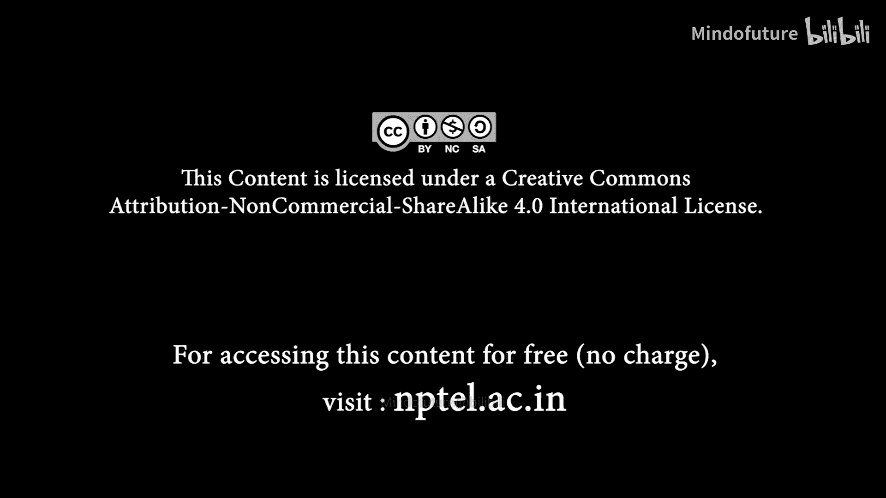
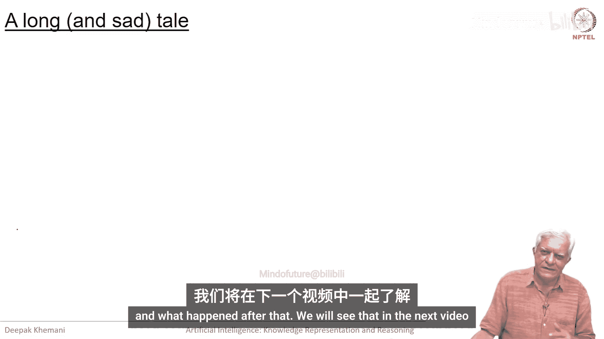

# 090：解释驱动的理解 🧠

在本节课中，我们将学习一个名为“PaM”的程序如何理解英文故事。PaM利用关于目标、计划和行动的知识来构建对故事的理解。我们将通过一个复杂的故事示例，探讨PaM如何通过“解释驱动的理解”来推断人物行为背后的原因。

---

## 故事示例与分析

上一节我们介绍了PaM程序的基本概念，本节中我们来看看一个更复杂的故事示例。

故事文本如下：
> 约翰想赢得改装车比赛。比尔也想赢得改装车比赛。于是，在比赛前，约翰破坏了比尔的点火装置。

如果向PaM提问：“为什么约翰破坏了点火装置？”
PaM会回答：“因为他试图阻止比尔参赛。”

文斯基将这类活动称为“反规划”，即一个人物的行为可以被理解为旨在阻止另一个（通常是敌对的）人物的目标。

---

## PaM的推理机制

PaM使用规则（也称为“请求”）进行推理，其规则库包含约100条不同类型的规则。

以下是PaM使用的部分推理规则示例：
*   **目标-对象规则**：如果一个角色有拥有某物的目标，那么该角色可能想按该物体的既定用途来使用它。这有助于理解“这个人为什么想要这个物体”。
*   **计划盒**：PaM拥有32个不同的“计划盒”，用于处理从“满足条件”到“撤销条件”等各种情况。

---

## 脚本与框架式理解

在脚本理论中，理解输入等同于找到一个“框架”或“脚本”，并将输入整合进去。这就像检索一个更大的故事模板，并发现当前听到的内容是该模板的一部分。

然而，基于脚本的理解可能存在以下问题：
1.  可能找不到一个单一的框架来匹配输入。
2.  即使找到了，也可能需要将多个脚本场景组合起来。
3.  仅仅将输入归类到某个场景（如餐厅、火车事故）并不等同于真正的理解，这更像是一种模式识别。

---

## 解释驱动的理解

耶鲁大学的研究小组将PaM的方法称为“解释驱动的理解”。

PaM的设计目标是在不依赖任何特定框架的情况下理解故事。故事可以发生在任何地方，不必是刻板的情境。然而，PaM会维护一组**预测**来捕捉输入。

其工作流程是：PaM会设法预测接下来可能听到什么。如果某个输入不符合预期（即预测失败），PaM会尝试使用**溯因**方法为这个新输入寻找解释。它会自底向上构建推理链，并检查推断出的结论是否成立。

预测可能位于一个长推理链的末端。最终，要么输入匹配了某个预测，要么可以从输入中推导出（溯因或推断出）某个预测。所有在可接受的推理链中做出的推断，随后都会被添加到故事表示中。

---

## PaM的核心算法

以下是PaM处理输入句子的基本算法流程：

1.  **获取输入**：以概念依赖理论等形式读入输入句子。
2.  **检查预测**：进入预测组件，检查当前输入是否与某个预期（预测）相符。
    *   如果**是**，则将输入以及推理过程中产生的任何推断整合到故事表示中。然后读取下一个输入。
    *   如果**否**，则进入溯因阶段。
3.  **溯因推理**：尝试从输入中推断出一个解释。
    *   如果**无法推断**，则无法进行进一步处理。
    *   如果**可以推断**，则将推断出的内容视为新的输入，并重复此流程。

---

## 溯因推理的决策树

当观察一个事件（动作）时，PaM遵循一个决策树来寻找解释：

1.  **该事件是已知计划的一部分吗？**
    *   是 → 该计划就是解释。
    *   否 → 进入下一步。
2.  **能从该事件推断出一个计划吗？**
    *   否 → 无法处理，返回失败。
    *   是 → 推断出一个可能的计划，进入下一步。
3.  **这个计划是为了一个已知目标吗？**
    *   是 → 该计划就是解释。
    *   否 → 进入下一步。
4.  **能从这个计划推断出一个目标吗？**
    *   是 → 进入下一步。
    *   否 → 进入步骤7。
5.  **这个目标对某个已知计划有辅助作用吗？（即，是否存在你预期的计划，且此目标对该计划有助益？）**
    *   是 → “目标-计划”序列就是解释。
    *   否 → 进入下一步。
6.  **这个目标的产生是由于某个已知的“主题”吗？**（主题是恒常的驱动力，例如“饥饿”——人们周期性感到饥饿是常态）
    *   是 → 主题就是解释（例如，约翰饿了，因为人们常会饿）。
    *   否 → 进入下一步。
7.  **能推断出一个计划，使得该目标在其中起辅助作用吗？**
    *   是 → 返回步骤3，用这个新计划继续循环。
    *   否 → 流程结束。

**主题**指的是一组恒常的目标。

---

## 总结与预告

本节课中，我们一起学习了PaM程序如何通过“解释驱动的理解”来解析故事。我们探讨了其基于目标、计划和行动的推理机制，分析了溯因推理的决策流程，并比较了它与传统脚本式理解的区别。

接下来，我们将通过一个更长的故事（关于一个人想要另一个人拥有的自行车）来具体演示PaM的整个推理过程。我们将在下一个视频中详细解读。