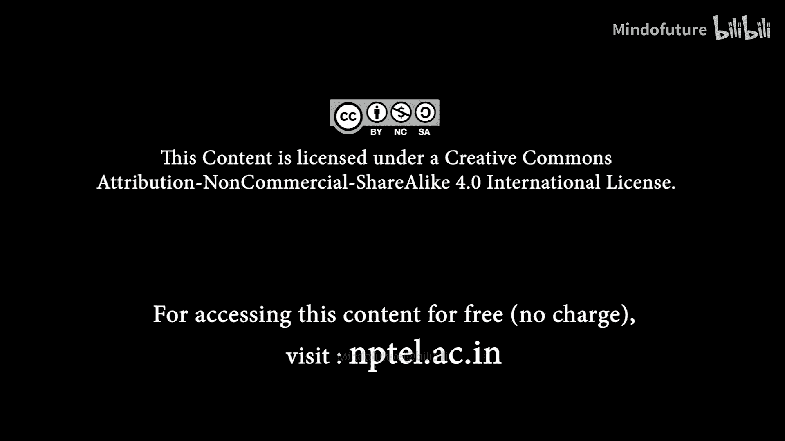
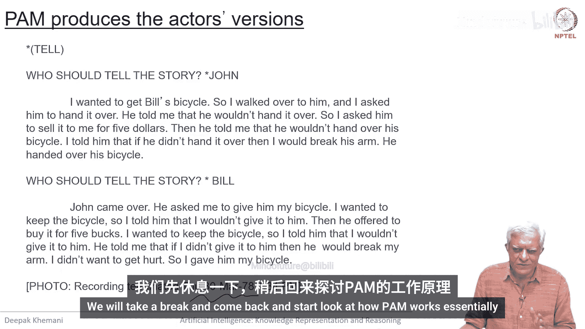

# 091：自行车争夺战

在本节课中，我们将学习如何使用目标、计划和行动来理解一个故事。我们将通过一个名为“Pam”的程序来分析“自行车争夺战”这个故事，看看它如何通过推理角色的目标和计划来理解情节。

## 概述

上一节我们介绍了Pam程序理解故事的基本原理。本节中，我们来看看Pam如何具体分析一个关于约翰和比尔争夺自行车的故事。我们将跟随Pam的推理过程，学习它如何将句子转化为内部表示，并利用目标、计划和行动之间的逻辑关系来理解故事。

## 故事内容

以下是需要理解的故事文本：
> 约翰想要比尔的自行车。他走到比尔面前，问他是否愿意把自行车给他，比尔拒绝了。然后约翰告诉比尔，他愿意出5美元买下它，但比尔仍然不同意。最后，约翰告诉比尔，如果他不交出自行车，就会打断他的胳膊。于是，比尔把自行车给了约翰。

## Pam的理解过程

### 识别初始目标

输入的第一句话是“约翰想要比尔的自行车”。Pam使用概念依赖理论将其表示为：
*   **目标**：约翰希望在未来**拥有**目前属于比尔的自行车。

这个目标本身不是一个预测到的事件，因此Pam启动自底向上的搜索来寻找解释。它检查规则库，发现有两个可能的“主题”可以解释为什么约翰想要自行车：
1.  他想使用这辆交通工具（`Use vehicle`）。
2.  他单纯喜欢这辆自行车（`Fondness`）。

Pam在“喜爱”主题中找到了解释，因此停止了进一步的推理。此时，Pam在故事表示中加载了一个预测：约翰（计划者）将会采取某种**行动**来满足这个“获取物品”的目标。

### 解释意外行动

下一个输入是“他走到比尔面前”。这个“走”的动作与当前的目标没有直接关联，不在预期之内。

因此，Pam再次进入自底向上推理模式，试图解释这个行动。它推断：
*   约翰有一个**子目标**：靠近比尔。
*   为了实现这个子目标，他使用了名为“走”的**计划**。
*   这个子目标本身又是实现“获取自行车”这个主要目标的**工具性步骤**。

于是，Pam理解了“走到比尔面前”这个行动：它是为了执行后续计划（询问）而必须完成的子目标的一部分。

### 识别并验证计划

接下来的输入是“问他是否愿意把自行车给他”。Pam识别出这是一个“询问”事件。

此时，Pam发现这个“询问”行动正好符合之前的预测——即约翰会采取一个计划来获取自行车。因此，“询问”被解释为约翰为了满足其目标而使用的**计划**。

基于此，Pam更新了故事表示，并设置了新的预期：比尔要么**同意**（目标达成），要么**拒绝**这个请求。

### 处理拒绝并尝试新计划

输入“比尔拒绝了”符合“拒绝”的预期。Pam解释为比尔做出了“告知约翰不会给他自行车”的决定，这是比尔“拒绝请求”计划的一部分。Pam还推断出比尔有自己的目标：**保留**他的自行车。

由于第一个计划（询问）失败，约翰尝试了第二个计划：**讨价还价**（“约翰告诉比尔他愿意出5美元买下它”）。Pam的处理方式与处理“询问”类似，将其识别为一个新计划，并再次预期同意或拒绝的结果。

比尔的再次拒绝（“比尔仍然不同意”）导致约翰启用第三个计划：**威胁**（“约翰告诉比尔，如果他不交出自行车，就会打断他的胳膊”）。Pam利用概念依赖理论表示威胁，并将其识别为“威胁”计划。

### 理解最终结果与角色动机

输入“比尔把自行车给了约翰”。这个行动满足了“约翰目标达成”的预测。

然而，Pam不理解**为什么**比尔会服从威胁。因此，它再次进行自底向上推理，寻找比尔行动的解释。它推断：
*   比尔有一个**新目标**：**保持健康**（避免胳膊被打断）。
*   为了实现这个目标，他采用了“服从威胁”的**计划**。
*   这个计划的具体**行动**就是“把自行车给约翰”。

至此，Pam完成了对整个故事的理解。

## 问答与故事复述

理解完成后，Pam可以回答关于故事的问题：
*   **问**：约翰为什么走到比尔面前？
    *   **答**：因为他想向比尔要自行车。
*   **问**：比尔为什么把自行车给约翰？
    *   **答**：因为他不想受伤。

Pam还可以从不同角色的视角复述故事：

**约翰的版本**：
> 我想要比尔的自行车，所以我走到他面前，让他把车交给我。他告诉我他不会给。于是我提出用5美元买下它，他又拒绝了。我告诉他，如果不给，我就打断他的胳膊。然后他就把自行车给我了。

**比尔的版本**：
> 约翰走过来，向我要我的自行车。我想留着自行车，所以告诉他我不会给。他提出用5美元买，我还是想留着，所以再次拒绝。他告诉我，如果不给，他就打断我的胳膊。我不想受伤，所以把自行车给了他。

## 总结

本节课中，我们一起学习了Pam程序如何逐步分析“自行车争夺战”这个故事。我们看到，Pam通过以下步骤进行理解：
1.  **识别目标**：从叙述中提取角色的主要欲望（如“想要自行车”）。
2.  **预测计划**：根据目标，预期角色可能采取的行动方案。
3.  **解释行动**：将具体的句子（如“走过去”、“询问”）归类为实现目标的**计划**或**子目标**。
4.  **处理结果**：根据行动结果（同意、拒绝）更新故事状态，并推断新目标或新计划。
5.  **最终推理**：通过将所有行动与深层目标（如“拥有物品”、“保持健康”）联系起来，理解每个角色的行为动机。

这个案例展示了基于目标的推理如何让计算机像人类一样，理解故事中事件之间的因果和意图关联。