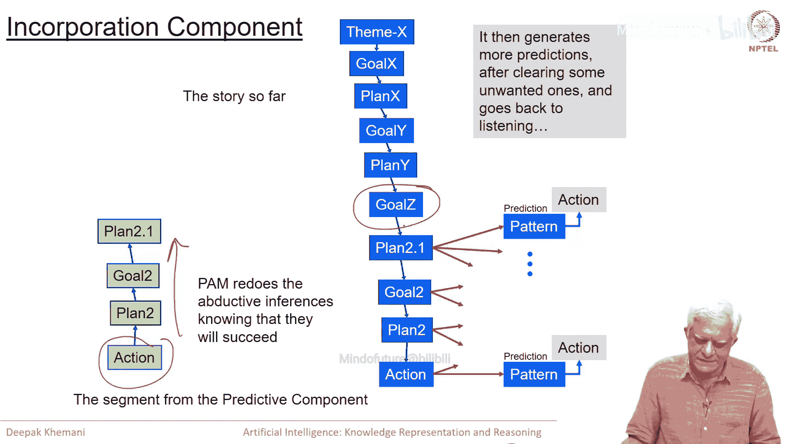

# 092：计划应用器机制PAM 🧠

在本节课中，我们将学习计划应用器机制（Plan Applier Mechanism，简称PAM）的工作原理。PAM是一个用于理解故事的程序，它通过将输入句子与内部的目标-计划层次结构进行匹配来推断故事中角色的意图和行为。

PAM的工作流程分为三个阶段：预测阶段、自底向上阶段和整合阶段。它拥有一个知识库，其中存储了针对不同类型目标的实现计划。这些计划可能包含子目标，子目标又可能关联子计划，最终会分解到具体的动作层面。当PAM读取故事时，它会尝试将句子融入这个目标-计划层次结构中，通过推断哪些计划和子目标是活跃的来理解故事。

## 预测阶段 🔮

上一节我们概述了PAM的整体框架，本节中我们来看看预测阶段的具体工作。

预测组件首先尝试解释新的输入。它可以访问PAM之前做出的一系列预测，其中一些预测来源于主题，如饥饿驱动力、维持健康等。一个预测是PAM猜测可能重要的规则条件部分，PAM在此进行溯因推理，预测不一定是事实，但可能是真的。预测组件会依次将输入与每个活跃规则的前提条件进行匹配。

以下是预测阶段的关键步骤：
*   如果某个预测得到确认，则该规则及其匹配信息，连同在自底向上阶段中关联的任何规则，都会被传递给整合组件。
*   它会追踪正在被实现的目标。
*   如果没有预测被匹配，则将控制权传递给自底向上组件。

## 自底向上阶段 🔍

当预测阶段无法匹配输入时，控制权会转移到自底向上组件。

自底向上组件为输入生成合理的解释。它利用PAM关于意图的知识，规则被组织在一种类似于语义网络中所见的判别网络中。它以测试模式进行推理，因为匹配的规则仍可能导致某种死胡同。它不会直接修改故事表示，而是在做出推断后，将其传回预测组件，由预测组件尝试查看是否有预测被匹配。如果它找不到任何规则，那么PAM就无法理解这个故事。

## 整合阶段 🔗

预测阶段和自底向上阶段共同为理解做准备，整合阶段则负责将理解结果固化。

当一个预测被输入确认时（输入可能来自故事本身，也可能是自底向上组件做出的推断），整合组件会将输入和推断整合到故事表示中。它接收导致匹配预测的规则序列作为输入，再次使用这些规则，并将推断也添加到故事中。之后，它会移除不再需要的预测（包括已被满足的预测），并生成对接下来可能听到内容的新预测，最后将控制权交还给预测组件。

## PAM的工作循环 🔄

现在我们已经了解了三个独立阶段，让我们看看它们是如何协同工作的。

可以看到，整个过程始于预测组件。当遇到被预测的内容时，就交给整合模式。否则，就调用自底向上模式，自底向上模式会生成一个新的推断。然后查看这个推断是否在预测模式的预期之中，如果不是，则再次回到自底向上模式。因此，程序会在这个“自底向上 -> 预测”的循环中迭代，直到找到被预测的内容，然后将其交给整合模式。

## 具体示例分析 📖

为了更清晰地说明，让我们通过一个假设的例子来追踪PAM的处理流程。

假设在故事阅读的某个阶段，PAM读到了一个动作。PAM有一个称为“焦点”的概念，即屏幕上看到的名为“输入间隙”的矩形框。间隙就像一个槽位，任何被读取的内容都会被送入这个间隙，因此PAM总是查看这个间隙以获取下一个输入。

以下是PAM处理一个未预期动作的推理步骤：
1.  **预测模式尝试匹配**：预测模式会逐一查看顶部的三个预测，检查输入间隙中的内容是否匹配模式。如果不匹配，则转入自底向上模式。
2.  **自底向上模式寻找计划**：PAM并未预期会听到这个动作，因此需要探索这个动作可能属于哪些计划。它进入自底向上模式，查看知识库，尝试找出这个动作可能属于的计划（假设有三个计划）。它会逐一尝试，看计划一是否成功，或者计划二是否才是目标，等等。
3.  **将计划放入焦点并返回预测**：然后，它将选中的计划放入输入间隙，并将控制权交还给预测组件。预测组件再次逐一匹配所有预测模式。
4.  **逐层向上推断**：如果再次不匹配，则交还给自底向上组件。这意味着PAM现在要查看这个计划一是否属于某个我们预期会听到的目标。在自底向上模式中，假设计划一只对应一个目标（目标一）。PAM将这个目标一放入输入间隙，并再次进入预测组件进行匹配尝试。
5.  **处理死胡同与尝试替代路径**：如果再次失败，则返回自底向上模式，尝试推断这个目标可能是哪个计划的子目标。假设目标一无法做出进一步推断（即死胡同），PAM将放弃计划一，转而尝试该动作可能关联的另一个计划（计划二）。然后重复上述过程：进入预测模式 -> 不匹配 -> 进入自底向上模式寻找计划二的目标（目标二）-> 放入预测模式 -> 不匹配 -> 再进入自底向上模式寻找目标二的上级计划或主题。
6.  **成功匹配与整合**：假设在寻找目标二的上级时，发现它可能属于两个计划和一个主题。PAM首先尝试第一个（计划2.1），将其放入输入间隙并进入预测模式。这次，假设它成功了——计划2.1正好有一个预测在等待它。于是控制权转移到整合模式。
7.  **构建故事与生成新预测**：整合模式获得了由之前句子构建的故事以及针对新动作做出的推断链（动作 -> 计划二 -> 目标二 -> 计划2.1），并将整个链条整合到故事中。随后，它会生成新的预测，即接下来预期会看到的内容。这些新预测会显示在屏幕右侧。

本节课中我们一起学习了计划应用器机制（PAM）的三阶段工作流程：预测、自底向上推理和整合。我们看到了PAM如何通过一个聚焦于“输入间隙”的循环，不断尝试将故事输入与内部的目标-计划层次结构相匹配，从而理解角色的行为意图。当直接预测失败时，PAM会通过自底向上的推理提出假设，并验证这些假设，最终将确认的推断整合到不断发展的故事表示中。