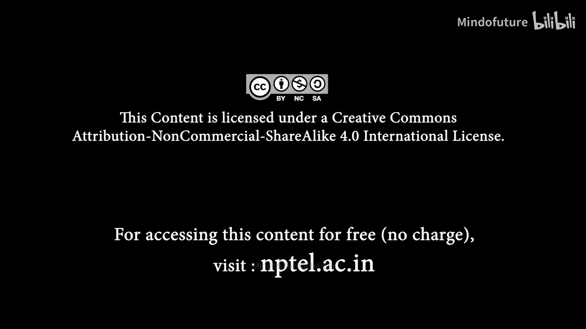
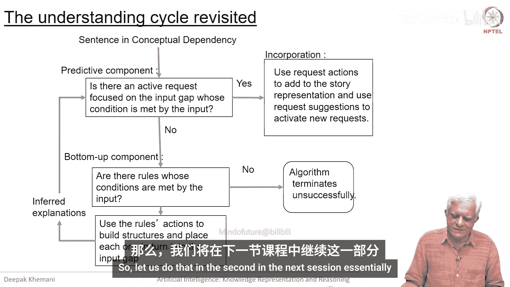

# 093：请求与规则实例

在本节课中，我们将通过一个具体的例子，深入探讨PAM（Plan Applier Mechanism）系统如何运用请求和规则来理解故事。我们将看到PAM如何通过预测、自顶向下理解和自底向上推理的循环，将新的句子整合到不断构建的故事表示中。

## 概述

上一节我们介绍了PAM的工作循环。本节中，我们来看看PAM如何应用具体的请求规则来处理一个新的故事片段，从而理解“约翰饿了”和“他在餐厅吃饭”这两个事件之间的逻辑联系。

## 理解“约翰饿了”

故事的第一句话是：“约翰饿了”。PAM接收到这个信息后，会将其转换为内部的概念依赖表示：`Actor: HUME0 (代表约翰)，Hunger Value: -3`。

PAM不解释状态，因此它首先进入自底向上推理模式。它尝试将“约翰饿了”这个状态直接放入当前的故事结构中，但发现这并不直接匹配任何现有部分。于是，PAM继续在自底向上模式中寻找可以解释此状态的规则。

它找到了一条关于“饥饿”的规则。这条规则指出：人们常常有满足饥饿的目标，而这些目标会关联到相应的计划。因此，PAM推断出约翰有一个“满足饥饿”的目标。

这个推断出的目标被添加到故事表示中。同时，PAM也理解了“约翰饿了”这件事并不意外，因为它符合“人们常常会饿”这个普遍预期。

## 激活请求规则

在推断出“满足饥饿”这个目标后，PAM知道这个目标存在两个空缺需要填补：
1.  **计划者**：谁有这个目标？
2.  **计划**：用什么计划来实现这个目标？

PAM会生成并激活相应的请求规则来寻找这些信息。这些请求规则本质上是一种指令，告诉系统接下来应该关注哪里以及寻找什么。

以下是激活的请求规则：
*   **针对计划空缺的请求**：在输入焦点中寻找一个计划，并检查它是否属于“满足饥饿”目标的计划列表。如果找到，就将其填入目标中。
*   **针对计划者空缺的请求**：在当前关注的焦点（通常是已知的参与者）中，确定谁是此目标的行动者。

这些请求被激活后，就成为了PAM的“预期”或“待办事项”，指导它如何处理后续的输入。

## 处理“他在餐厅吃饭”

接下来，故事的第二句话是：“他在餐厅吃饭”。PAM接收到这个表示“吃饭”动作的信息。

最初，PAM预期的是一个“计划”，而不是一个具体的“动作”。因此，这个动作触发了自底向上推理模式。

PAM将这个动作放入推理网络，并寻找能解释它的规则。它找到一条规则：**“在餐厅吃饭”这个动作，是“去餐厅（以满足饥饿）”这个计划的一部分**。

于是，PAM推断出存在一个“去餐厅”的计划，并将这个计划放入输入焦点进行检查。此时，之前激活的、寻找“满足饥饿之计划”的请求规则被触发。它发现“去餐厅”计划确实在“满足饥饿”目标的计划列表中，匹配成功。

## 整合故事

至此，所有空缺都被成功填补：
*   **目标**：满足饥饿（由第一句话推断）。
*   **计划**：去餐厅计划（由第二句话推断）。
*   **计划者**：约翰（由已知信息和请求规则确定）。
*   **具体动作**：在ORG0餐厅吃饭（第二句话的直接内容）。

整个故事表示被扩展和连接起来。PAM理解了约翰因为饿了（目标），所以采取了去餐厅吃饭（计划）的行动。此外，关于“餐厅脚本”的子事件空缺（例如，点餐、付款等）仍然开放，PAM会准备好通过激活新的请求规则，将后续可能出现的相关句子（例如“他不喜欢那个汉堡”）连接并整合到这个子事件结构中。

## 总结

本节课中，我们一起学习了PAM如何运用请求规则进行故事理解。我们看到了一个完整的流程：PAM首先通过自底向上推理从状态推断出目标，然后激活请求规则来建立预期；当新的输入（动作）到来时，再次通过自底向上推理将其关联到一个计划；最终，该计划满足了之前的预期，所有信息被整合成一个连贯的故事表示。这个过程的核心在于，**理解故事就是发现并连接句子之间的逻辑关系**，而请求规则正是PAM主动寻找和建立这些关系的工具。