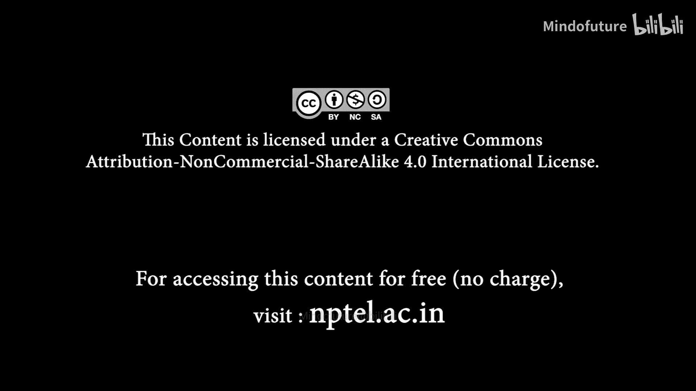
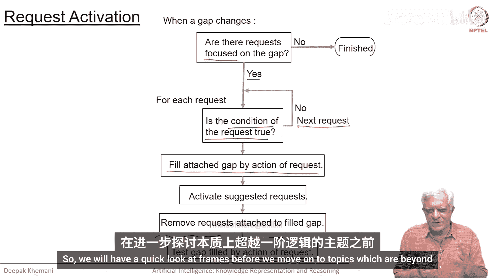

# 094：管理规则实例 🧠

在本节课中，我们将学习PAM（Plan Applier Mechanism）程序如何通过管理“请求”（Requests）来理解和推理故事。我们将深入探讨其预测与自底向上推理的循环机制，以及如何通过激活和移除请求来高效地构建故事的心理表征。

---

## PAM的工作原理概述

上一节我们介绍了PAM如何利用概念从属和脚本知识。本节中，我们来看看PAM处理故事的核心循环机制。

PAM通过生成一组预测来理解故事。它不断检查听到的内容是否符合预期。如果不符合，则进入自底向上模式进行推理，试图将新信息与已有知识关联起来。自底向上推理从行动关联到计划，再从计划关联到目标。

其核心处理循环如下：
1.  输入一个概念从属表示的句子。
2.  进入**预测模式**：检查是否有“活跃请求”的“焦点”被输入信息满足。
3.  如果满足，则进入**整合模式**：使用请求的“行动”来更新故事表征，并使用请求的“建议”来激活新的请求（即生成更多预期）。
4.  如果预测失败，则进入**自底向上模式**：检查是否有规则的“条件”被输入信息满足。
5.  如果满足，则使用规则的“行动”来构建结构，并将其放入输入焦点，然后**返回步骤2的预测模式**。
6.  这个循环持续进行，直到一个预测被满足。如果自底向上推理也无法进行，则算法以失败终止，意味着故事无法被理解。

---

## 请求链与焦点-目标机制

PAM可以建立请求链，其中一个请求的“焦点”是另一个请求的“目标”。

当一个请求被放置时，它声明：当有信息填入我的**焦点**时，我将进行推理，并将推理结果添加到我的**目标**中。而这个目标本身可能就是另一个请求的焦点。这样，一个请求的触发可以激活下一个请求，形成信息传递的链条。

这个机制确保了推理能够根据新输入的信息动态地向前推进。

---

## 目标与计划的结果字段

目标和计划都有一个我们之前未提及的“结果”字段。活跃的请求会**传递这个结果**。

这并非一个解释性请求，它不终止对解释的搜索。它只是声明：**如果计划成功，则其对应的目标成功；如果计划失败，则目标失败**。本质上，计划的结果就是其所服务的目标的结果。

例如，当John向Bill请求自行车时，PAM会生成两个独立的请求：一个处理成功情况（需将目标已实现的信息传递给程序其他部分），另一个处理失败情况（需生成新预期，寻找下一个可行计划）。

---

## 请求的移除规则

为了提高效率，程序需要管理并移除不再需要的请求，防止它们在未来被意外触发。

以下是请求移除的规则：
*   **请求触发后即被移除**：一旦一个请求的条件被满足并执行了行动，它就会被从其焦点槽上移除。
*   **目标槽被填充后，相关请求被移除**：如果一个请求填充了某个目标槽，那么所有以该槽为目标的请求都会被移除，因为结论已达成。
*   **焦点槽被永久填充后，相关请求被移除**：如果一个槽被填充且之后不会再改变，那么所有聚焦于该槽的请求在测试后也会被移除。

这些规则共同作用，在保持表征一致性的同时，极大地提升了处理效率，确保程序在任何时刻只维护相关的、活跃的规则。

---

## 请求的激活流程

现在，我们来看看当信息槽（缺口）发生变化时，请求是如何被激活的。

当程序中的一个“缺口”（即表征中的一个空槽）被新信息填充时，会发生以下步骤：
1.  检查是否有请求**聚焦于**这个发生了变化的缺口。
2.  如果没有，则处理结束。
3.  如果有，则遍历每一个聚焦于此缺口的请求，检查其**条件**是否被新信息满足。
4.  对于每一个条件被满足的请求：
    *   执行该请求的**行动**，填充它所关联的其他目标缺口。
    *   激活该请求**建议**的新请求。
5.  完成上述操作后，**移除**所有附着在刚刚被填充的原始缺口上的请求（因为该缺口的信息已更新完毕）。
6.  程序继续处理由被触发请求的行动所填充的下一个缺口。

你可以将PAM想象成一个构建大型表征网络的程序。这个网络中有许多带“槽”的框架，有些槽是空的。请求就像连接这些槽的“管道”。当一个槽被填入信息（缺口变化），与之相连的管道（请求）就会被触发，将信息或推理结果“流向”另一个槽。这种管理请求的机制，本质上是在管理阅读输入句子时，内部表征中的数据流动。

---

## 总结与展望

本节课中，我们一起学习了PAM程序如何通过管理请求链来实现故事的动态理解。我们探讨了其预测与推理的循环、焦点-目标机制、请求的激活与移除规则，以及整个数据流动的过程。

研究概念从属、脚本和PAM的目的在于：首先，理解知识表示如何聚焦于概念的层面而非语言层面；其次，探索如何以可有效利用的方式来表示背景知识或语用信息，从而理解我们听到的任意英文句子。

耶鲁大学的这项工作是在理解自然语言或故事的背景下完成的。但你可以想象，如果存储了这类知识，你也可以用它来**生成计划**（如果你有要解决的目标），甚至**生成故事**。James Meehan编写的TALE-SPIN程序就做到了这一点，它利用所有这些目标-计划互动的知识来创造角色并随机决定他们采用的计划，从而构造出故事。

贯穿本课程的核心观点是：**知识是智能行为的关键**。你必须拥有关于你所操作领域的知识。问题在于，**如何表示这些知识**以及**如何使用它们**。

接下来，我们将快速浏览一下“框架”（Frames），因为它与脚本（Scripts）常被一同提及。两者本质相似：框架更偏重**语义**和**类别**，脚本更偏重**情节**和**动作序列**。如果忽略这些差异，仅将它们视为表示方案中的元素，二者有很多共通之处。在深入一阶逻辑之外的主题之前，我们将先对框架进行简要了解。