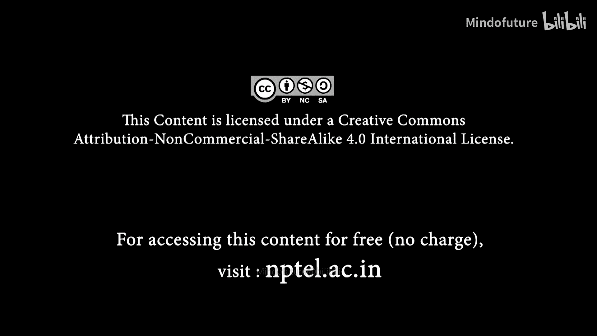
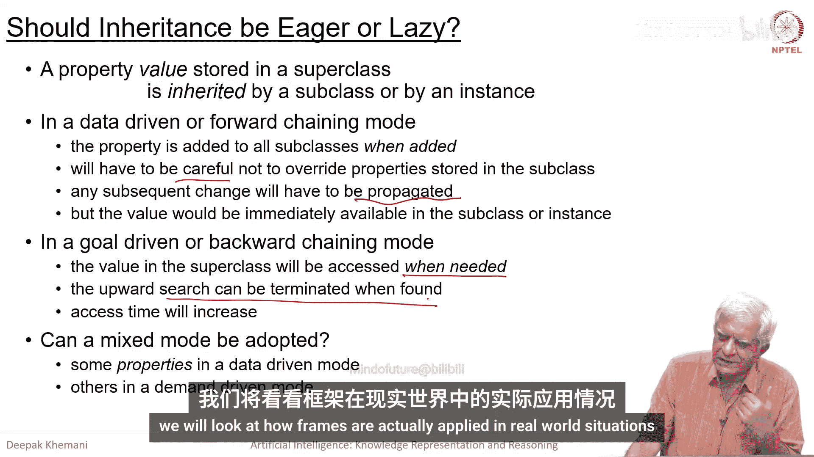

# 096：继承

## 概述
在本节课中，我们将要学习知识表示中的继承概念。我们将重点比较两种不同的层次结构：基于描述逻辑自动推导出的严格分类法，以及人工构建的、允许属性覆盖的框架系统。我们将探讨它们各自的原理、构建方法以及继承机制的特点。

## 抽象层次结构与分类法
上一节我们介绍了层次结构的概念。本节中我们来看看抽象层次结构和聚合层次结构，我们当前聚焦于抽象层次结构。我们正在比较框架系统和分类法。框架系统是人工构建的系统，而分类法则可以从描述逻辑中推导出来。

在描述逻辑中，你描述不同的概念，这些描述会强制形成特定的类与子类关系。我们之前看到，在描述逻辑中，可以使用表格法来判断一个类是否被另一个类所包含。如果这是可能的，那么我就可以创建一个图表。假设C1包含D，D包含E，依此类推。本质上，我们可以创建一个分类法。

关于表示从描述逻辑推导出的分类法，有一点需要注意：这种包含关系是传递的。如果C被D包含，D被E包含，那么C也被E包含。但为了简洁，我们不会画出所有传递性的链接，就像我们画哈斯图时一样。

## 描述逻辑中的分类法构建
让我们看看这些分类法是如何在描述逻辑中被推导出来的。给定两个概念C和D，我们有一个可判定的过程（我们见过表格法）来检查C是否被D包含。我们可以使用这个过程将所有概念排列成一个分类法。分类法本质上是一个偏序，其中子类与超类的关系成立。

由于分类法是由逻辑推导出来的，继承是严格的。我们将看到，这与人工创建的、允许覆盖的分类法不同。在基于描述逻辑的分类法中，因为关系基于逻辑，一个类只有在严格是另一个类的子类时才会被命名为其子类。

我们来看一个名为`classify`的算法，它用于将一个新概念插入到已有的分类法中。假设你已经有一个分类法，我们定义了一个新概念，它应该放在分类法的哪个位置？这由`classify`算法完成。

这个过程也可以用来构建分类法本身。你可以从一个空的分类法开始，它只包含顶概念和底概念。顶概念是全集，底概念是空集。然后，随着新概念的加入，你通过我们即将看到的过程不断插入它们。分类法本身可以通过这个过程创建。

但我们考虑一种情况：我们已经部分创建了分类法，或者已经有一个分类法，我们想向其中添加一个新概念。

## 分类算法详解
假设你有一个分类法。注意，这里我们没有画出传递性链接，这是我们遵循的惯例，尤其是在这些分类法中，因为继承是严格的，所以我们不需要那些额外的链接。例如，我们不需要从这里到这里的链接。

你看到的是一个分类法，以及其中的链接。目前我们只讨论概念，只讨论TBox，因为分类法是在TBox上定义的。当然，如果有个体存在，我们可以将其添加到所属的最具体概念中。但那是后话，分类法本身是由概念定义创建的。

我们面临的问题是：给定这个分类法和一个新概念C，我们想把它放在正确的位置。我们有一个检查包含关系的程序。

以下是插入新概念C的步骤：

1.  **构建C的超类集合**：我们从顶概念开始。显然，C会被“Thing”包含，因为所有东西都被“Thing”包含。所以我们将“Thing”放入我们正在构建的集合中——C的所有超类的集合。然后我们开始向下遍历，对于每个元素，我们问：这个概念包含C吗？如果答案是肯定的，我们就将其添加到这个超类集合中。这样，我们就构建了C的所有超类的集合。

2.  **找出最具体的超类**：然后，我们查看C的“最具体”的超类。哪些是最具体的超类？它们不包含任何其他（在此集合中的）超类。例如，这个超类包含这个和那个，所以它不会被添加到集合S中。但这些会被添加进去。所以，我们从超类集合中选出最具体的那些，称这个集合为S。

3.  **构建C的子类集合**：在下一阶段，我们从集合S开始，再次向下遍历，并使用相同的程序检查是否有概念被C包含。通过这种方式，我们识别出C的所有子类。

4.  **找出最一般的子类**：至此，C还没有任何链接，它没有被添加到表示分类法的图中。但我们知道它的位置。由此，我们找到“最一般”的子类。即那些不被任何其他（在此集合中的）子类所包含的子类。我们称这个集合为G。

5.  **建立链接**：最后，我们简单地建立从所有超类（S中的）到C的链接，以及从C到所有子类（G中的）的链接。但只有当这两个集合不相交时才这样做。因为如果它们不相交，则至少有一个公共元素。那个公共元素既包含C又被C包含，那么它本质上就是C的另一个名字。我们就不必添加另一个节点，只需给那个节点添加另一个标签即可。

这就是我们可以在描述逻辑中构建分类法的过程，它们是明确定义的，并且继承是严格的。

## 框架分类法与覆盖继承
现在让我们谈谈框架分类法。框架是人工构建的。因此，基本区别在于继承不是严格的。

在抽象层次结构中组织知识的一个直接好处就是继承。超类中的属性及其值会被其所有子类继承。例如，属性“轮子数量=4”可以存储在一个名为“四轮车”的通用框架中。然后，该属性将被所有子类或你能想到的各种汽车或具有四个轮子的车辆继承。

我们获得的主要好处是表示的紧凑性。我们只需在一个地方写下“所有这些类别的元素都有四个轮子”这个事实，然后在其他地方继承它。它们可以作为子类的默认值。所以，当我们说“掀背车是一种汽车”时，我们可以默认说它有四个轮子，因为它是某个具有四个轮子的四轮车类的子类。

当我们将子类添加到框架分类法时，我们只需要添加新的、在超类中尚不存在的东西。这再次带来了紧凑性。

在框架系统中，继承不是严格的。这意味着子类可以覆盖继承的值。例如，一辆重型卡车，可能被列在“四轮车”下（这当然是矛盾的），但假设这样做了，那么我们可以说重型卡车有六个或更多轮子。

这里也有紧凑性的考虑：为什么不创建四轮车、六轮车、八轮车、十二轮车等等的类呢？那样世界上就会有太多的类了。正如我们将在讨论默认逻辑时看到的那样，你想创建一类叫做“鸟”的东西，并且你想能够说鸟会飞。但并非所有的鸟都会飞，例如鸵鸟不会飞。那么，我们应该创建一个单独的“会飞的鸟”和“不会飞的鸟”的类吗？但那样我们会错过两者之间的许多其他共性。这本质上是紧凑性和正确性之间的权衡。而人工构建的分类法可以通过允许子类与超类不同来覆盖正确性因素，因此继承不是严格的。

## 继承的执行时机：主动与惰性
你可能想问的一个问题是：继承应该是主动的还是惰性的？这是推理中经常出现的问题：你应该在何时进行推断？继承本质上是一种推断。你应该在可能的时候进行，还是在需要的时候进行？这就是主动和惰性的区别。

主动继承对应于前向链。存储在超类中的属性值会立即被子类或实例继承。如果你在数据驱动模式（类似于前向链）下工作，那么属性在你添加到超类时就会立即添加到子类中。但你必须小心不要覆盖在较低层级已经提到的属性。如果你做了任何更改，例如，如果你改变它，这个改变必须被传播。

如果你在目标驱动模式或后向链模式下工作，那么超类的值将在你需要时才被访问。然后你将开始在分类法中向上搜索，当在其最低层级找到值时，搜索将终止。但访问时间会增加，就像惰性求值（即后向链）的情况一样。也许我们可以结合两种模式：一些属性可以用数据驱动模式实现，而另一些则可以用需求驱动模式实现。

## 总结
本节课中我们一起学习了知识表示中的继承机制。我们比较了基于描述逻辑的严格分类法和人工框架系统的区别。描述逻辑分类法通过算法（如`classify`）构建，继承关系严格且不可覆盖，保证了逻辑的一致性。而框架系统则更灵活，允许子类覆盖从超类继承的属性值，这虽然在逻辑上不严格，但在实际知识表示中提供了紧凑性和实用性。我们还探讨了继承执行的两种策略：主动（前向）继承和惰性（后向）继承，它们分别对应不同的推理需求和应用场景。理解这些差异有助于我们根据具体问题选择合适的知识表示与推理工具。