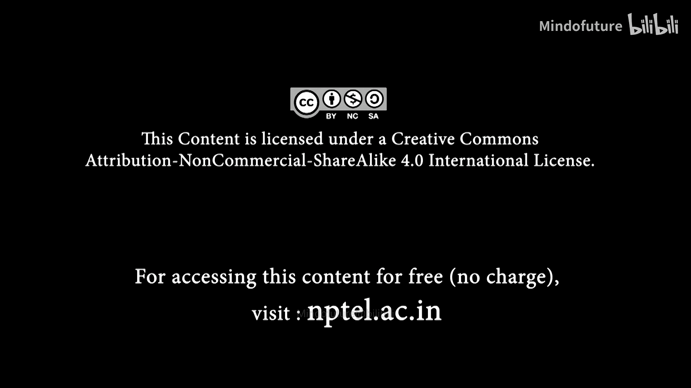
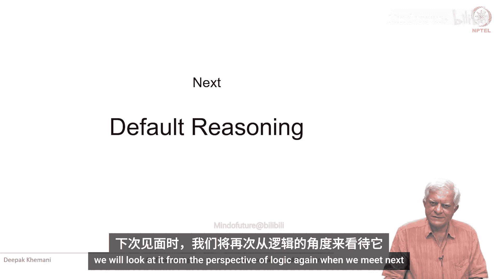

# 098：分类中的继承 🧬

在本节课中，我们将学习分类法中的继承机制。我们将探讨如何在具有抽象层次的知识结构中，从超类向子类传递信息，并处理继承过程中可能出现的冲突。我们将形式化地定义继承层次结构，并学习如何判断一条继承路径是否“可采纳”，以及如何从潜在的模糊网络中得出合理的结论。

---

## 继承中的冲突与挑战

上一节我们介绍了在描述逻辑中构建分类法，其子类与超类的关系是逻辑定义的，因此分类是严格的，不存在“覆盖”的可能性。然而，在现实世界中，情况并非总是如此。我们常常需要构建允许覆盖的分类法。

因此，我们必须解决一个问题：如果在分类法中，从不同祖先继承的信息存在冲突，我们应如何处理？我们在此并非采取纯逻辑的视角，而是将其视为一种手工构建的结构，并探究我们能从中推断出什么。

假设一个概念或个体可以从多个祖先继承特征。有时这些特征不会冲突，但有时则可能产生冲突。例如，我们知道企鹅是鸟，而鸟会飞，但企鹅不会飞。我们却将它们置于同一个分类法的不同层级中。

---

## 形式化继承层次结构

我们将继承层次结构定义为一种形式化的图形表示。我们将其限定在抽象层次结构中，因为继承本质上与抽象层次结构紧密相连。

我们将其定义为一个由顶点和边组成的有向图。图中的节点代表个体、类别或属性。在推理层面，我们将类别和属性都视为一元谓词，不做严格区分。

一条边 `(X, Y)` 表示 `X 是 Y`。这里 `X` 可以是一个类，也可以是一个个体。因此，这条边可以表示“X 是 Y 的子类”或“X 是 Y 的实例”。

我们还会引入一种**负边**，表示为 `(X, ¬Y)`。它表示 `X 不是 Y` 或 `X 不是 Y 的实例`。引入负边的作用是使冲突显式化。例如，如果我们有“X 是红色的”和“X 不是红色的”这两个陈述，冲突就非常明确。如果没有负边，像“X 是红色的”和“X 是蓝色的”这样的陈述，除非系统有额外知识（如“红色和蓝色互斥”），否则不会被视为直接冲突。

---

## 路径与可采纳性

在继承网络中，我们通过路径来推导结论。

*   **正路径**：由一系列正边组成的路径，记作 `A →⁺ B`。它支持结论 `A 是 B`。
*   **负路径**：由一系列正边结尾加上一条负边组成的路径，记作 `A →⁻ B`。它支持结论 `A 不是 B`。我们**不允许路径中出现多条负边**，因为双重否定（如“不是非哺乳动物”）的推理在此上下文中没有意义。

为了处理网络中的模糊性，Touretzky 提出了 **“可采纳性”** 的定义。一条关于个体 `A` 的结论（`A 是 B` 或 `A 不是 B`）是**可采纳的**，当且仅当存在一条支持该结论的**可采纳路径**。

一条路径是可采纳的，需要满足以下条件：
1.  路径中的每一条边本身都是关于 `A` 可采纳的。
2.  对于正路径，路径上没有任何节点 `X` 拥有一条到目标 `B` 的负边（即“预占”了该正结论）。
3.  路径中不包含关于 `A` 的**冗余边**。

**冗余边**的定义如下：如果图中存在一条从 `X` 到 `Y` 的直接边 `(X, Y)`，但同时存在另一条从 `X` 到 `Y` 的正路径，且该路径上的所有边都是可采纳的，并且没有其他节点通过负边连接到该替代路径上的任何中间节点 `Zi` 或终点 `Y`，那么直接边 `(X, Y)` 就是冗余的。

---

## 扩展与推理类型

当一个继承层次结构关于某个个体 `A` 存在潜在模糊性（即可同时推导出 `A 是 X` 和 `A 不是 X`）时，我们如何得到一组一致的信念？这通过 **“扩展”** 来捕捉。

一个关于节点 `A` 的**轻信扩展**是原网络的一个最大、连通且无模糊性的子网络。“最大”意味着不能再添加任何其他节点而不破坏其连通性或引入模糊性。

由于网络可能存在多个合法的轻信扩展，我们可以定义不同的推理方式：

以下是三种主要的推理方式：
*   **轻信推理**：如果一个结论被**至少一个**扩展所支持，就接受它。
*   **怀疑推理**：如果一个结论被**所有**扩展一致支持，才接受它。
*   **理想怀疑推理**：比怀疑推理更严格，要求所有扩展不仅支持同一结论，而且是通过**相同的路径**来支持该结论。

---

## 总结

本节课中，我们一起学习了分类法中的继承机制。我们了解到，在允许覆盖的现实世界分类中，从多个祖先继承信息可能导致冲突。我们通过形式化的继承图、正/负路径、可采纳性规则来处理这些冲突。当网络存在模糊性时，我们可以通过构建不同的“扩展”来得到一致的信念集，并可以根据需求选择轻信、怀疑或理想怀疑等不同的推理策略来得出结论。

接下来，我们将进入**默认推理**的学习，它是在开放世界假设下，进行合理但可能被新信息推翻的推断，也称为非单调推理。我们将从逻辑的角度再次探讨这一主题。