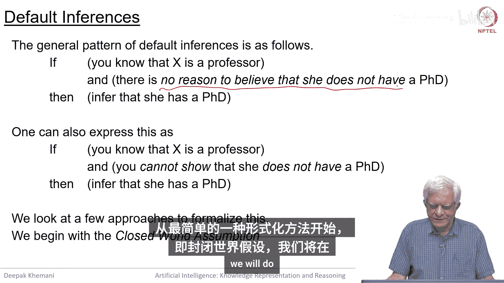

# 099：默认推理

在本节课中，我们将学习默认推理。这是一种在不确定性环境下进行推理的方法，它允许我们做出看似合理但并非由知识库严格逻辑蕴含的结论。我们将探讨为什么需要默认推理，它的基本模式，以及如何将其形式化。

上一节我们介绍了分类体系中的继承机制，并看到了其中包含的默认推断思想。本节中，我们将从逻辑的角度来审视默认推理。

## 默认推理的必要性

逻辑通常不擅长处理不确定性和不一致性。在现实世界中，我们很少能进行纯粹的演绎推理，常常面临某种程度的不确定性。

问题在于全称量词。如果你用全称量词来表达世界知识，例如 `∀x Bird(x) ⇒ Fly(x)`，那么该陈述必须对领域中的每个实例都为真。一旦出现例外（例如一只不会飞的鸟），整个知识库就会变得不一致。我们不喜欢知识库不一致，因为从不一致中可以推导出任何结论。

因此，我们需要一种机制，在给定知识库的情况下，能够做出一组看似合理的推断，并附带一个警告：如果获得更多知识，其中一些推断可能不再成立。这意味着我们能够做出的推断集合并不总是随着已知事实单调增长，事实上，当我们向知识库添加更多事实时，它可能会变小。这种推理形式也因此被称为**非单调推理**。

## 一般陈述与全称陈述

并非所有全称蕴含陈述都是正确的。以下是几个例子：

*   **真陈述**：`∀x Man(x) ⇒ Mortal(x)`（所有人终有一死）。
*   **假陈述**：`∀x Rose(x) ⇒ Red(x)`（并非所有玫瑰都是红色的）。
*   **定义性真陈述**：`∀x Triangle(x) ⇒ Quadrilateral(x)`（所有三角形都是四边形）。（*译者注：此处原文可能有误，三角形不是四边形。可能意指“所有三角形都有三条边”这类定义性陈述。*）
*   **真陈述**：`∀x, y Parent(x, y) ⇒ Older(x, y)`（所有父母都比他们的孩子年长）。
*   **假陈述**：`∀x Bird(x) ⇒ Fly(x)`（并非所有鸟都会飞，例如企鹅、鸸鹋、鸵鸟）。
*   **假陈述**：`∀x AquaticCreature(x) ⇒ Fish(x)`（并非所有水生生物都是鱼，例如鲸鱼、海蛇）。

尽管如此，这类关联非常有用，我们仍然希望能够表达它们。因此，我们将它们表达为**一般关系**，而非**全称关系**。我们真正的意思是“通常，鸟会飞”或“一般来说，水生生物是鱼”。

## 默认推断的模式

我们希望进行的推断被称为**默认推断**。以下是几个例子：

*   如果 `x` 是一只鸟，我们应能推断 `x` 会飞。
*   如果 `x` 是一片叶子，我们应能推断 `x` 是绿色的。
*   如果 `x` 没上过大学，我们可能推断 `x` 不聪明。
*   如果 `x` 是一位教授，我们可能推断 `x` 拥有博士学位。

这些推断通常为真，但可能存在例外。当获得关于 `x` 的更多信息时，它们可能被证明是假的。因此，它们也被称为**可废止的**推断，意味着其结论可能被**击败**（即被证明为假）。

默认推断的一般模式如下：

> 如果你知道 `x` 是教授，并且**没有理由相信**她不拥有博士学位，那么**推断**她拥有博士学位。

或者重新表述为：

> 如果你知道 `x` 是教授，并且**不能证明**她不拥有博士学位，那么推断她拥有博士学位。

我们希望以规则的形式来表达知识，这些规则允许你进行推断，但同时附加一个条件：“除非……否则成立”。

## 总结

本节课中，我们一起学习了默认推理的基本概念。我们了解到，由于现实世界充满例外和不确定性，使用严格的全称逻辑规则会导致问题。默认推理允许我们基于“通常情况”进行合理推断，同时保留在获得新信息时撤回结论的能力。其核心模式是：在已知某些前提且没有相反证据的情况下，可以得出一个默认结论。

在下一节中，我们将开始探讨形式化默认推理的方法，并从其中最简单的一种形式——**封闭世界假设**开始。