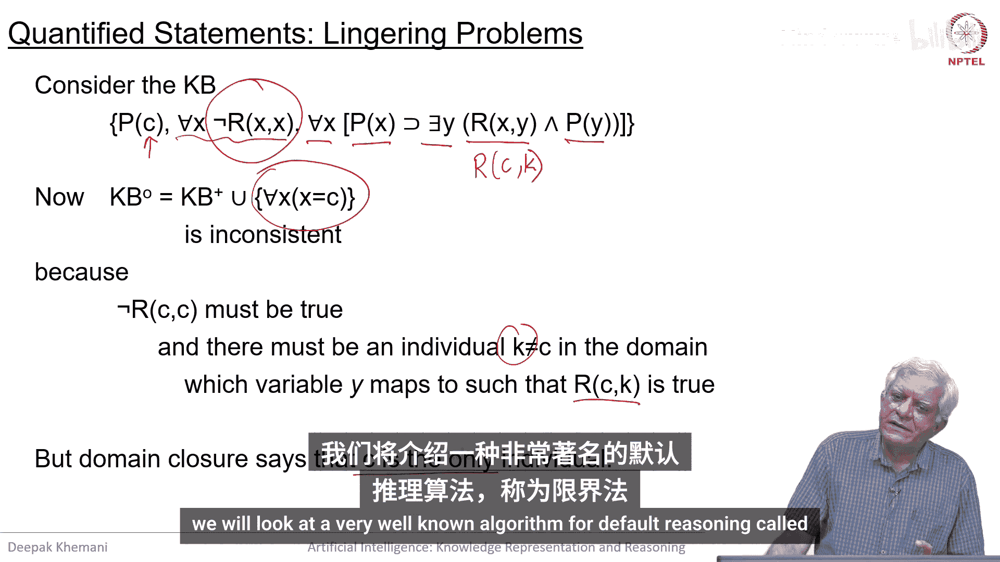

知识表示与推理：P100：封闭世界假设 🧠

在本节课中，我们将学习一种处理不完全知识下推理的简单方法：封闭世界假设。我们将探讨其基本思想、实现方式、潜在问题以及一些改进方案。

---

上一节我们介绍了默认推理的概念。本节中，我们来看看其中一种最简单的实现方法：封闭世界推理。

封闭世界假设的核心思想是：除非已知一个原子命题 **P** 为真，否则就假定它为假。这类似于我们在学习 Prolog 时遇到的“否定即失败”机制，但此处仅适用于原子语句。

为了应用这一假设，我们需要对知识库进行扩充。以下是具体步骤：

首先，我们有一个初始的知识库 **KB**。然后，我们构造一个新的知识库 **KB+**。**KB+** 包含 **KB** 中的所有语句，并额外添加所有形式为 **¬P** 的语句，其中 **P** 是一个原子命题，且 **KB** 无法推出 **P**。

完成扩充后，我们就可以使用标准的逻辑蕴含过程来处理 **KB+**，就像它只是一个普通的逻辑语句集合一样，从而进行推理。此时，我们说原始知识库 **KB** 在封闭世界假设下可以推出 **α**。

---

然而，采用封闭世界假设会带来一个后果：推理过程不再是“局部”的。在命题逻辑和一阶逻辑中，推理是局部的，结论仅依赖于其前提。一旦前提已知为真，结论就可以被添加到知识库中。

但在默认逻辑中，为了证明 **KB** 无法推出某个原子命题 **P**，我们必须探索所有可能的证明途径，这意味着需要检查整个知识库。因此，当向知识库中添加更多语句时，推理的正确性依赖于对整个知识库的检查，这使得过程变得非局部。其他形式的推理（如概率推理）也往往具有类似特性。

---

接下来，我们通过“外延”的概念来理解封闭世界推理的作用。

一个谓词的外延是其所有为真的实例的明确列举。例如，如果论域是数字 {1, 2, 3, 4}，那么关系 `<` 的外延就是集合 {(1,2), (1,3), (1,4), (2,3), (2,4), (3,4)}。

封闭世界推理所做的，就是最小化所有原子谓词的外延。它只保留那些已知为真或可以被推出的实例，而舍弃其他所有可能。从某种意义上说，这使得外延尽可能小。

---

但是，这种最小化方法在某些知识库中会导致问题，特别是当知识库包含析取语句时。析取式常常带来麻烦，这也是我们使用霍恩子句获益的原因之一。

考虑一个简单的知识库，它包含语句：**P ∨ Q**（例如，“Tweety 会飞” 或 “Pepi 会飞”）。我们知道至少有一个为真。

当我们应用封闭世界假设时，会尝试向知识库添加 **¬P** 和 **¬Q**，因为我们无法证明 **P** 或 **Q** 为真。但添加后，知识库会变得不一致，因为子句集合 **{P ∨ Q, ¬P, ¬Q}** 是不可满足的。

---

为了解决这个问题，人们提出了广义封闭世界假设。

其核心思想是：不要不加区分地最小化所有原子谓词的外延。特别是，对于出现在析取式中的原子谓词，只有在有证据表明析取式本身仍能成立（即知识库不会变得不一致）时，才对其进行最小化。

具体方法是：在扩充知识库时，对于一个原子命题 **P**，如果存在一个包含 **P** 的析取式 **P ∨ Q₁ ∨ ... ∨ Qₙ**，并且剩余文字（即不含 **P** 的部分）**Q₁ ∨ ... ∨ Qₙ** 本身为真，那么我们才可以安全地将 **¬P** 添加到知识库中。

例如，如果知识库有“Tweety 或 Pepi 会飞”，并且我们还能推出“Tweety 或 Pepi 或 Chirpy 会飞”，那么我们可以添加 **¬flies(Chirpy)**，因为我们知道“Tweety 或 Pepi 会飞”这个析取式本身是成立的。广义封闭世界假设不如封闭世界假设严格，它更注重维护知识库的一致性。

---

封闭世界假设和广义封闭世界假设面临的另一个问题是处理量化语句。

这是因为知识库中可能存在未命名的个体。例如，如果知识库只提到了数字 1, 2, 3, 4，我们如何判断“对于所有 x，x < 11”或“存在 x，使得 x > 11”这样的语句呢？我们不知道论域中是否还有其他个体。

如果我们假设论域中的个体仅限于知识库中明确提到的那些（这符合封闭世界假设的精神），那么我们就可以做出判断。这通过添加**论域封闭公理**来实现。

该公理声明：对于所有 **x**，**x** 必须等于知识库中提到的某个特定个体。例如，如果知识库只提到常量 **c**，那么论域封闭公理就是：**∀x (x = c)**。

---

然而，即使应用了论域封闭公理，一些问题仍然存在。考虑以下知识库：
*   **P(c)** 为真。
*   **∀x ¬R(x, x)** 为真。
*   **∀x [P(x) → ∃y (R(x, y) ∧ P(y))]** 为真。

假设论域封闭公理规定只有个体 **c** 存在（即 **∀x (x = c)**）。根据第三条规则，因为 **P(c)** 为真，必须存在某个 **y** 使得 **R(c, y) ∧ P(y)** 为真。这个 **y** 不能是 **c** 本身，因为 **¬R(c, c)**。但论域封闭公理又说只有 **c** 存在，这就产生了矛盾。

这个例子说明，即使结合了封闭世界假设和论域封闭公理，在处理包含存在量词和自反性否定的复杂知识时，仍可能遇到一致性问题。

---

本节课中，我们一起学习了封闭世界假设及其在默认推理中的应用。我们了解了如何通过扩充知识库来实现它，也探讨了它带来的非局部推理特性、在处理析取式时可能导致的矛盾，以及通过广义封闭世界假设和论域封闭公理进行的改进和限制。在下一节中，我们将学习一种非常著名的默认推理算法：限定。