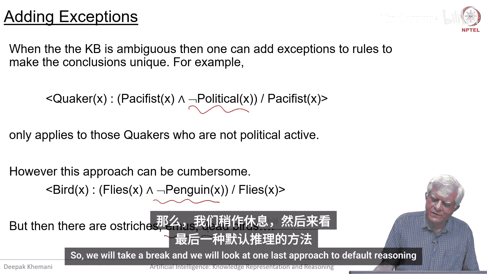

# 101：缺省逻辑 🧠

在本节课中，我们将学习第三种处理缺省推理的方法——**缺省逻辑**。缺省逻辑由雷特提出，它不通过最小化谓词来封闭假设，而是允许我们在特定条件下做出一些积极的假设。

---

## 缺省理论的结构

上一节我们介绍了缺省逻辑的基本思想，本节中我们来看看其具体构成。一个缺省逻辑的知识库被称为**缺省理论**，它由两部分组成：

1.  **理论 F**：一组确定的事实。
2.  **缺省规则集 D**：一组允许我们进行假设的规则。

一个缺省规则具有以下形式：
`α: β / δ`
其中：
*   **α** 是**前提**。
*   **β** 是**证成**。
*   **δ** 是**结论**（即我们可以做出的假设）。

该规则的含义是：如果我们相信前提 α，并且相信证成 β 是**一致**的（即我们不相信 ¬β），那么我们就可以相信结论 δ。

---

## 规则示例与扩展

理解了缺省规则的形式后，我们来看一个具体例子。关于“鸟会飞”这一常识，在缺省逻辑中可以表示为：
`bird(x): flies(x) / flies(x)`
这种证成与结论相同的规则被称为**正常规则**，通常简写为 `bird(x) : / flies(x)`。它表示：如果 x 是鸟，并且“x 会飞”与当前信念一致，那么就可以假设 x 会飞。

那么，给定一个缺省理论，我们最终能相信什么？这由**扩展**来定义。一个扩展是一个一致的信念集合 E，它满足以下条件：所有能从“理论 F”与“在 E 中可应用的缺省规则所得结论集”的并集中推导出的句子，都属于 E。

更具体地说，一个缺省规则 `α: β / δ` 在扩展 E 中**可应用**，当且仅当：
*   α ∈ E （前提在 E 中）
*   ¬β ∉ E （证成的否定不在 E 中，即 β 与 E 一致）

---

## 处理异常与歧义

现在，我们来看看缺省逻辑如何处理异常情况和推理歧义。考虑以下知识库：
*   F: `bird(tweety)`, `bird(chilly)`, `¬flies(chilly)`
*   D: `bird(x) : / flies(x)`

这个理论有唯一的扩展，其中包含 `flies(tweety)`，但不包含 `flies(chilly)`。因为对于 chilly，`¬flies(chilly)` 已在 F 中，使得证成 `flies(chilly)` 不一致，因此缺省规则不可应用。

然而，缺省逻辑也可能产生多个扩展，导致歧义。例如：
*   F: `quaker(nixon)`, `republican(nixon)`
*   D: `quaker(x) : / pacifist(x)`, `republican(x) : / ¬pacifist(x)`

此理论将产生两个扩展：一个包含 `pacifist(nixon)`，另一个包含 `¬pacifist(nixon)`。面对多个扩展：
*   **怀疑论推理者**只相信所有扩展共有的结论。
*   **轻信论推理者**相信任一扩展中包含的结论。

可以通过为规则添加例外条件来解决歧义，例如：
`quaker(x) : pacifist(x) ∧ ¬politicallyActive(x) / pacifist(x)`
但这会使规则变得复杂，且难以穷尽所有例外情况。

---

## 总结

本节课中，我们一起学习了**缺省逻辑**。我们了解了缺省理论由事实和缺省规则构成，缺省规则允许我们在前提成立且证成一致时，做出积极的假设。信念的最终集合由“扩展”定义，并且可能不唯一，从而导致了怀疑论和轻信论两种推理方式。虽然可以通过添加例外来处理歧义，但这种方法可能显得繁琐。