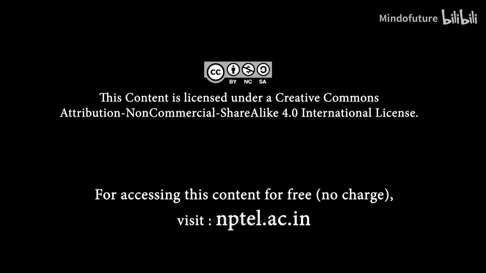
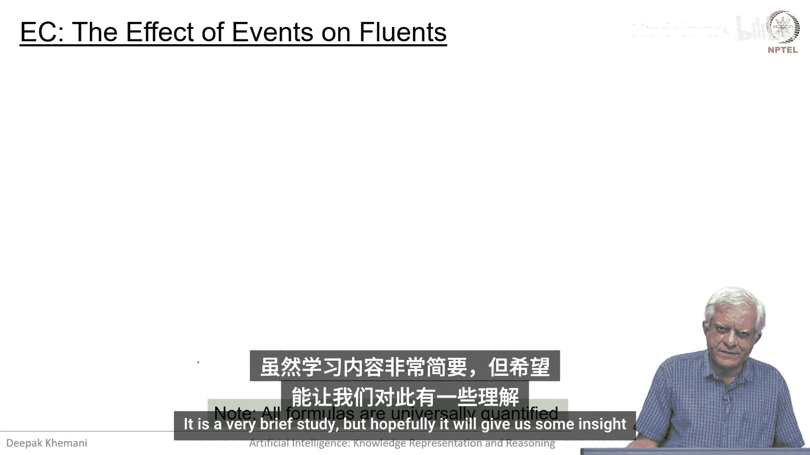

# 103：事件演算 🕰️

在本节课中，我们将学习**事件演算**。这是一种超越一阶逻辑的方法，用于处理**时间、变化和动作**的推理。我们将看到如何将动作和谓词本身作为对象来处理，并理解事件演算中的核心概念和谓词。

## 从一阶逻辑到事件演算

上一节我们介绍了默认推理。本节中，我们来看看如何扩展一阶逻辑以处理动态变化的世界。

在一阶逻辑中，语言的**项**要么是变量、常量，要么是由函数符号构造的项。**公式**则由项构成，例如 `t1 = t2` 或 `P(t1, ..., tn)`。这些公式的谓词参数只能是**项**，而项指向我们讨论的**领域**中的对象。

然而，一阶逻辑无法直接处理像**动作**或**时间**这样的概念。虽然我们可以将时间作为显式参数加入，但动作本身不是领域中的对象。类似地，像“A在B上”这样的陈述，其真值会随着动作（如拿起A）的发生而改变。在一阶逻辑中，一旦一个陈述被证明为真，它就永远为真，但这不适用于动态世界。

为了解决这个问题，我们引入了**事件演算**。它将动作和那些真值可变的谓词（称为**流**）本身作为领域中的对象来处理。这个过程称为**具体化**。

## 事件演算的构成要素

事件演算是一种语言，允许我们讨论**时间**、**事件（动作）** 和**流**之间的关系。以下是其核心构成：

事件演算中的变量和常量属于以下几种**类型**：

*   **事件类型**：表示动作或外部事件。变量通常用 `e1, e2, e3` 等表示。
    *   例如：`unstack(blockA, blockB)`（动作）、`rain`（外部事件）。
*   **流类型**：表示真值可变的谓词。变量通常用 `f1, f2, f3` 等表示。
    *   例如：`on(blockA, blockB)`, `at(Ram, office)`。
*   **时间点类型**：表示时间点。变量通常用 `t1, t2, t3` 等表示。
    *   在连续事件演算中可以是实数，在离散事件演算中可以是整数。

## 事件演算的核心谓词

以下是事件演算中定义的一些关键谓词，它们将上述类型的项作为参数：

*   **`happens(e, t1, t2)`**：表示事件 `e` 在时间点 `t1` 开始，在时间点 `t2` 结束（具有持续时间）。瞬时动作可以视为 `t1 = t2`。
    *   示例：`happens(eclipse, t5, t7)`。
*   **`holds_at(f, t)`**：表示流 `f` 在时间点 `t` 为真。
    *   示例：`holds_at(solid(glacier17), t21)`。
*   **`initially(f)`**：表示流 `f` 在推理开始的时间点 `t0` 为真。等价于 `holds_at(f, t0)`。
*   **`initiates(e, t, f)`**：表示事件 `e` 在时间点 `t` 发生，并导致流 `f` 在 `t` 之后变为真。
    *   示例：事件“醒来”会启动流“清醒”。在离散事件演算中，这通常意味着 `holds_at(f, t+1)`。
*   **`terminates(e, t, f)`**：表示事件 `e` 在时间点 `t` 发生，并导致流 `f` 在 `t` 之后变为假。它是 `initiates` 的反面。
*   **`released_at(f, t)`**：表示流 `f` 在时间点 `t` 被**豁免**于常识惯性定律。惯性定律规定，除非受事件影响，否则流的真值保持不变。`released_at` 用于处理不确定性，表示我们无法推断其状态。
    *   示例：抛硬币后，流 `heads(coin)` 的状态被释放，无法预测。

## 派生谓词

为了方便表达，事件演算定义了一些派生谓词：

以下是几个常用的派生谓词及其定义：

*   **`clipped(t1, f, t2)`**：表示在时间 `t1` 和 `t2` 之间的某个时刻，流 `f` 被变为假。
    *   逻辑定义：`∃e, t [happens(e, t) ∧ t1 ≤ t ≤ t2 ∧ terminates(e, t, f)]`
*   **`declipped(t1, f, t2)`**：表示在时间 `t1` 和 `t2` 之间的某个时刻，流 `f` 被变为真。
    *   逻辑定义：`∃e, t [happens(e, t) ∧ t1 ≤ t ≤ t2 ∧ initiates(e, t, f)]`
*   **`persists(t1, f, t2)`**：表示在时间区间 `[t1, t2]` 内，流 `f` 未被豁免于惯性定律，并保持了其真值。
    *   逻辑定义：`∀t [t1 ≤ t ≤ t2 → ¬released_at(f, t)] ∧ (holds_at(f, t1) → holds_at(f, t2))`

## 总结

本节课中，我们一起学习了**事件演算**的基本框架。我们了解到，为了对**时间、变化和动作**进行逻辑推理，需要将一阶逻辑中的**动作**和**流**具体化为领域中的对象。我们介绍了事件演算的三种基本类型（事件、流、时间点）和核心谓词，如描述事件发生的 `happens`、描述流状态的 `holds_at`、以及描述事件效果的 `initiates` 和 `terminates`。最后，我们还看到了一些用于简化表达的派生谓词。事件演算为我们提供了一种强大的工具，用于在动态世界中建模和推理。