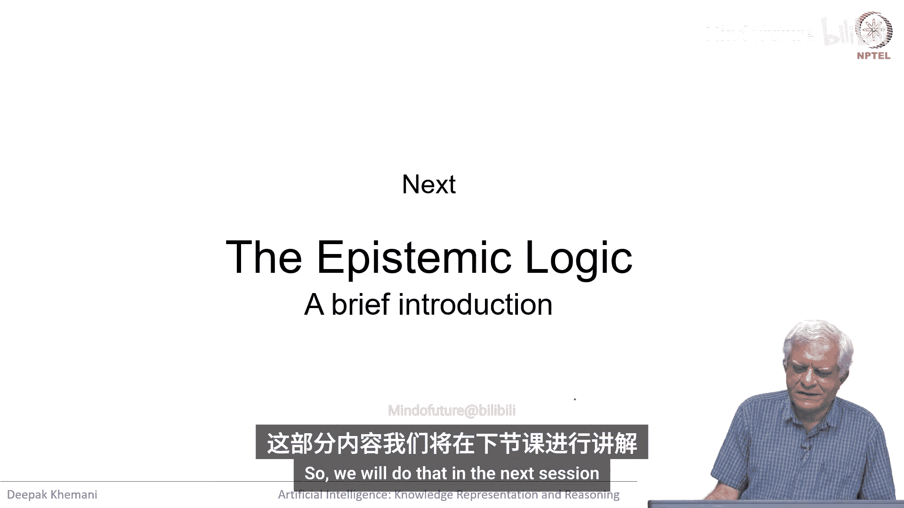

知识表示与推理：P104：事件的影响

在本节课中，我们将学习事件演算，特别是事件对“流”（fluent，即随时间变化的命题）的影响。我们将探讨事件如何启动或终止一个流，并介绍如何通过“惯性公理”和“限定”技术来处理“框架问题”，以简洁地表示动作的非影响。

---

上一节我们介绍了事件演算及其一些谓词。本节中，我们来看看这些谓词之间的关系，特别是事件对流的影响。

这是一个事件演算公理。它表示：如果一个事件 **E** 在时间 **T** 发生，并且已知事件 **E** 会启动流 **F**，那么流 **F** 在时间 **T** 成立。例如，如果机器人捡起了积木，那么机器人就持有积木。现在，时间也作为一个参数。

同理，如果一个事件发生并终止了一个流，那么该流在时间 **T** 不成立。`HoldsAt` 表示流为真，`Happens` 表示事件发生，`Initiates` 和 `Terminates` 是描述事件对流影响的关系。

我们还看到，事件可能使流脱离常识惯性定律。如果一个事件发生并释放了一个流，那么该流本质上就被释放了。

接下来，我们来看惯性公理。该公理表示：如果一个流在时间 **T1** 成立，**T2** 在 **T1** 之后，并且该流在 **T1** 到 **T2** 期间持续，且未被“剪断”，那么它在时间 **T2** 也成立。

这通过逻辑明确地表示：某物在时间 **T1** 为真，并且没有任何事情改变其真值，那么它在更晚的时间 **T2** 也为真。

---

这与“框架问题”紧密相关。框架问题是一个众所周知的挑战，即在逻辑中表示动作的效果时，如何避免显式地表示大量直观上显而易见的非效果。我们不想显式地声明“这个没变，那个没变”，而只想陈述效果，并仍能做出正确的推理。

以下是框架问题的一个例子：
*   如果你用颜色 **C** 粉刷物体 **X**，那么该物体的颜色将变为 **C**。这里，`paint(X, C)` 是一个事件，`color(X, C)` 是一个流，`Initiates` 关联了事件与流。
*   如果你将物体移动到位置 **P**，那么该物体的位置将变为 **P**。

然后，我们陈述一个“叙事”或“故事”：
*   在时间1，物体 **a** 的颜色是红色，位置在房子里。
*   在时间2，某人将 **a** 粉刷成蓝色。
*   在时间2，某人将 **a** 移动到花园。

那么，在时间4，什么是真的？移动积木会改变它的颜色吗？这类问题正是框架问题试图解决的：我们如何处理一个事物不影响另一个事物的事实？粉刷和移动积木是独立的。

---

这个问题因著名的“耶鲁射击问题”而广为人知。问题描述如下：
有三个动作：`load`（装弹）、`sneeze`（打喷嚏）、`shoot`（射击）。
有三个流：`loaded`（枪已装弹）、`alive`（存活）、`dead`（死亡，是 `alive` 的否定）。

以下是领域描述（`Sigma`）：
1.  `Initiates(load, loaded, t)`
2.  `Initiates(shoot, dead, t) ← HoldsAt(loaded, t)` （等价于 `Terminates(shoot, alive, t) ← HoldsAt(loaded, t)`）

以下是叙事（`Delta`）：
1.  `HoldsAt(alive, 0)`
2.  `Happens(load, 1)`
3.  `Happens(sneeze, 2)`
4.  `Happens(shoot, 3)`
5.  `1 < 2`
6.  `2 < 3`
7.  `3 < 4`

给定领域描述 `Sigma`、叙事 `Delta` 和以下简单事件演算公理，我们能否推出 `HoldsAt(dead, 4)`？

简单事件演算公理：
1.  `HoldsAt(f, t) ← Initially(f) ∧ ¬Clipped(0, f, t)`
2.  `HoldsAt(f, t2) ← Happens(e, t1) ∧ Initiates(e, f, t1) ∧ (t1 < t2) ∧ ¬Clipped(t1, f, t2)`
3.  `Clipped(t1, f, t2) ← ∃a, t [Happens(a, t) ∧ (t1 < t < t2) ∧ Terminates(a, f, t)]`

不幸的是，仅凭这些无法有效推出 `HoldsAt(dead, 4)`。因为我们没有显式描述动作的非效果（例如，打喷嚏不会使枪卸载），也没有描述动作的非发生（即，没有其他未陈述的动作发生），同时还需要区分不同的动作和流。

---

为了解决这个问题，我们需要引入“唯一命名假设”和“限定”技术。

唯一命名假设规定不同的动作名称（如 `load`, `sneeze`, `shoot`）和流名称（如 `loaded`, `alive`, `dead`）代表不同的实体。

限定是一种默认推理形式，用于最小化某些谓词的外延。其思想是：我们只承认已明确陈述的效果和事件发生；任何未陈述的副作用或未陈述的事件发生都被假定为不存在。

对于耶鲁射击问题，我们对领域理论（`Initiates` 和 `Terminates` 谓词）进行限定，默认假设动作没有意外效果。同时对叙事（`Happens` 谓词）进行限定，默认假设没有意外的事件发生。

通过应用限定，并包含唯一命名假设，我们现在可以有效地得出结论：在射击事件之后，`HoldsAt(dead, 4)` 成立。

---

本节课中，我们一起学习了事件演算如何超越一阶逻辑，能够将动作作为参数，讨论变化和时间。我们还将其与默认推理联系起来，指出要得出确切的结论，必须对“未发生的事件”和“未陈述的效果”做出正确的假设。我们通过限定技术实现了这一点，它允许我们基于最小化扩展的默认假设进行推理。

下一节，我们将学习本课程的最后一个主题：认知逻辑，它讨论智能体知道其他智能体知道什么。