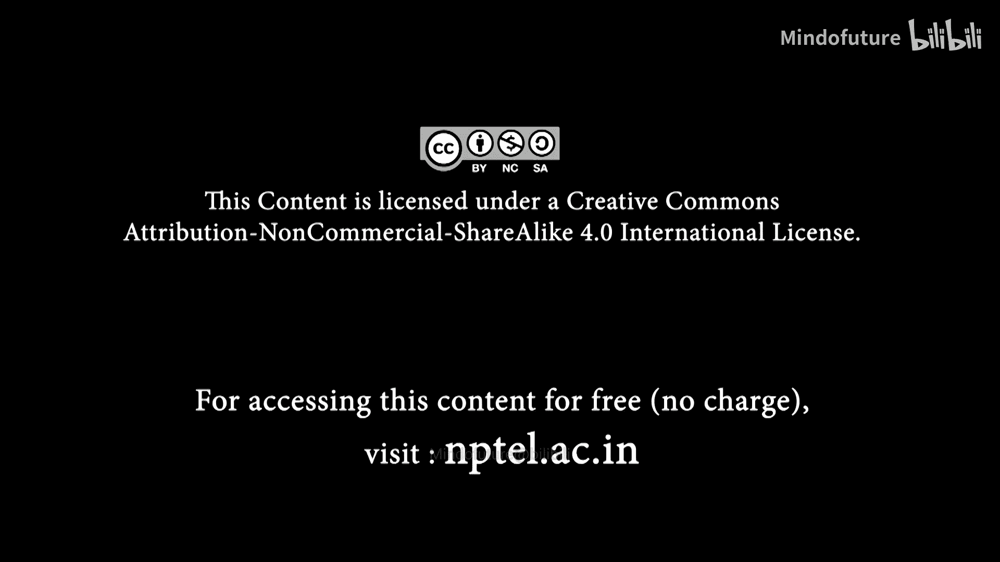
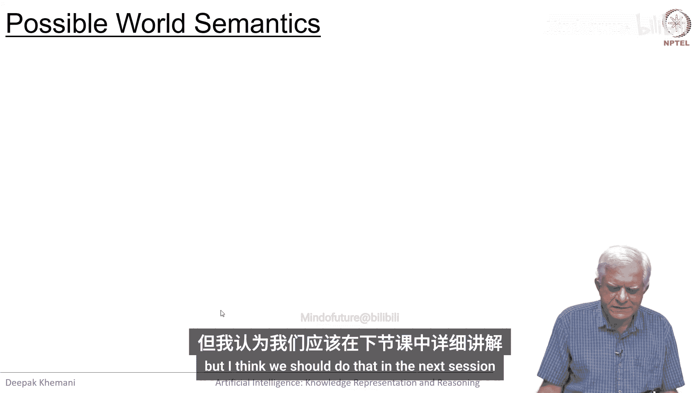

# 105：认知逻辑 👁️‍🗨️

在本节课中，我们将学习认知逻辑，这是一个关于知识和推理的新兴领域。我们将探讨在多智能体场景中，智能体如何推理彼此的知识，并通过一些经典谜题来理解其应用。

---

## 概述

到目前为止，我们已经学习了知识库、真值、证明推导等内容。从命题逻辑出发，我们探讨了默认推理（如何在大多数情况下进行一般性推断）和事件演算（如何描述事件和谓词随时间的变化）。现在，我们将进入多智能体场景，研究智能体如何了解其他智能体的知识，即“关于知识的推理”。这是一种非常普遍的情况，我们经常需要推理他人知道什么、做什么以及为什么这么做。

## 认知逻辑的应用场景

以下是认知逻辑常见的应用场景：

*   **个人互动**：例如，一个人知道他的母亲知道他需要做作业，因此晚上不能玩到很晚。
*   **策略制定**：例如，苏雷什知道阿米特知道他打算竞标合同，因此需要制定策略来出价超过阿米特。
*   **隐私保护计算**：例如，如何在不透露个人年龄的情况下，计算一群人的平均年龄。
*   **日常推理**：例如，斯塔知道她的父亲知道她的飞机已经降落。

## 经典谜题解析

让我们通过一个经典谜题来理解认知推理的过程。

**谜题描述**：谢丽尔分别给了阿尔伯特和伯纳德两个不同的自然数（从0开始）。她要求他们找出谁的数字更大。对话如下：
1.  阿尔伯特说：“我不知道。”
2.  伯纳德说：“我也不知道。”
3.  阿尔伯特说：“即使你这么说，我还是不知道。”
4.  伯纳德说：“啊哈！现在我知道谁的数字更大了。”
5.  阿尔伯特说：“那样的话，我也知道我们俩的数字了。”
6.  伯纳德说：“现在我也知道我们俩的数字了。”

**推理过程**：
1.  阿尔伯特说“我不知道”，意味着他的数字A不是0（否则他会知道自己的数字更小）。因此，A ≥ 1。伯纳德现在也知道了这一点。
2.  伯纳德说“我也不知道”，意味着他的数字B ≥ 2。因为如果B是0或1，伯纳德就会知道阿尔伯特的数字更大。现在阿尔伯特知道了B ≥ 2。
3.  阿尔伯特说“即使你这么说，我还是不知道”，这意味着A ≥ 3。
4.  伯纳德说“现在我知道谁的数字更大了”，结合已知信息（B ≥ 2， A ≥ 3），可以推断出B = 2 或 3，并且阿尔伯特的数字更大。
5.  阿尔伯特说“那样的话，我也知道我们俩的数字了”，这意味着A必须是3，并且阿尔伯特知道B是2。
6.  伯纳德说“现在我也知道我们俩的数字了”，这意味着伯纳德也推断出A是3。

**结论**：阿尔伯特的数字是3，伯纳德的数字是2。

## 认知逻辑的语言

认知逻辑扩展了经典逻辑，引入了表示“知识”的模态算子。其基本语言构成如下：

*   **原子命题**：例如 `P`。
*   **逻辑连接词**：
    *   否定：`¬φ`
    *   合取：`φ ∧ ψ`
    *   （注：通过否定和合取可以定义其他连接词，如析取、蕴含等。）
*   **认知算子**：`K_a φ`，表示“智能体a知道φ为真”。这里的φ本身也可以是认知逻辑公式。

认知算子`K`与之前见过的“信念”算子`B`类似，但关键区别在于：知识算子`K`仅适用于**真实**的陈述，而信念算子`B`没有这个要求。这个特性由“公理T”体现。

## 认知逻辑的公理系统

认知逻辑有一套标准的公理系统，通常以字母命名：

*   **公理 K (知识公理)**：`K_a (φ → ψ) → (K_a φ → K_a ψ)`
    *   含义：如果智能体a知道φ蕴含ψ，并且知道φ，那么他也知道ψ。这相当于认知层面的肯定前件律。
*   **公理 D**：`K_a φ → ¬K_a ¬φ`
    *   含义：如果智能体a知道φ，那么他不会知道非φ（即他的知识是一致的）。
*   **公理 T (真值公理)**：`K_a φ → φ`
    *   含义：如果智能体a知道φ，那么φ在现实中为真。这是知识与信念的核心区别。
*   **公理 4 (正内省公理)**：`K_a φ → K_a K_a φ`
    *   含义：如果智能体a知道φ，那么他知道自己知道φ。
*   **公理 5 (负内省公理)**：`¬K_a φ → K_a ¬K_a φ`
    *   含义：如果智能体a不知道φ，那么他知道自己不知道φ。

不同的公理组合构成不同的系统：
*   **系统 K**：只包含公理K。
*   **系统 T**：包含公理K和T。
*   **系统 S5**：最常用的系统，包含公理K、T、4和5。

## 语义：可能世界模型

认知逻辑的语义通常使用**可能世界模型**来解释。一个认知模型包含：
*   一组可能世界。
*   每个智能体有一个可及关系，连接智能体认为可能的世界。
*   每个世界对原子命题有一个真值赋值。

公式`K_a φ`在世界w中为真，当且仅当，在所有智能体a从w认为可能的世界中，φ都为真。

## 总结

本节课我们一起学习了认知逻辑的基础知识。我们了解到，认知逻辑是用于推理多智能体之间知识的工具，其核心是在经典逻辑上增加了知识算子`K_a`。我们通过公理系统（如K、T、4、5）来形式化知识的性质，例如真实性、内省性和一致性。其语义可以通过可能世界模型来理解。最后，我们通过分析阿尔伯特和伯纳德的数字谜题，直观地展示了如何利用“关于他人知识的知识”进行逐步推理。