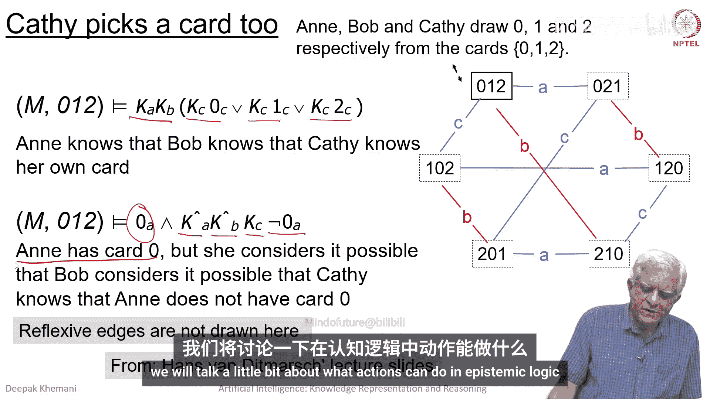

# 106：克里普克结构与可能世界语义 🧠

在本节课中，我们将学习认知逻辑的语义基础——克里普克结构和可能世界语义。我们将了解如何用这些模型来表示智能体在不完全知识下的推理过程。

## 认知逻辑回顾

上一节我们介绍了认知逻辑的语言和公理系统。认知逻辑在命题逻辑的基础上，增加了表示“知道”的模态算子 **K**。我们定义了语言，并看到了证明系统中关于知识的一组公理假设。这些公理描述了智能体对知识的基本认知。

本节中，我们来看看这种逻辑的语义模型。

## 克里普克结构与可能世界 🌍

大约80年前，克里普克为认知逻辑定义了语义。在这种逻辑中，不同的智能体在不完全知识下运作，因此无法确知世界的真实状态。

在典型的世界情境中，你知道一些事，不知道另一些事；其他智能体也知道一些事，同样不知道另一些事。我们如何在这种部分知识下进行推理？请注意，我们讨论的仍然是“知识”，而非“信念”。你只能知道为真的事，不能知道为假的事。但你的知识可能是不完全的：你知道一些事，但不知道另一些事。

克里普克引入了“可能世界”的概念。想象存在许多可能的世界，每个智能体只能“访问”其中的一部分（也可能是全部）。通常，每个智能体只能访问一部分。这类模型被称为**克里普克结构**。在不同的可能世界中，为真的命题集合也不同。

例如，假设世界中有三个命题 **P**、**Q**、**R**。你可以想象存在八个可能的世界，对应 **P**、**Q**、**R** 真值组合的所有情况。不同的智能体可能知道不同的可能世界。当然，在真实情境中，其中一个可能世界会是真实世界。但即使在真实世界中，智能体对这些世界的知识也可能是不完全的。

智能体没有足够的知识来区分某些可能世界与其他世界，尽管“地面真相”只存在于一个可能世界中。我们将通过例子来阐明“可能世界”这个概念。

这些模型被称为克里普克结构。让我们来正式定义它。

## 克里普克结构的定义 📐

设 **S** 为一组状态（或可能世界）的集合。一个可能世界是指某些陈述为真、某些陈述不为真的世界。

设 **Φ** 为一组原子命题的集合。
设 **π** 是一个映射或赋值函数，它为这些原子语句分配真值。它将集合 **Φ** 中的每个命题映射为真或假。这就像一个解释函数，类似于命题逻辑中为每个命题分配真值的函数。它为属于可能世界集合 **S** 的每个状态 **s** 进行这种赋值。因此，这是一个真值赋值或解释。

设 **A** 为智能体的集合。
然后，对于每个智能体 **a ∈ A**，我们定义一个标记为 **a** 的二元关系 **Rₐ**。**Rₐ** 是 **S × S** 上的二元关系，本质上是可能世界结构中不同状态之间的边。这个关系是一个等价关系，通常用于建模智能体无法区分的状态。

那么，一个针对 **n** 个智能体的克里普克结构 **M** 是一个元组：
**M = (S, π, {R₁, R₂, ..., Rₙ})**
其中包含：一组状态 **S**，一个解释函数 **π**，以及为每个智能体定义的一组二元关系。

## 满足关系与真值定义 ✅

接下来我们讨论满足关系。我们总是假设相对于某个可能世界进行讨论，称这个世界为 **s**。

给定克里普克结构 **M** 和该结构中的一个状态 **s**，我们说一个句子 **P** 在 **(M, s)** 中被满足（记作 **M, s ⊨ P**），当且仅当该状态下的解释函数为该语句给出的值为真。这简单地表示，解释函数告诉你该语句在那个特定状态下为真。**P** 的真值仅在该状态下有效。这本质上是谈论“事实”，即我们在讨论自认知逻辑时所说的客观陈述。

当然，还有逻辑连接词：
*   公式 **φ ∧ φ‘** 为真，当且仅当 **φ** 为真且 **φ‘** 为真。
*   否定式 **¬φ** 为真，当且仅当 **φ** 不为真。

最重要的是，我们说一个智能体 **i** 知道 **φ** 为真。在我们的语言中，这是一个公式 **Kᵢ φ**，代表智能体 **i** 知道 **φ** 这一事实。这个公式为真，当且仅当：
1.  **φ** 必须在状态 **s** 中为真。
2.  不仅如此，对于每个通过关系 **Rᵢ** 与状态 **s** 相关联的状态 **t ∈ S**（即所有智能体 **i** 无法与 **s** 区分开的状态），公式 **φ** 都必须为真。

这意味着什么？假设有一个状态 **s**，其中 **P** 为真。还有另一个状态 **t**，其中 **P** 也为真。假设还有第三个状态 **u**，其中 **P** 也为真。那么，如果在所有从 **s** 通过智能体 **i** 的关系可到达的状态中 **P** 都为真，那么我们就可以说 **Kᵢ P** 在 **s** 中成立。

但是，如果我们添加另一个状态 **v**，其中 **¬P** 为真，并且 **v** 通过关系 **Rᵢ** 与 **s** 相连，那么我们就不能说智能体 **i** 知道 **P**。因为存在一个智能体 **i** 无法区分的可能世界，其中 **P** 不为真。

因此，智能体 **i** 知道公式 **φ**，当且仅当在智能体无法区分的所有可能世界中，**φ** 都为真。

## 示例解析（两个智能体） 🧩

这里有一个例子，希望能让事情更清楚。

我们有一个克里普克结构，包含三个状态：**s**、**t**、**u**。
有两个智能体：**1** 和 **2**。
我们的语言中只有一个公式：**P**。
我们有两个关系 **R₁** 和 **R₂**，分别对应两个智能体，表示他们无法区分哪些世界。
真值赋值如下：在状态 **s** 中 **P** 为真，在状态 **u** 中 **P** 为真，在状态 **t** 中 **P** 不为假（即为假）。

我们可以用图形描绘如下：我们有三个节点，标记为状态 **t**、**s**、**u**。
状态之间有边。首先注意，每个状态对每个智能体都有一个自反边。这意味着智能体当然能区分一个状态和它自身。

这里有一条标记为 **1** 的边，连接 **t** 和 **s**。这意味着智能体 **1** 无法区分可能世界 **t** 和可能世界 **s**。
还有一条标记为 **2** 的边，连接 **s** 和 **u**。这意味着智能体 **2** 无法区分可能世界 **s** 和可能世界 **u**。

如我们所说，在 **t** 中 **P** 不为真，但在其他两个状态中 **P** 为真。

我们能说什么？我们将始终以状态 **s** 为参考进行讨论。

在这个状态 **s** 中，给定这个克里普克结构，**“智能体1知道P”** 这个陈述不成立。为什么？因为在状态 **s** 中，**P** 确实为真。但是，存在一个智能体 **1** 无法与 **s** 区分的世界，即标记为 **t** 的世界。在 **s** 中 **P** 为真，在 **t** 中 **P** 不为真。因此，智能体 **1** 显然不知道 **P** 为真。

但是，**“智能体2知道P”** 这个陈述成立。为什么？因为对于智能体 **2** 来说，可及的可能世界是 **s** 和 **u**。在 **s** 和 **u** 中，陈述 **P** 都为真。因此，就智能体 **2** 所能想象的所有世界而言，**P** 都为真。再次记住，我们始终以状态 **s** 为参考。

现在，考虑陈述：**“智能体1知道智能体2知道P是否为真”**。这意味着智能体 **1** 知道智能体 **2** 知道 **P** 的真值。智能体 **1** 自己不能确信 **P** 为真，正如我们所说，他不能说 **P** 为真。当然，他也不知道 **P** 是否为假（在这个例子中，**P** 在 **s** 中不为假）。

如果我们讨论的是世界 **t**，那么智能体 **2** 会认为 **P** 为假。但在 **s**（我们的参考状态）中，智能体 **2** 知道 **P** 的值为真，这由 **“K₂ P”** 表示。因此，**“K₁ (K₂ P ∨ K₂ ¬P)”**（智能体1知道智能体2知道P或知道非P）在 **s** 中成立。因为：
*   在状态 **s** 本身（我们的参考状态），智能体 **2** 知道 **P** 为真，我们已经观察到这一点。
*   在状态 **t**（智能体 **1** 无法与 **s** 区分的世界），智能体 **2** 知道 **P** 不为真（因为在状态 **t** 中 **P** 为假，并且从该状态智能体 **2** 无法到达任何其他状态，所以它知道 **P** 不为真）。

因此，在智能体 **1** 能看到的两个状态（**s** 和 **t**）中，智能体 **2** 都知道 **P** 的真值（在 **s** 中知道为真，在 **t** 中知道为假）。因此，智能体 **1** 知道智能体 **2** 知道 **P** 是否为真，这个公式成立。

我们将此留作一个小练习。你可以将其理解为：智能体 **2** 认为智能体 **1** 有可能知道 **P** 的值。你应该更详细地验证这确实是情况。

## 卡牌游戏示例（三个智能体） 🃏

让我们看另一个有小卡牌包的例子。假设有三个玩家：Annie、Bob 和 Cathy（用 **A**、**B**、**C** 表示）。我们有一个包含三张牌的小牌堆，牌名分别为 **0**、**1**、**2**。

用原子命题 **Cardᵢₓ** 表示玩家 **x** 持有牌 **i**。例如，**Card₂_B** 表示牌 **2** 由玩家 Bob 持有。

以下是这个世界（领域）中的一些句子及其含义：

1.  **K_A (Card₂_B)**：智能体 A（Annie）知道 Bob 持有牌 2。
2.  **K_A (Card₀_A) ∨ K_A (Card₁_A) ∨ K_A (Card₂_A)**：Annie 知道她自己持有哪张牌（0、1 或 2）。即 Annie 知道自己的牌。
3.  **K_A (¬Card₂_B)**：Annie 知道 Bob 没有持有牌 2。
4.  **K_B (¬K_A (Card₂_B))**：Bob 知道 Annie 不知道 Bob 持有牌 2。
5.  **¬K_A (¬Card₂_B)**：Annie 不知道 Bob 没有持有牌 2。这等价于说 Annie 认为 Bob 有可能持有牌 2。我们有时用 **K̂_A (Card₂_B)** 这种简写形式表示“Annie 认为 Card₂_B 可能成立”。

假设发牌情况如下：Annie 拿到牌 **0**，Bob 拿到牌 **1**，牌 **2** 在桌上。真实世界如图所示（用深色矩形表示）。Annie 持有 **0**。

但 Annie 不知道 Bob 持有 **1** 还是持有 **2**（另一张牌在桌上）。因此，图中存在一条标记为 **A** 的边，连接两个状态，表示她无法区分 Bob 持有 **1** 还是 Bob 持有 **2** 的情况。

同样，Bob 无法区分 Annie 持有 **0** 还是 Annie 持有 **2** 的情况，依此类推。从每个状态出发，都存在这种不可区分关系。

在标记为 **012** 的状态（真实世界，Annie:0, Bob:1, Cathy:2）中，我们可以判断：
*   **¬K̂_B (Card₁_A)**：Bob 不认为 Annie 有可能持有牌 1。这是真的，因为 Bob 自己持有牌 1。
*   **K̂_A (K̂_B (Card₁_A))**：Annie 认为 Bob 有可能认为 Annie 持有牌 1。因为 Annie 持有 0，她不知道 Bob 实际上持有 1。如果 Bob 持有的是 2，那么 Bob 可能会认为 Annie 持有 1。因此，Annie 认为这种可能性是存在的。
*   **K_A (K̂_B (Card₀_A))**：Annie 知道 Bob 认为 Annie 有可能持有牌 0。她确实持有 0，所以 Bob 当然有可能认为她持有 0。

现在假设 Cathy 也拿了一张牌（第三张牌）。现在我们有一个人人都持牌的世界。同样，不同智能体之间存在不可区分关系。**012** 仍然是真实世界（Annie:0, Bob:1, Cathy:2）。

在这个世界中：
*   **K_C (Card₀_C) ∨ K_C (Card₁_C) ∨ K_C (Card₂_C)**：Cathy 知道她自己持有哪张牌（0、1 或 2）。这意味着她知道她持有什么牌。
*   **K_A (K_B (K_C (Card₀_C ∨ Card₁_C ∨ Card₂_C)))**：Annie 知道 Bob 知道 Cathy 知道她自己的牌。这是一个真陈述，因为你可以验证在给定状态下这是成立的。
*   **K̂_A (K̂_B (K_C (¬Card₀_A)))**：Annie 认为 Bob 有可能认为 Cathy 知道 Annie 没有持有牌 0。Annie 实际上持有牌 0。但这里有两层“认为有可能”，所以你应该仔细思考一下这个陈述。

## 总结 📝

本节课中，我们一起学习了认知逻辑的语义基础——克里普克结构和可能世界语义。

我们了解到：
*   可能世界是描述不同真值命题组合的状态。
*   克里普克结构 **M = (S, π, {R₁, ..., Rₙ})** 形式化地定义了包含多个智能体的认知场景。
*   智能体 **i** 知道 **φ**（即 **Kᵢ φ** 为真），当且仅当 **φ** 在当前世界为真，并且在智能体 **i** 无法与当前世界区分的所有可能世界中，**φ** 都为真。
*   通过图形化的克里普克结构模型，我们可以清晰地分析多个智能体在不同知识状态下的认知关系，例如“知道”、“不知道”、“认为可能”等。

这种形式化模型为我们理解分布式知识、多智能体通信与协作奠定了坚实的基础。接下来，我们将探讨在认知逻辑中“行动”会产生什么影响。