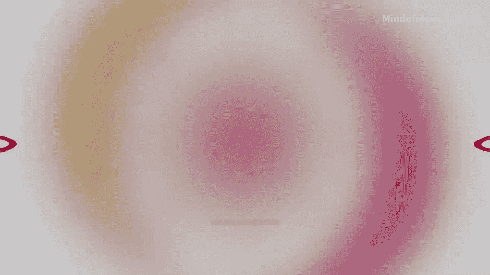
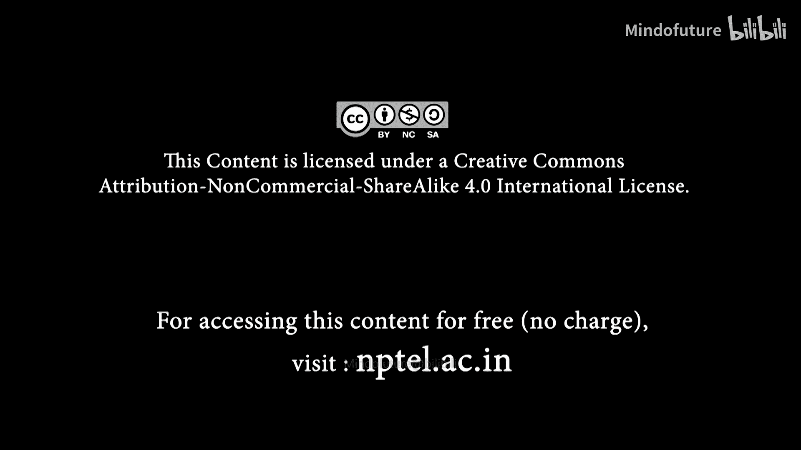
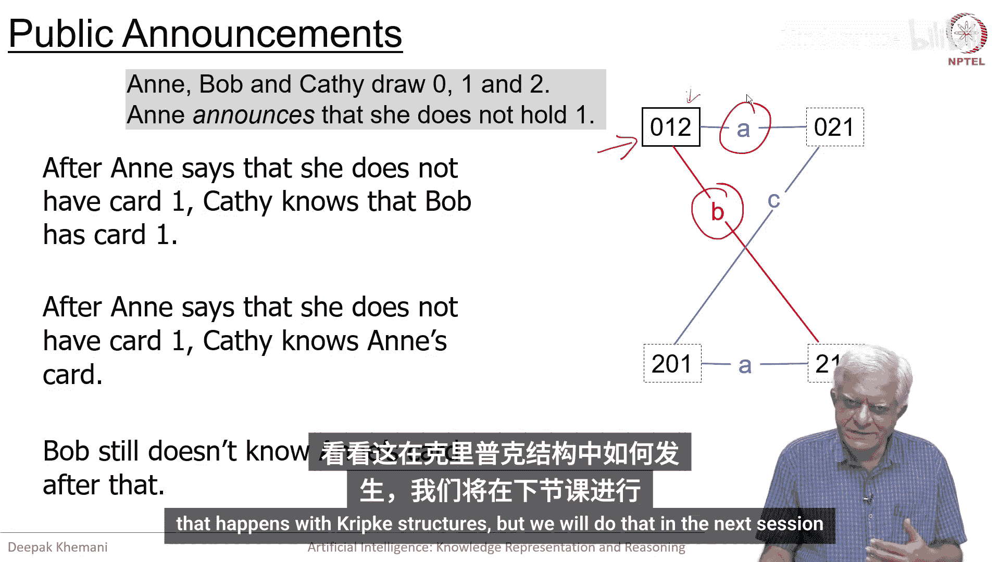

# 107：泥孩谜题 🧠

在本节课中，我们将学习认知逻辑中的一个经典谜题——泥孩谜题。我们将探讨如何使用可能世界语义来建模知识，以及公开宣告如何改变智能体对世界的认知。通过这个谜题，我们将理解智能体如何通过推理和公开信息来更新自己的知识状态。

---

上一节我们介绍了认知逻辑的基本语言和语义，特别是使用克里普克结构（可能世界模型）来表示智能体的知识。本节中，我们来看看一个具体的应用场景——泥孩谜题，并分析公开宣告如何影响智能体的认知。

## 谜题设定

假设有 **N** 个孩子在玩耍。其中 **K** 个孩子（K 可以是 0 到 N 之间的任何数）的额头沾上了泥巴，因此被称为“泥孩”。每个孩子都能看到其他所有孩子额头的情况，但无法直接看到自己的额头。此外，孩子们不会主动交流他们看到的情况。

## 关键事件与假设

一位父亲到来，并公开向所有孩子宣告：“你们当中至少有一个人的额头上有泥巴。” 在此之后，父亲会反复询问：“你们有谁知道自己的额头是否有泥巴吗？” 孩子们会同时、诚实地回答“知道”或“不知道”。

我们假设所有孩子都是完全理性、诚实且感知力强的。他们能进行所有逻辑推理，并且回答是同步的。

## 推理过程分析

以下是不同泥孩数量（K值）下的推理过程：

**当 K = 1 时（只有一个泥孩）**
*   这个泥孩看到所有其他孩子的额头都是干净的。
*   听到父亲的宣告（“至少一人有泥巴”）后，他立即推断出那个有泥巴的人就是自己。
*   因此，当父亲第一次提问时，这个孩子会回答“知道”。

**当 K = 2 时（有两个泥孩，设为A和B）**
*   第一轮提问：
    *   A看到B额头有泥，但不知道自己的情况。A会想：“如果我的额头是干净的，那么B将看到所有额头都是干净的。根据K=1的推理，B会在第一轮就回答‘知道’。”
    *   B基于同样的逻辑，也会期待A在第一轮回答“知道”。
    *   结果，两人都回答了“不知道”。这个“不知道”的回答成为了新的公共信息。
*   第二轮提问：
    *   A听到B第一轮说“不知道”，于是推断：“B没有立即知道，说明我（A）的额头不是干净的。否则B就会看到所有干净额头而立刻知道。因此，我的额头一定有泥。”
    *   B进行完全对称的推理，也得出了自己额头有泥的结论。
    *   于是，在第二轮提问时，A和B会同时回答“知道”。

**当 K = 3 时**
*   第一轮：每个泥孩看到两个泥孩，都说“不知道”。
*   第二轮：每个泥孩会想：“如果我是干净的，那么现场就只有两个泥孩。根据K=2的推理，那两个泥孩应该在第二轮回答‘知道’。” 但所有人都说了“不知道”。
*   第三轮：基于第二轮无人知晓的事实，每个泥孩推断出现场一定有第三个泥孩，那就是自己。于是所有三个泥孩在第三轮同时回答“知道”。

这个模式可以推广：**当有 K 个泥孩时，他们会在第 K 轮提问时，同时回答“知道”。**

## 公开宣告的作用

一个关键问题是：父亲的初始宣告“至少一人有泥巴”是否必要？答案是**必要**的。

*   如果没有这个宣告，即使只有一个泥孩（K=1），他也会因为看到所有其他孩子额头干净，而认为可能K=0（没人有泥巴），从而无法断定自己额头是否有泥。
*   父亲的宣告建立了 **K ≥ 1** 这个公共知识。它排除了 K=0 这个世界，为后续的递归推理提供了起点。正是基于这个公共知识，孩子们才能进行“如果我是干净的，那么别人会看到…”这样的反事实推理。

## 认知逻辑建模示例

我们可以用克里普克结构来形式化分析一个简化的知识更新场景。假设有三个智能体（Anne, Bob, Cathy）和三张牌（0, 1, 2），每人拿一张。初始的可能世界模型包含所有分配情况。

*   **公开宣告**：Anne 宣告：“我拿的不是牌1。”（这是一个真实陈述，因为她拿的是牌0）。
*   **模型更新**：这个宣告排除了所有 Anne 拿着牌1 的可能世界。这些世界从模型中**被消除**。
*   **知识更新**：
    *   Cathy 从新的模型中获益。她原来不知道牌1在谁那里。现在她知道Anne没有牌1，结合自己能看到的信息，她能**推断出**Bob拿着牌1，Anne拿着牌0。在更新后的模型里，Cathy所处的可能世界没有到其他世界的连接，这意味着她**知道**全部事实。
    *   Bob 则没有获得新信息，因为他原本就知道自己拿着牌1，Anne的宣告没有告诉他任何他不知道的事情。在他的认知里，仍然存在多个他无法区分的可能世界。

这个过程展示了公开宣告如何通过**消除不可能的世界**来收缩认知模型，从而使某些智能体获得新知。

---

本节课中我们一起学习了泥孩谜题及其在认知逻辑下的分析。我们看到了：
1.  如何通过递归推理解决分布式知识问题。
2.  **公开宣告**如何创造**公共知识**，并成为递归推理的基石。
3.  如何使用可能世界模型（克里普克结构）来形式化表示公开宣告后的知识更新，即通过消除与宣告内容不符的可能世界来收缩模型。

这个谜题清晰地展示了理性智能体如何利用公共信息和逻辑推理，从最初的不确定状态逐步获得确定的知识。