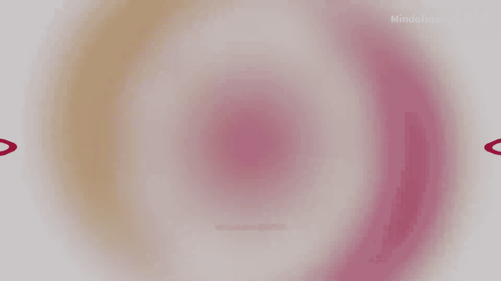
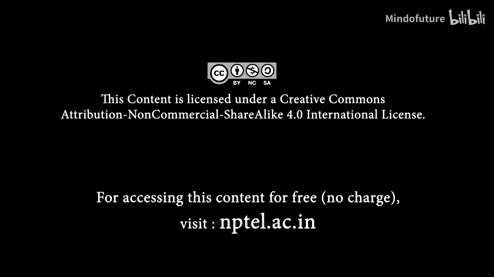
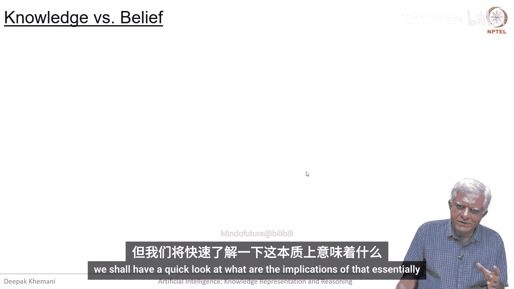

知识表示与推理：108：认知行为的影响

在本节课中，我们将学习知识结构如何通过获取新信息（如公开宣告）进行剪枝，并以“泥孩子”谜题为例，深入探讨公共宣告如何影响群体的认知状态。我们还将介绍“公共知识”与“相互知识”这两个核心概念，并对比知识与信念的区别。

上一节我们介绍了知识结构，本节中我们来看看当智能体通过公开宣告获取新信息时，这些结构会发生怎样的变化。公开宣告，例如举手表示“是”，会消除某些可能世界，从而更新所有智能体的知识状态。

**泥孩子谜题示例**

考虑一个场景，有三个孩子：Anne、Bob和Cathy。他们的额头可能沾有泥巴。每个孩子能看到其他孩子的额头，但看不到自己的。我们用三个变量（A, B, C）表示，每个变量取值为0（干净）或1（泥泞）。初始时，存在2^3=8种可能世界。

父亲公开宣告：“你们中至少有一个人的额头上有泥。”这个宣告排除了（0,0,0）这个世界。此后，每个孩子都会根据自己观察到的情况和这个公共知识进行推理。

以下是推理过程的关键步骤：

1.  第一次提问：父亲问：“有人知道自己额头有泥吗？”如果只有一个孩子额头有泥（例如世界（1,0,0）），那么那个孩子（Bob）将立刻知道，因为他能看到其他两人额头干净，结合父亲的宣告，就能推断出自己额头有泥。然而，在本次场景的真实世界（1,1,0）中，没有人举手。这意味着所有“只有一个孩子额头有泥”的世界（(1,0,0), (0,1,0), (0,0,1)）也被排除了。
2.  第二次提问：此时只剩下（1,1,0）、（1,0,1）、（0,1,1）、（1,1,1）这些世界。在真实世界（1,1,0）中，Anne能看到Bob有泥、Cathy干净。她知道至少两人有泥（因为第一次无人举手，排除了只有一人有泥的情况）。由于她只看到Bob一人有泥，她就能推断出自己额头也有泥。Bob同理。因此，当父亲第二次提问时，Anne和Bob都会举手。

**公共知识与相互知识**

上述推理依赖于“父亲的宣告是公共知识”这一关键前提。

*   **公共知识**：一个命题P对一组智能体是公共知识，当且仅当：每个智能体都知道P，每个智能体都知道其他每个智能体都知道P，并且这个嵌套认知可以无限延续下去。公式表示为：`C_G P`，其中对于群体G中的任意智能体i, j, ...，`K_i P`、`K_i K_j P`、`K_i K_j K_k P`... 都成立。
*   **相互知识**：一个命题P对一组智能体是相互知识，当且仅当每个智能体都知道P，但他们不一定知道其他人也知道P。这是一个更弱的概念。

在泥孩子谜题中，如果父亲是私下分别对每个孩子耳语“至少一人有泥”，那么这就只是相互知识，而非公共知识。在这种情况下，对于有两个或以上泥孩子的情况，孩子们将永远无法推断出自己额头是否有泥。因为Anne不知道父亲对Bob说了什么，所以她无法理解Bob为何不举手，推理链条就此中断。

**公共知识的达成与挑战**

公开宣告是达成公共知识的直接方式。然而，在某些通信不可靠或存在延迟的场景中（例如著名的“两将军问题”），达成公共知识极其困难，因为确认“对方知道我知道”的过程需要无限循环的确认。

本节课中我们一起学习了认知行为，特别是公开宣告，如何通过剪枝可能世界来更新知识状态。我们以泥孩子谜题为例，详细演示了基于公共知识的推理过程。最后，我们区分了强大的“公共知识”与较弱的“相互知识”，并理解了前者在协同推理中的关键作用。下一节，我们将探讨“信念”这一概念，及其与“知识”的区别。