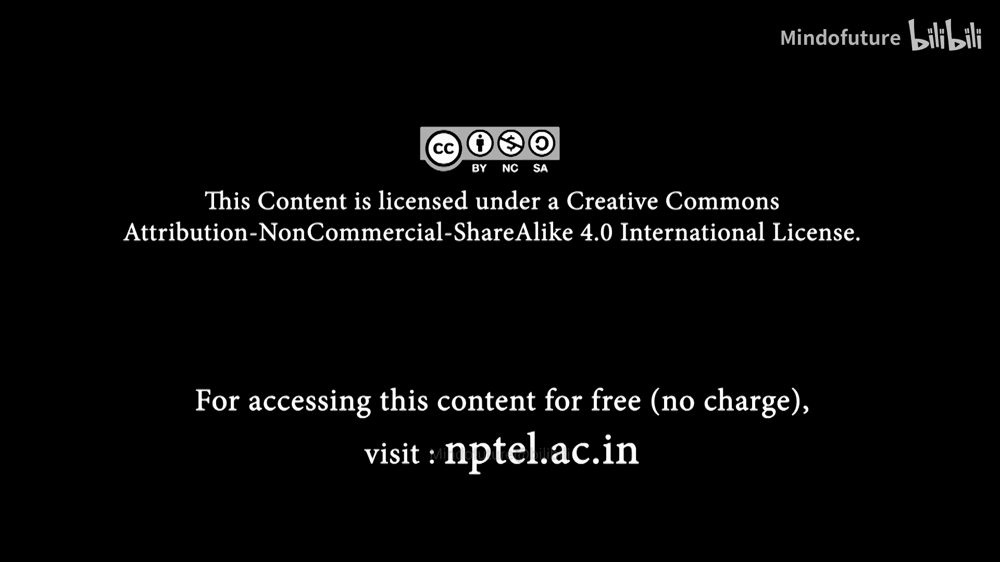
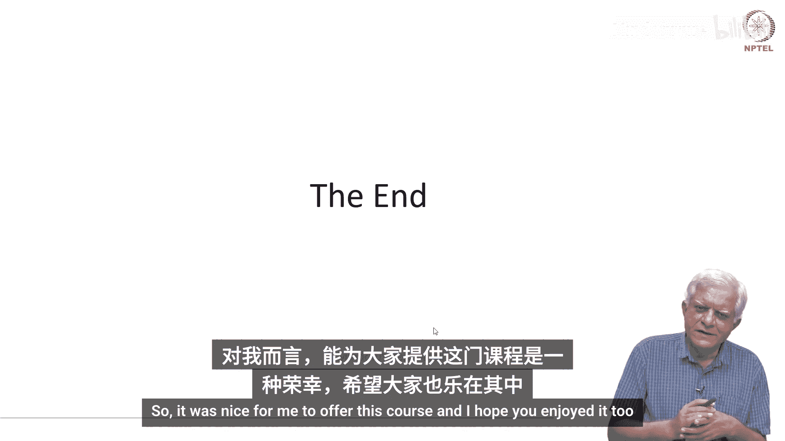

知识表示与推理：P109：信念推理

在本节课中，我们将学习信念推理。我们将探讨当逻辑系统不包含“知识必须为真”这一公理时会发生什么，并了解信念逻辑、欺骗以及推理中的可能性世界等概念。最后，我们将通过两个生动的例子来展示信念推理的复杂性和挑战。

---

### 信念与知识的区别

上一节我们介绍了认知逻辑，它用于对知识进行推理。知识的特点是只能知道真实的事物。这是因为认知逻辑中存在一个**真理公理**，它规定：如果一个智能体知道一个命题 `φ`，那么 `φ` 在领域中必须为真。

如果没有这个真理公理，智能体就可以相信不一定为真的句子。例如，智能体A可以相信“地球是平的”。这并不意味着地球真的是平的，只是智能体A如此相信。现实世界中充满了相互冲突的信念。

### 信念推理的挑战与欺骗

允许智能体持有错误信念，开启了各种可能性。特别是，现在有可能在他人心中诱导错误的信念。这并不罕见，例如我们常听到的假新闻和虚假信息。在选举期间，各种承诺也可能出现。

基于信念进行推理是一项困难得多的任务，这一研究领域仍处于起步阶段。我们目前没有太多成熟的结论可以讨论，但可以探讨一些该领域可能的研究方向。

诱导错误信念是欺骗的基础。欺骗自古有之，在所有对抗性情境中都是一种常见且强大的工具。然而，如何形式化地实现欺骗对我们来说仍然很困难。

以下是两个我们正在研究的问题示例，我们将讨论它们，但不涉及具体的解决方案。

### 示例一：《咕噜牛》故事

第一个例子来自一个名为《咕噜牛》的儿童故事。它讲述了一只聪明老鼠的故事。

这只老鼠先后遇到了狐狸、猫头鹰和蛇，它们都想吃掉老鼠。老鼠虚构了一个名为“咕噜牛”的怪物，并说服每个捕食者：咕噜牛喜欢吃狐狸/猫头鹰/蛇，所以它们才应该逃跑。这些动物相信了它并逃走了。

故事后来变得更复杂：老鼠真的遇到了它想象中的“咕噜牛”，并且通过类似的方法也欺骗了它。

这个故事涉及欺骗、信念以及在他人心中诱导错误信念。它也涉及问题解决领域的其他方面，比如为生存而战。

我们想探究的是：一只老鼠如何能编造这样的谎言？如果你要实现一个能做出此类行为的智能体，需要结合哪些不同种类的表示和推理？

以下是老鼠为了做到这一点必须进行的推理步骤：

*   **目标设定**：假设逃跑无望，老鼠的目标是吓跑捕食者。
*   **目标分解**：老鼠推断，如果捕食者（如狐狸）感到害怕，它就会逃跑。因此，它的新目标是吓唬狐狸。
*   **计划生成**：老鼠虚构了一个名为“咕噜牛”的怪物，并详细描述了它如何喜欢吃狐狸。
*   **预期反应**：老鼠必须预想狐狸在持有这种错误信念后会如何反应。
*   **执行欺骗**：老鼠决定说出谎言：“我有一个叫咕噜牛的朋友，它要来吃掉你”，并希望狐狸上当。

这是一个非常困难的问题。如何让一个智能体产生这样的计划，通过说谎在对手心中制造错误信念？

### 示例二：桥牌中的欺骗

第二个例子来自我最喜欢的领域——桥牌。我想展示这涉及到基于可能性世界的推理。

我们来看一个具体的牌局情况。我们关注方块花色。玩家“南家”的目标是建立他的方块长套。南家必须假设一个条件：方块A必须在西家手中。这个假设在真实世界中恰好成立。

基于这个假设，南家制定了一个打牌计划：出一张小方块朝向手中的K。从南家的视角来看，由于他看不到东家和西家的牌，剩余牌张有多种可能的分布方式，这些就是不同的可能性世界。

通过分析，南家认为在多个可能性世界中，他的计划会成功，只有在少数情况下会失败。因此，这是一个成功概率很高的好计划。

在真实世界中，西家是一位名叫莫里斯·格雷的陆军中士。西家可以预见到南家的计划。西家做出了一个精彩的打法：他提前丢弃了方块A！

这一举动的精妙之处在于：**如果真实世界是另一个特定的可能性世界（即西家原本持有A和另一张大牌），那么提前扔掉A就是唯一能击败南家计划的正确打法**。西家假装自己处于那个可能性世界中。

在实际牌局中（南家持有A、Q和小牌），扔掉A本身并不会破坏南家的计划。然而，这个动作**欺骗**了南家。南家推理：“西家只有在持有A和另一张大牌时，才会做出扔掉A这个看似无意义的举动。既然他扔了A，说明真实世界就是那个他持有A和另一张大牌的世界。” 因此，南家放弃了他原本成功的打法，转而尝试其他路线，最终导致了失败。

这就是欺骗：西家通过一个动作，诱导南家对真实世界产生了错误的信念。

### 总结与展望

本节课我们一起学习了信念推理。我们首先区分了信念与知识，指出信念不必为真。接着，我们探讨了信念推理的挑战，特别是欺骗这一概念。最后，我们通过《咕噜牛》和桥牌两个例子，具体分析了如何在推理中处理可能性世界、诱导错误信念以及实施欺骗。

欺骗仍然是一个非常新兴的领域。我们目前还没有能够自主实施欺骗的程序。虽然存在能制造“深度伪造”等内容的程序，但背后的欺骗行为是由人主导的。如何让程序进行欺骗，仍然是一个广阔的开放领域。

至此，我们结束了对认知逻辑的学习，也结束了本门课程。希望你们喜欢这门课程并从中受益，也希望它能对你们未来的工作有所帮助。