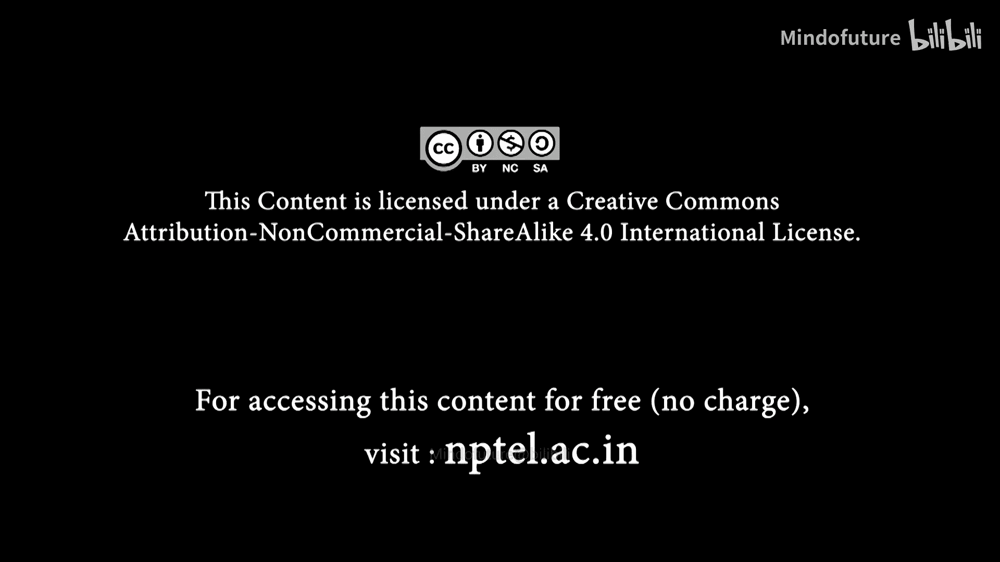
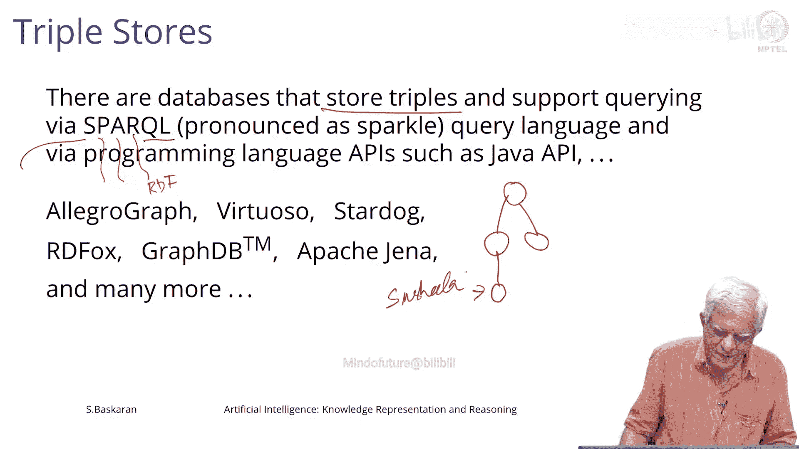

# 112：RDF资源描述框架 📚

在本节课中，我们将学习资源描述框架（RDF），这是一种用于在万维网上表示信息的标准化数据建模技术。我们将了解RDF的核心概念、其组成部分以及它如何为语义网提供基础。

---

## 概述

上一节我们介绍了使用三元组进行标准化表示的概念。本节中，我们将看看随着万维网的发展，人们如何希望跨网络交换信息，并让网络更具意义，即迈向“语义网”。RDF是实现这一目标的关键框架。

## 从逻辑到语义

我们最初的知识表示研究从符号表示开始，并以此为基础，将逻辑视为一种不仅用于表示，也用于推理的机制。在进行逻辑推理时，我们并不关心含义。逻辑不关注意义，也不关注真值，它只是一种符号处理机制。

逻辑机制的优势在于，只要给定一个真实的知识库、一组公理或前提，它就能自动产生其他真实的陈述。一个完备且可靠的逻辑系统只会产生真实的陈述。

当我们转向表示时，我们开始关注谓词的选择和句子的表示方法。我们提出了使用二元谓词表示一切，并形成“三元组”概念的标准表示法。

现在，随着万维网的出现，人们希望跨网络交换信息，并希望网络更具意义，因此我们使用“语义网”这个术语。“语义”指的是含义。我们希望网络具有共享的意义，就像语言一样，使用者对语言中的词句有共同的理解。

## RDF简介

资源描述框架（RDF）是一种用于表示万维网上资源信息的语言。RDF文档可以以多种格式存储。我们的目标不是深入学习RDF或其扩展RDFS，而是理解RDF和RDFS是什么，以及它们允许我们做什么。

RDF主要讨论资源，并使用以下约定：

*   **资源标识符**：用于标识万维网上的资源，具有全局作用域。同一个资源标识符在不同的RDF文档或机器上标识同一个资源。一个资源可以有多个标识符，但一个标识符应只代表一个资源。
*   **统一资源定位符（URL）**：指向计算机上的位置资源，例如 `www.iitm.ac.in`。
*   **统一资源名称（URN）**：持久且独立于位置的标识符，例如图书的ISBN号。
*   **统一资源标识符（URI）**：可以是URL或URN。
*   **国际化资源标识符（IRI）**：允许多语言表示，例如不同语言的维基百科页面。

## 命名空间

RDF使用的关键概念是命名空间。我们希望名称具有特定含义，因此将资源名称放入命名空间，命名空间定义了名称使用的上下文。

一个命名空间通常有一个名称，例如RDF模式（RDF Schema）的命名空间。我们可以使用短名称来引用命名空间，例如用 `rdfs:` 代替完整的URI。甚至可以指定默认命名空间。

存在许多命名空间，例如：
*   `rdf:`：RDF本身。
*   `rdfs:`：RDF模式，是RDF的扩展，允许描述更多内容。
*   `owl:`：网络本体语言，是表达能力更强的扩展。
*   其他如XML模式、DBpedia、YAGO等。

有时我们知道资源存在，但不知道它来自哪个命名空间，这时可以使用空白节点（以 `_:` 开头）。空白节点对于RDF图和查询结果是本地的。

## 数据模型与RDF组成

人们讨论多种数据模型，RDF是其中之一。其他包括实体关系模型、关系模型、XML模型、属性图模型等。

RDF的领域使用三个元素建模：**资源**、**属性**和**陈述**。图和文档用于组织陈述，将它们收集在一起。

以下是RDF的核心组成部分：

*   **资源**：在RDF中，一切皆是资源。我们谈论的任何事物都是一个资源，并拥有唯一标识符。资源可以是物理对象、个体元素、抽象概念、类别或属性。
*   **属性**：属性是资源之间的二元关系。在RDFS中，我们可以定义关系的定义域和值域。定义域是关系的起点，值域是终点。
*   **陈述**：陈述是一个三元组，这是RDF的标准化紧凑格式。一个三元组例如：`<资源， 属性， 值>`。

从编码视图看，三元组是三个URI。从词汇视图看，我们谈论的是三个资源（属性本身也是资源）。从数据视图看，我们谈论的是一个拥有某个属性值的资源。从逻辑视图看，我们谈论的是主语、谓语和宾语，形式为 `谓语(主语， 宾语)`。

## RDF示例与图表

一个陈述（三元组）可以看作是语义图中的一条边。例如，我们之前讨论的关于诗歌“Rung”的例子。

首先，我们可以用RDFS定义一些类和属性：
*   `诗人` 是一个 `rdfs:类`，并且是 `人` 的子类。
*   `演唱` 是 `艺术家` 的 `rdfs:子属性`。`艺术家` 连接艺术品和艺术家，而 `演唱` 特指连接歌曲和歌手。

然后，我们可以用三元组描述“Rung”：
*   `Rung` 的诗人是 `Amir Khusro`。
*   `Rung` 的流派是 `Sufi`。
*   `表演101` 的标题是 `Rung`。
*   `表演101` 的演唱者是 `Shankar`。
*   `表演101` 的日期是 `2023-01-01`。

RDF数据模型是一组形成图的陈述。不同的陈述通过共享的资源或节点连接起来，形成一个网络。

## 关联开放数据与查询

图和文档用于组织三元组。图存储在RDF文档中。网络上这种形式的数据被称为“关联开放数据”。如果你搜索“LOD Cloud”，可以看到网络上存在大量此类相互关联的文档集合。

数据库以“三元组存储”的形式存储这些三元组（主语-谓语-宾语）。它们支持一种名为 **SPARQL** 的查询语言。SPARQL 就像用于查询关系数据库的 SQL，用于查询图数据库或三元组存储。你可以指定图形模式进行查询。

例如，要查询“Sita的所有叔叔和阿姨”，可以指定一个代表叔伯/姨母关系的图形模式（通过父母和祖父母连接），SPARQL会返回所有匹配的数据。

知名的三元组存储包括AllegroGraph、Virtuoso、4store、Dydra等。

---

## 总结

本节课中，我们一起学习了资源描述框架（RDF）。我们了解到RDF是一种用于在语义网上表示信息的标准化框架，其核心是使用三元组（资源-属性-值）来描述事物。我们探讨了资源标识符、命名空间的重要性，以及RDF如何通过图结构组织数据，形成关联开放数据云。最后，我们简要介绍了用于查询RDF数据的SPARQL语言。下一节，我们将继续探索更富表达力的知识表示语言。