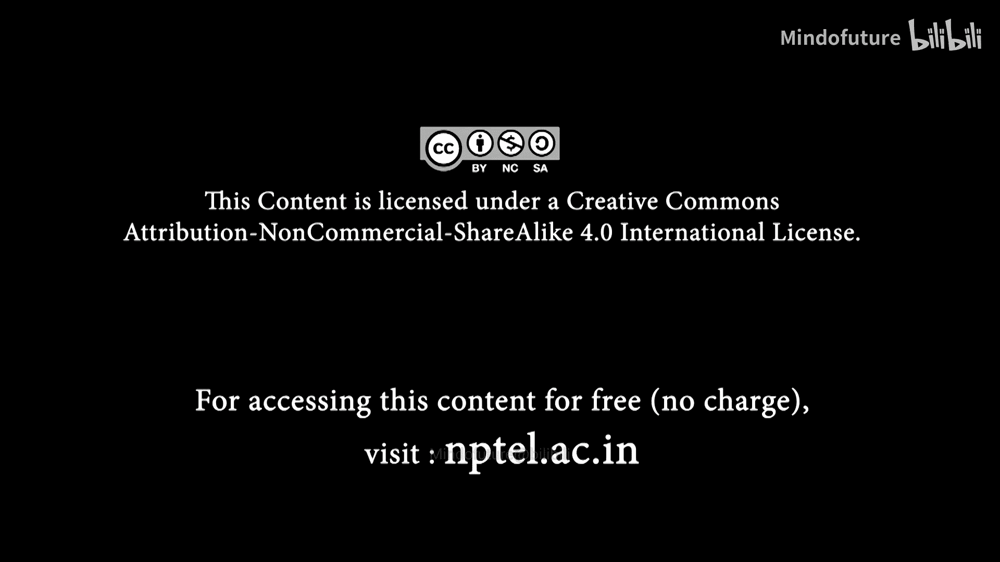
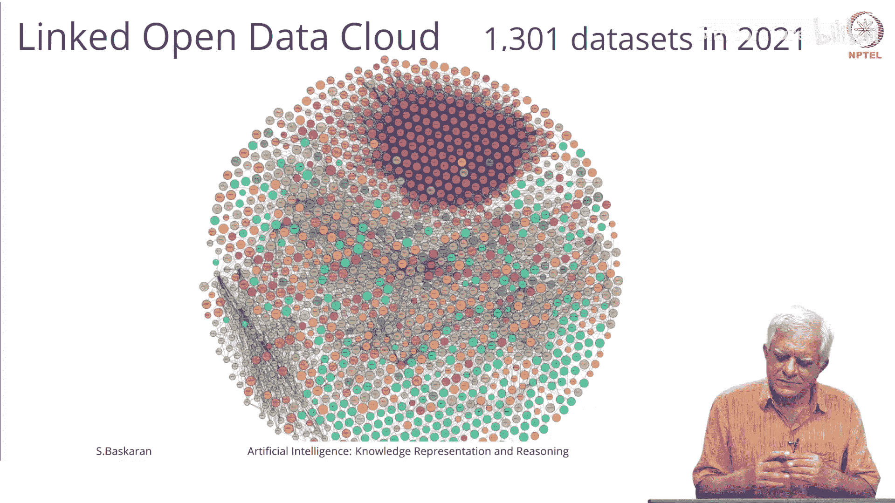

# 113：RDF、RDFS、OWL与LOD云 🌐




在本节课中，我们将学习知识表示中的核心网络标准：RDF、RDFS和OWL。我们将了解它们的基本概念、语法结构以及它们如何共同构成庞大的“关联开放数据云”（LOD云）。这些技术的目标是建立一个可以在网络上共享的通用词汇表。

## RDF：资源描述框架

上一节我们介绍了知识表示的基本概念，本节中我们来看看RDF。RDF是一种用于描述网络资源的标准化格式。它使用**三元组**（triple）的形式来陈述事实，每个三元组由**主语**（subject）、**谓语**（predicate）和**宾语**（object）三部分组成。

以下是RDF三元组的基本结构：
```
<主语> <谓语> <宾语> .
```

例如，我们可以用RDF描述“诗人是人的一个子类”：
```
:poet rdfs:subClassOf :person .
```
这里，`rdfs:subClassOf` 是RDFS词汇表中的一个属性，用于定义类之间的子类关系。

## RDF的表示格式

RDF有多种表示格式。一种常见的格式是Turtle格式，它提供了一种紧凑的书写方式。

以下是一个使用Turtle格式的RDF示例：
```
@prefix : <http://example.org/> .
@prefix rdf: <http://www.w3.org/1999/02/22-rdf-syntax-ns#> .
@prefix rdfs: <http://www.w3.org/2000/01/rdf-schema#> .

:genre rdf:type rdf:Property ;
       rdfs:domain :Song ;
       rdfs:range :Genre .

:poet rdfs:domain :Song ;
      rdfs:range :Poet .
```
在这个例子中，我们定义了`genre`和`poet`两个属性，并分别指定了它们的定义域（domain）和值域（range）。

## RDFS：RDF模式

RDFS在RDF的基础上，提供了定义词汇表（本体）的基本元素。它允许我们创建新的类、数据类型、属性和字面量。

以下是RDFS提供的一些核心词汇：
*   `rdfs:subClassOf`：定义一个类是另一个类的子类。
*   `rdfs:subPropertyOf`：定义一个属性是另一个属性的子属性。
*   `rdfs:domain`：指定一个属性的定义域（主语所属的类）。
*   `rdfs:range`：指定一个属性的值域（宾语所属的类或数据类型）。

## OWL：网络本体语言

OWL建立在RDF和RDFS之上，提供了更强大、更精确的描述逻辑能力。它允许我们定义复杂的类、属性约束和关系。

以下是OWL的一些关键特性：

**1. 定义复杂类**
OWL允许通过并集、交集、补集等操作来定义新类。
```
:Parent owl:equivalentClass [
    a owl:Class ;
    owl:intersectionOf ( :Person [ a owl:Restriction ;
                                  owl:onProperty :hasChild ;
                                  owl:someValuesFrom :Person ] )
] .
```
这个例子定义了一个“父母”类，即“人”与“至少有一个孩子（且孩子是人）”的交集。

**2. 属性约束**
OWL可以对属性施加各种约束。
*   **存在约束**（`owl:someValuesFrom`）：至少存在一个满足条件的值。
    ```
    :PersonWithDaughter owl:equivalentClass [
        a owl:Restriction ;
        owl:onProperty :hasChild ;
        owl:someValuesFrom :Female
    ] .
    ```
*   **全称约束**（`owl:allValuesFrom`）：所有值都必须满足条件。
*   **基数约束**（`owl:cardinality`）：限制关联的个体数量。

**3. 其他关系**
OWL还能表达个体间的同一性（`owl:sameAs`）与差异性（`owl:differentFrom`），定义属性的逆属性（`owl:inverseOf`）和属性链（`owl:propertyChainAxiom`）等。

## 关联开放数据云（LOD Cloud）

RDF、RDFS和OWL共同支撑起了“语义网”的愿景，其成果体现为关联开放数据云。这是一个由成千上万个相互链接的RDF数据集构成的全球性网络。

*   **2007年**：LOD云初具雏形，包含约28个数据集，如DBpedia（维基百科的结构化数据）、FOAF（朋友关系描述）等。
*   **2009-2010年**：数据云迅速扩张，连接密度和数据集数量显著增长。
*   **2017-2021年**：LOD云形成了多个兴趣子区域（如生命科学、政府数据、媒体出版等），包含了超过1300个数据集，构成了一个极其丰富和互联的知识网络。

这些数据集使得机器能够理解和处理网络上的信息，为智能搜索、数据集成和知识发现提供了基础。

## 总结与后续

本节课中我们一起学习了知识表示的三大网络标准：RDF、RDFS和OWL。我们了解了RDF如何用三元组描述事实，RDFS如何提供基本的建模词汇，以及OWL如何提供强大的逻辑描述能力。最后，我们看到了这些技术如何共同构建起庞大的关联开放数据云。



掌握了这些基础后，我们就能理解网络上的结构化知识是如何组织和互联的。下一节，我们将把这些知识与逻辑学联系起来，开始学习**描述逻辑**（Description Logic）。描述逻辑是OWL的逻辑基础，它是**一阶逻辑**的一个可判定子集，专门用于处理类、属性和个体之间的关系，是实现自动化推理的关键。