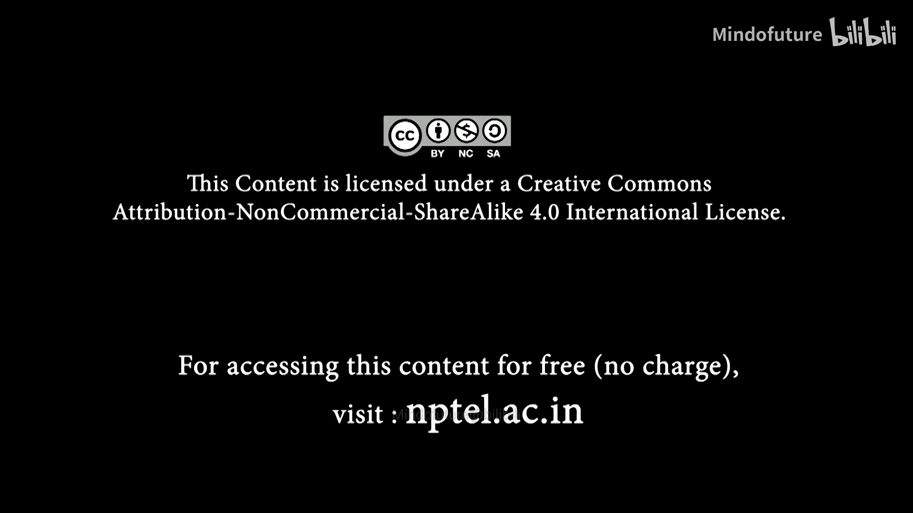
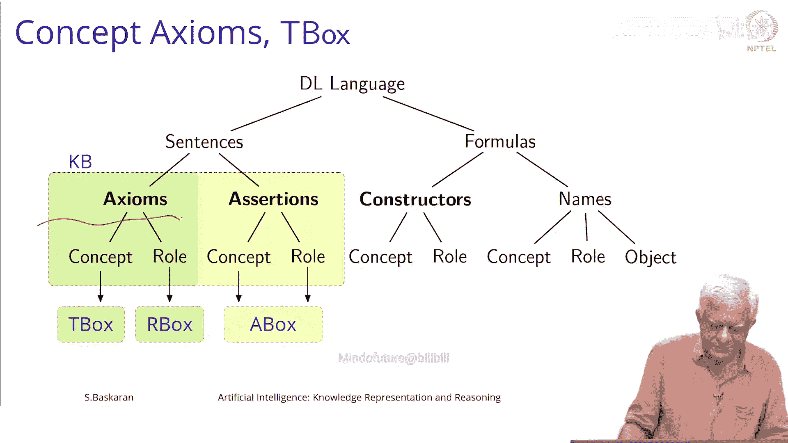

# 114：定义新概念与角色 📚

在本节课中，我们将学习描述逻辑中定义新概念和角色的方法。描述逻辑的核心在于，我们可以使用概念构造器从现有概念构建新概念，并通过角色逆运算和角色组合来定义新角色。

## 概念构造器 🧱

上一节我们介绍了描述逻辑的基础，本节中我们来看看如何构建新概念。概念构造器允许你从现有概念创建新概念。你可以从一组基本概念开始，例如在定义家族数据库时，我们只谈论两种关系：亲子关系和性别关系。仅使用这些事实，我们将构建知识库的其余部分，定义阿姨、叔叔、祖父和祖先等概念。

以下是概念构造器的列表：

*   **⊤（Top Concept）**：也称为“Thing”。域中的所有元素都是⊤的成员。它定义了整个域。公式表示为：**Δ^ℐ**（整个解释域）。
*   **⊥（Bottom Concept）**：也称为“Nothing”。它代表空概念或空集。没有任何元素属于这个概念。公式表示为：**∅**。
*   **A（命名概念）**：A来自我们允许的概念名称集合。命名概念本质上是⊤概念的一个子集。例如：`Male`， `Female`。
*   **¬C（补集或否定）**：¬C表示概念C的补集。解释是：所有不在C中的元素都在¬C中。公式表示为：**Δ^ℐ \ C^ℐ**。
*   **C ⊓ D（交集）**：同时属于概念C和概念D的元素集合。公式表示为：**C^ℐ ∩ D^ℐ**。
*   **C ⊔ D（并集）**：属于概念C或概念D（或两者）的元素集合。公式表示为：**C^ℐ ∪ D^ℐ**。
*   **∀R.C（全称限制）**：所有通过角色R关联的对象都来自概念C的个体集合。如果一个个体的所有R-填充者都在C中，则该个体属于∀R.C。值得注意的是，如果一个个体没有任何R-填充者，它也属于这个类（空真成立）。公式表示为：**{a ∈ Δ^ℐ | ∀b. (a, b) ∈ R^ℐ → b ∈ C^ℐ}**。
*   **∃R.C（存在限制）**：至少有一个通过角色R关联的对象来自概念C的个体集合。个体必须至少有一个R-填充者，并且该填充者属于C。公式表示为：**{a ∈ Δ^ℐ | ∃b. (a, b) ∈ R^ℐ ∧ b ∈ C^ℐ}**。
*   **∃R.Self（自反限制）**：所有通过角色R关联到自身的个体集合。例如，“爱自己的人”。公式表示为：**{a ∈ Δ^ℐ | (a, a) ∈ R^ℐ}**。
*   **(≥ n R.C)（最小基数限制）**：至少有n个通过角色R关联且来自概念C的填充者的个体集合。公式表示为：**{a ∈ Δ^ℐ | |{b | (a, b) ∈ R^ℐ ∧ b ∈ C^ℐ}| ≥ n}**。
*   **(≤ n R.C)（最大基数限制）**：至多有n个通过角色R关联且来自概念C的填充者的个体集合。公式表示为：**{a ∈ Δ^ℐ | |{b | (a, b) ∈ R^ℐ ∧ b ∈ C^ℐ}| ≤ n}**。
*   **{a1, …, ak}（枚举概念）**：通过直接列出其所有成员来定义的概念。例如，一周的日子：`{Sunday, Monday, Tuesday, Wednesday, Thursday, Friday, Saturday}`。

## 角色构造器 🔗

了解了如何定义新概念后，我们接下来看看如何定义新角色。我们可以通过角色逆运算或角色组合从现有角色定义新角色。

以下是角色构造器的类型：

*   **U（通用角色）**：表示域中每个元素都与其他每个元素相关联。它类似于域的笛卡尔积。公式表示为：**Δ^ℐ × Δ^ℐ**。
*   **P（命名角色）**：来自命名角色集合的基本角色。它是域的一个子集。
*   **P⁻（角色逆）**：角色P的逆。它包含所有使得(b, a)属于P的(a, b)对。例如，亲子关系的逆就是子亲关系。公式表示为：**{(a, b) | (b, a) ∈ P^ℐ}**。

除了上述基本角色，我们还可以通过组合来定义更复杂的角色：

*   **R1 ∘ R2（角色组合）**：定义一个新角色，将个体a与个体c关联起来，当且仅当存在一个个体b，使得(a, b)属于R1且(b, c)属于R2。例如，如果R1是“兄弟”，R2是“孩子”，那么R1 ∘ R2可以定义“侄子/侄女”关系。公式表示为：**{(a, c) | ∃b. (a, b) ∈ R1^ℐ ∧ (b, c) ∈ R2^ℐ}**。
*   **角色链**：这个概念可以扩展到更长的角色链。例如，`R1 ∘ R2 ∘ … ∘ Rk`。这表示存在一系列中间个体x1, …, xk-1，使得a通过R1关联到x1，x1通过R2关联到x2，…，最终xk-1通过Rk关联到b。这可以用来描述复杂的亲属关系，如“我姐夫的兄弟”。

## 总结 📝

本节课中我们一起学习了描述逻辑中定义新概念和角色的核心方法。我们首先介绍了各种**概念构造器**，包括基本概念（⊤, ⊥, 命名概念）、布尔运算（¬, ⊓, ⊔）、数量限制（∀, ∃, ≥n, ≤n）以及枚举概念。接着，我们探讨了**角色构造器**，包括基本角色（U, P, P⁻）以及通过组合（∘）来构建复杂角色链的方法。这些构造器为我们提供了强大的工具，能够从简单的初始关系（如亲子和性别）出发，逐步定义出知识库中所需的各种复杂概念和关系（如叔叔、祖先等）。在下一节中，我们将学习概念公理。